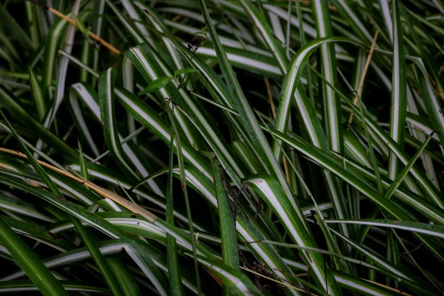
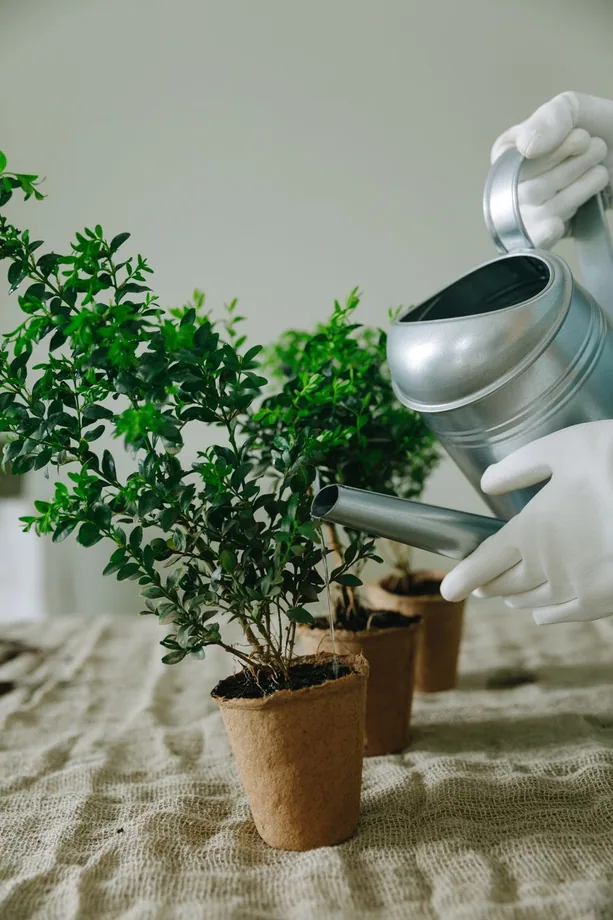

Brown, crispy leaf tips are one of the most common houseplant complaints, and one of the most confusing. The plant looks mostly healthy, new leaves keep coming, and yet the edges keep drying out. It feels like a mystery, but extension services that have studied houseplant problems for decades agree on a short list of usual suspects, and you can work through them one at a time.

This guide explains the most likely causes of brown tips, how to tell them apart, what to do about each, and when you can simply stop worrying.

## First, what brown tips actually mean

Brown tips and edges are what happens when the very ends of a leaf, the parts farthest from the roots, don't get enough water or get damaged by something dissolved in it. The tissue dies and dries out. You can compare it to split ends on hair: unattractive, rarely life-threatening, and a sign that something in the plant's environment is slightly off.

The key point from extension sources is that brown tips are a symptom with several possible causes. University of California's pest management program lists them under brown or scorched leaf tips: overwatering, excessively dry soil, too much fertilizer or salts in the soil or water, certain mineral toxicities such as fluoride, and low humidity. Cutting off the browned portion improves appearance, but, as Iowa State University's extension points out, browning will return if the root cause is not addressed.

## Cause 1: Low humidity

Many popular houseplants come from tropical forests, where the air is damp. Most homes are much drier, especially in winter when heating or air conditioning is running. Iowa State Extension names low humidity as the most likely cause of brown tips and edges on houseplants, particularly in the winter months.

**How to recognize it:** the browning is mostly at the tips and edges of many leaves, it gets worse in dry seasons, and it is typical on humidity-lovers such as calathea, ferns, prayer plants and some palms.

**What to do:**

- Group plants together so their leaves hold humidity around each other
- Use a humidifier near plants that really need it
- Move plants away from heaters, vents and drafts
- Keep humidity-loving plants in a bathroom or kitchen with enough light

Misting is popular, but it only raises humidity for a few minutes. It is not a reliable fix on its own. Pebble trays filled with water are often suggested, though their effect on the air around the plant is small. For plants that truly need high humidity, a humidifier works better.

Read humidity at the height of the leaves rather than across the room. Photo by [FOX ^.ᆽ.^= ∫ on Pexels](https://www.pexels.com/photo/digital-hygrometer-on-desk-displaying-temperature-and-humidity-35655037/).

## Cause 2: Inconsistent watering

If a plant dries out completely, then gets soaked, then dries again, the roots suffer, and leaf tips are usually the first to show it. Iowa State lists letting plants dry out too long between waterings as a direct cause of brown edges. The reverse also matters. University of California notes that overwatering can damage roots too, and damaged roots cannot supply the leaves properly, which produces the same brown tips.

**How to recognize it:** the soil is bone-dry when you check, or constantly soggy with a sour smell. Browning may come with drooping or yellowing leaves.

**What to do:**

- Check the soil with your finger before watering
- Water thoroughly until water drains from the bottom, then empty the saucer
- Aim for steady moisture suited to the plant, not cycles of drought and flood
- Use a pot with drainage holes and well-draining soil

If the root ball is so dry that water runs straight through, soak the pot in a bucket of water for 20 to 30 minutes so the soil can rehydrate.

## Cause 3: Salts from fertilizer and water

Over time, minerals build up in potting mix, from fertilizer and from tap water. These salts move up with the water and collect at the edges of the leaves, where they cause a type of chemical burn. The University of Missouri's plant science program describes excess fertilizer salts taken up by the plant accumulating along leaf margins and tips and causing "burn". It also warns that water softeners can create similar salty conditions, because they replace calcium with highly soluble sodium or potassium salts.

**How to recognize it:** white or yellowish crust on the soil surface or around the pot rim, brown tips on many leaves, especially if you fertilize often or use softened water.

**What to do:**

1. Stop fertilizing for now
2. **Flush the soil.** Take the plant to a sink or outdoors, and slowly pour a large amount of plain water through the pot, roughly three to four times the volume of the pot, letting it drain fully
3. Scrape off any surface crust
4. Resume fertilizing only at half strength or less, and only during active growth (see our fertilizing guide)
5. Don't use softened water on plants. Use rainwater, filtered water or unsoftened tap water

## Cause 4: Chemicals in tap water

Tap water may contain chlorine, chloramine, fluoride and dissolved minerals. For most plants this is no problem, but sensitive ones react to it. Iowa State lists spider plant, ti plant, dracaena, prayer plant and calathea as particularly sensitive to chlorine, fluoride and other chemicals. The University of Missouri adds that dracaenas and most members of the lily family are especially sensitive to fluoride.

**How to recognize it:** browning that appears even though watering, humidity and fertilizer seem fine, mainly on the sensitive plants listed above, and often as dark brown or reddish edges that slowly progress.

**What to do:**

- Switch to rainwater, filtered water or distilled water for sensitive plants
- Let tap water sit overnight, which allows chlorine (but not chloramine or fluoride) to dissipate
- Flush the soil every few months to remove accumulated minerals

If you use distilled water long-term, feed the plant carefully, since it contains no minerals of its own.

With a spider plant, compare fresh growth with the older leaf tips before changing the routine. Photo by [Magda Ehlers on Pexels](https://www.pexels.com/photo/close-up-of-lush-green-spider-plant-leaves-32667143/).

## Cause 5: Root problems and pot-bound plants

Anything that damages roots reduces the plant's ability to deliver water to its leaf tips. The cause can be root rot from overwatering, a root ball packed so tightly that it can't absorb water, or soil that has broken down and compacted. Extension guidance suggests that, where browning persists, repotting and checking the root system are early steps to try.

**How to recognize it:** roots circling the pot or poking from the drainage holes, water draining straight through, soil that stays wet for days, or a plant that has not grown in a long time.

**What to do:** slide the plant out and inspect the roots. Healthy roots are firm and light-colored. Trim any that are black, soft or smelly, loosen a tight root ball, and repot into fresh, well-draining mix in a pot one size larger.

## Cause 6: Light, heat and cold

Too much sun, hot air from a heater, or a cold draft can scorch the edges of leaves. University of California lists too much sun or heat through a window, low humidity, or a drafty setting as possible causes.

**How to recognize it:** browning on the side of the plant facing the window, patches that look bleached or papery, or damage after moving a plant to a new place.

**What to do:** move the plant a little farther from the glass or add a sheer curtain, and keep it away from vents and cold windows.

## How to work out which cause it is

Use this checklist:

1. **Which plant is it?** If it is a spider plant, calathea, prayer plant or dracaena, suspect water chemicals and humidity first.
2. **What does the soil look like?** A white crust points to salts. Dry, shrunken soil points to inconsistent watering. Constantly wet soil points to overwatering and root trouble.
3. **When did it start?** After you began fertilizing or after winter heating came on tells you something.
4. **Where does the browning appear?** On one side only suggests sun or drafts. All around the plant suggests humidity, water or roots.
5. **What do new leaves look like?** If they emerge perfect, you've solved it. If they are brown from the start, the problem is ongoing.

Change only one thing at a time and give it two to three weeks. Leaves that are already brown won't turn green again.

## Should you cut off the brown tips?

Yes, if they bother you. Use clean scissors and follow the natural shape of the leaf, leaving a very thin brown margin so that you don't cut into healthy green tissue and cause a new edge to brown. If most of a leaf is brown, remove the whole leaf at the base so the plant can put its energy into healthy growth.

## When it is nothing to worry about

Plants replace old leaves over time, and an occasional brown tip on an old leaf is normal. If the new growth is full-sized, green and firm, your overall care is working, and a few tips are not a reason to change everything.

## Keep a record that a brown tip can actually answer

Take a close-up of a marked leaf and another photo of the whole plant. Mark which leaves were already damaged. Include the window or vent in the wider shot if the injury is on one side. Write down when you fertilized, when you moved the pot and when it last dried thoroughly. If you change anything, note the date. You are looking for whether the damage is still advancing and whether the new leaves form clean edges.

A spider plant is a good example. If it has had the same little brown ends for weeks and every new leaf opens clean, you can leave the routine alone. If several newly developed leaves all brown at the tips, check the environment at leaf height and the history of both water and fertilizer. If that same plant has a crisp patch halfway up one leaf that recently leaned against a radiator, that local injury belongs on a different branch of the diagnosis. You may have two causes on one plant.

## Test the cause a little at a time

If the mix goes hard and dries quickly, check whether water runs straight down the gap between the soil and the pot. Water slowly in passes, let the mix absorb moisture, and see whether the pot gains weight. If the container stays heavy between waterings, inspect drainage and roots before trying a humidifier. Dry edges can appear while wet, damaged roots are failing to supply water to the leaves.

When fertilizer or water salts are plausible, look for deposits on the mix surface or around the rim. A white crust does not tell you which mineral is present. Try an appropriately low-mineral water source on that plant for new growth and keep the rest of the routine steady if the root system is healthy. Read what a household filter actually removes. An ordinary carbon filter may reduce chlorine or odors while leaving dissolved minerals or fluoride. A salt-based water softener may add sodium, so check the supply before using it as a low-mineral alternative. [University of California IPM houseplant diagnosis guide](https://ipm.ucanr.edu/home-and-landscape/houseplant-problems/).

Water in passes when completely dry mix pulls away from the container wall. Photo by [Thirdman   on Pexels](https://www.pexels.com/photo/person-watering-plants-on-pots-7656453/).

## What a good result looks like

Judge the next unfurling leaf and whether the existing brown line has stopped advancing. Fast-growing grasses or spider plants may show new growth before a slow dracaena does. Put a date next to your starting photo and let the plant supply the evidence on its own timeline. If you see a growing soft area, fresh spotting well away from the tips or widespread wilt, switch to a broader check. Look for pests under leaves and examine the root zone rather than continuing the same experiment.

A few damaged tips can be left in place. If you trim for appearance, follow the shape of the leaf and keep the cut within dry tissue. Clean your scissors first, especially if you just used them on a sick plant. Trimming a whole collection at the start can make it harder to see which of the old tips were stable. Mark the leaves you are following first and trim the others if you prefer.

## Quick summary

- Brown tips are a symptom with several causes: dry air, inconsistent watering, salts, tap water chemicals, root problems, and sun or drafts
- Start with the simplest checks: soil moisture, pot drainage, and your watering habits
- Flush soil with plain water every few months to remove salts
- Use filtered or rainwater for sensitive plants
- Trim brown tips for looks, but fix the cause first

## Final thoughts

Brown tips are usually a care adjustment, not an emergency. Work through the likely causes, change one thing at a time, and look at the new leaves to judge your progress.

## Sources and further reading

- Iowa State University Extension, [Why does my houseplant have brown leaf tips and edges?](https://yardandgarden.extension.iastate.edu/faq/why-does-my-houseplant-have-brown-leaf-tips-and-edges)
- University of California IPM, [Houseplant Problems](https://ipm.ucanr.edu/home-and-landscape/houseplant-problems/)
- University of Missouri, [Houseplant problems: an environmentally sensitive approach](https://ipm.missouri.edu/meg/2019/1/houseplantProblems/index.cfm)
- eXtension Ask an Expert, [House plant with leaf edge turning brown](https://ask.extension.org/kb/faq.php?id=634384)
