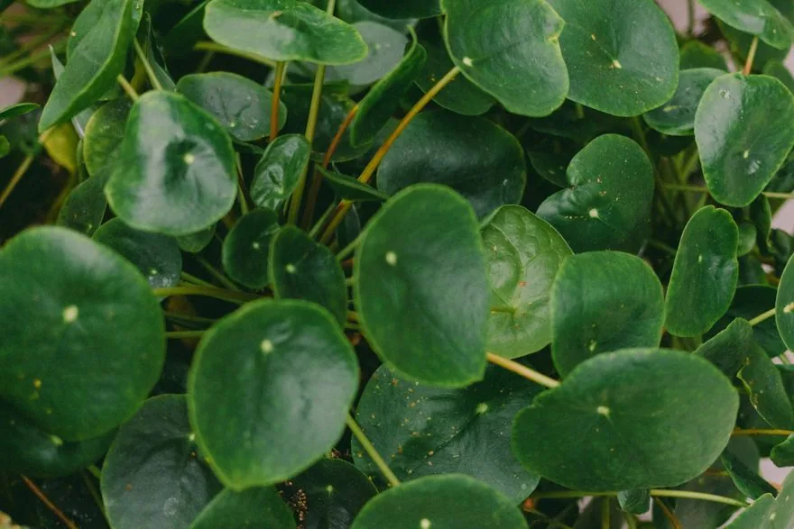
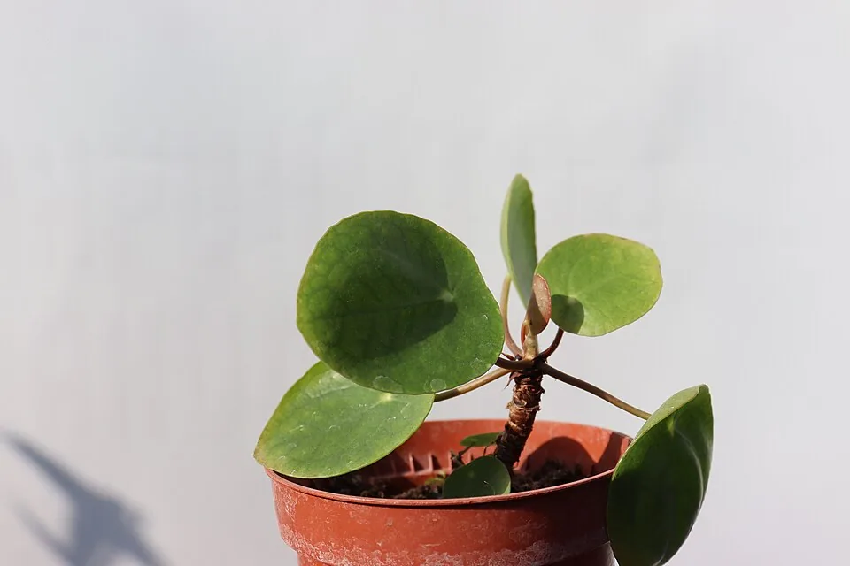
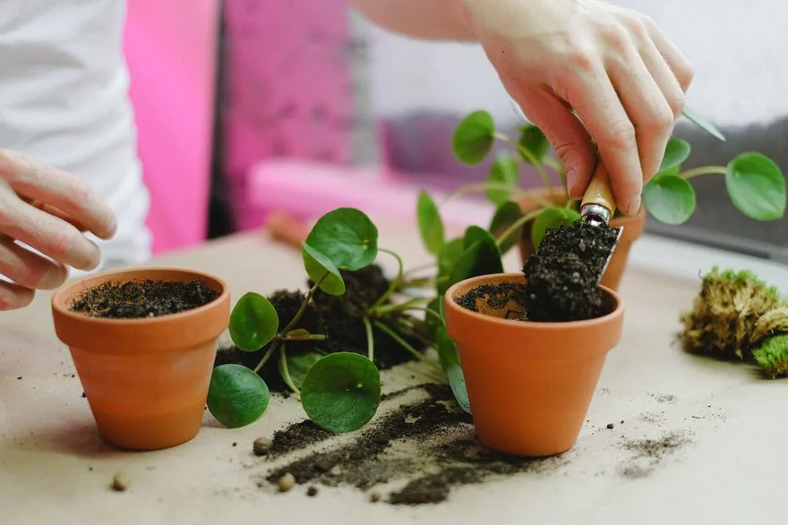

A Chinese money plant pushes small plantlets up around the base of the parent, sometimes while the main stem is still filling out. Those round leaves can also tell you how the plant is responding to its spot. Watch the newest ones for stalks stretching toward a window, curling after a move or remaining upright after watering. Those observations help you decide whether to change the light, check the mix or give the plant more time.

It also has a reputation as an easy plant, which is mostly true, but it has a few quirks that cause confusion. Leaves that curl, leaves that lean, leaves that go yellow and drop, a plant that grows lopsided. This guide explains all of it, plus how to take the pups off and pot them up.

## What it is (and what to call it)

Pilea peperomioides belongs to the nettle family (Urticaceae), though it does not sting. It has round, coin-shaped leaves held up on slender stems that attach to the middle of each leaf, which gives it a distinctive look. It goes by many names: Chinese money plant, pancake plant, UFO plant, missionary plant and friendship plant. Some growers now prefer "coin plant" or just "pilea". Reports on its origin say it comes from the mountain foothills of Yunnan province in southern China.

The NC State Extension Gardener Plant Toolbox describes it as an ornamental indoor houseplant whose easy care makes it suitable for home or office, and notes that it is safe for pets and children. That matches the ASPCA's list, which does not list it as toxic, but because common names are confusing (see the note on "money tree" below), it is worth double-checking the botanical name on the ASPCA site if you have animals.

A note on names: the "Chinese money plant" is a different plant from the "money tree" (Pachira aquatica), which has a braided trunk, and from the trailing "money plant" (pothos). If you are buying online or checking pet safety, use the botanical name, Pilea peperomioides.

## Light

Chinese money plants like bright, indirect light, similar to a spot near an east-facing window or set back from a south or west window. Direct afternoon sun can scorch the leaves and make them pale or crispy. Very low light makes the plant leggy, with long stems and smaller leaves, and it may lose its tidy, round shape.

**Rotate it.** The leaves lean toward the light, so a Pilea on a windowsill soon looks lopsided, with all the leaves reaching one way. Give the pot a quarter turn every week or so to keep it growing evenly. This is the single easiest habit to build, and it makes a visible difference.

If you are short of window light, especially in winter, a small grow light can help. Our [winter houseplant care guide](/winter-houseplant-care/) has advice on this.

## Watering

Chinese money plants prefer a steady, moderate approach: water thoroughly, then let the top layer of soil dry before watering again. A practical routine:

1. Push a finger about an inch or two into the soil
2. If it feels dry, water until water runs from the drainage holes
3. Let the pot drain and empty the saucer
4. If it is still damp, wait a few more days

In a warm, bright room, this might be about once a week. In winter or a cool room, it might be every two weeks. The plant has fairly thick, fleshy stems that store some water, so it tolerates short dry spells better than constant wetness. Waterlogged soil leads to root rot, with yellow leaves, drooping and black or mushy roots. If that happens, see our [root rot guide](/root-rot-in-houseplants/).

**Use water that is not too cold,** and avoid splashing the leaves heavily, which can leave marks. If you see white crust on the soil or brown edges on the leaves, flush the pot with plain water every few months to clear mineral build-up. This is covered in our [guide to brown leaf tips](/brown-leaf-tips-on-houseplants/).

## Soil and pots

Pileas like a light, well-draining mix. A general indoor potting mix with a handful of perlite or coarse sand mixed in works well. A pot with drainage holes is essential. Terracotta is a good choice, since it breathes and helps the soil dry evenly, though plastic is fine if you water carefully.

Do not choose a pot that is much too large. The plant has a compact root system, and extra soil stays wet. A pot only an inch or two wider than the root ball is enough. More on this in our [repotting guide](/how-to-repot-a-houseplant/).

## Temperature and humidity

Normal room temperatures suit it well. NC State Extension notes that cold drafts and sources of heat need to be avoided. Keep it away from heater vents, radiators and cold window glass in winter. Average household humidity is usually fine, though in very dry rooms the leaf edges may brown. See our [humidity guide](/humidity-for-houseplants/) for what works and what does not.

## Feeding

Feed lightly during the growing season (spring and summer) with a balanced liquid houseplant fertilizer at half strength about once a month. Skip it in autumn and winter. Overfeeding can lead to leaf burn or lots of leaf growth with weak stems. Details are in our [fertilizing guide](/how-to-fertilize-houseplants/).

## Why are the leaves curling, drooping or turning yellow?

Leaf changes are the plant's way of telling you something. These are the common patterns, with the most likely causes. None of them is a guarantee, so check the soil and roots before you decide.

**Leaves curling or doming (edges turning down or up).** This can be caused by watering problems, cold or hot drafts, or too much direct sun. If the soil is dry and the leaves are curling, it may need water. If the soil is wet, ease off. If the leaves facing the window are curling and pale, move the plant back from the glass.

**Drooping leaves.** Usually thirst or overwatering. Check the soil first. Our [drooping houseplant guide](/why-is-my-houseplant-drooping/) walks through the diagnosis.

**Yellow lower leaves.** The oldest leaves at the bottom of the plant naturally yellow and drop as the plant grows, so one or two now and then is normal. Many yellow leaves at once suggest overwatering, poor drainage or low light.

**Brown or black spots.** May be sunburn (crispy, tan patches on the sunniest side), cold damage, or water sitting on the leaves. Remove badly damaged leaves.

**Small, pale new leaves and long stems.** Too little light. Move the plant to a brighter spot.

**Sticky leaves or tiny insects.** Check for mealybugs, scale or spider mites. Our [pests guide](/houseplant-pests-spider-mites-mealybugs-scale/) covers each.

**Tiny flies around the soil.** Likely fungus gnats from wet soil. See our [fungus gnats guide](/fungus-gnats-in-houseplants/).

Check the newest leaves for curling, and note which direction they face. Photo by [Maria Tyutina on Pexels](https://www.pexels.com/photo/green-plants-in-close-up-shot-9356263/).

## Pups: how to take them off and root them

This is the fun part. Penn State Extension describes how Pilea peperomioides produces offsets, also called pups, that can be removed and potted separately from the parent plant. NC State Extension says the plant can be propagated by offsets (pups) and by stem cuttings, and that propagation is best done in spring or early summer during active growth.

Find the main stem and look around its base for small offsets. Photo by Dandarmkd, [Pilea peperomioides - Ботаничка градина Скопје (1).jpg](https://commons.wikimedia.org/wiki/File:Pilea_peperomioides_-_%D0%91%D0%BE%D1%82%D0%B0%D0%BD%D0%B8%D1%87%D0%BA%D0%B0_%D0%B3%D1%80%D0%B0%D0%B4%D0%B8%D0%BD%D0%B0_%D0%A1%D0%BA%D0%BE%D0%BF%D1%98%D0%B5_%281%29.jpg), [CC BY-SA 4.0](https://creativecommons.org/licenses/by-sa/4.0). Resized for the web.

### When to separate a pup

Wait until the pup has a few leaves and is a couple of inches tall. Small pups with only one leaf may struggle on their own. It is fine to leave them attached to the mother plant for longer, since they will root there.

### Step by step

1. **Find the pup.** It grows from the soil near the base of the plant, or from the main stem. Brush away some soil to see where it connects
2. **Cut it free.** Use a clean, sharp knife or scissors and cut the pup away from the main plant with some of the connecting root or stem. Try to keep any roots it already has
3. **Root it in water or soil.**

- **In water:** place the pup in a small jar of water with the cut end submerged and leaves above the water. Change the water weekly. Roots usually appear in a few weeks. Pot it in soil when roots are an inch or two long
- **In soil:** plant it directly in a small pot of light, damp potting mix and keep it lightly moist and in bright, indirect light

4. **Be patient.** New plants may take several weeks to root and begin growing

For the water-or-soil debate, our [propagation guide](/propagate-houseplants-water-vs-soil/) explains the trade-offs, and the same principles apply here.

### Other ways to propagate

Pileas can also be grown from stem cuttings. Cut a section of stem with a few leaves and root it in water or soil. Some growers have success with leaf cuttings, though the pup method is the most reliable.

## Repotting

A mature Pilea may need repotting every year or two. Signs include roots coming out of the drainage holes, soil drying out quickly and a plant that has stopped growing. Spring is the best time. Go up one pot size, use fresh, light mix and water after repotting. If you have pups around the base, repotting is a good moment to separate them.

Set the crown at its prior depth and choose a container that fits the roots. Photo by [Anna Shvets on Pexels](https://www.pexels.com/photo/person-repotting-house-plants-5830878/).

## Is it safe for pets?

NC State Extension describes it as safe for pets and children, and it does not appear on the ASPCA's list of toxic plants. As with any plant, chewing may still upset a stomach, and you should keep an eye on pets that nibble leaves. Check the ASPCA list for the exact plant you own, and see our [pet-safe houseplants guide](/pet-safe-houseplants/) for other safe options.

## Styling and grouping

Pileas look good on their own, but they also make easy companions for other plants of the same needs. A shelf near an east window with a Pilea, a peperomia and a small pothos will share similar light and watering needs, which makes your routine simpler. See our [pothos guide](/pothos-care-and-propagation/) for a plant that pairs well. Group plants by their water needs, not just by looks, so you are not tempted to water everything the same way.

When you rotate the pot each week, take a minute to look closely at the plant. Check the stems for pups, the undersides of the leaves for pests, the soil surface for fungus gnats, and the drainage holes for roots. A short weekly look catches nearly every problem while it is still small.

## Sharing pups responsibly

Because pups are so easy to share, many Pilea owners pass them to friends. A few good habits keep that tradition healthy. Check the parent plant and the pup for pests before handing it over, so you do not pass on mealybugs or fungus gnats. Pot the pup in fresh mix, not old soil from the parent. Tell the new owner how you grow it: light, watering and the weekly turn. And if you receive a pup, keep it apart from your other plants for a couple of weeks, as you would with any new plant.

## Check the label before borrowing advice for a money plant

When I describe the money plant I kept in water in my winter care story, I mean the plant we called that at home. I left its species unspecified. For this guide the label needs to say *Pilea peperomioides*. Look for shield-like round leaves whose stalk attaches near the center underneath, and an upright main stem that may have small shoots near the base. A golden pothos climbs or trails and has different leaves. A money tree has several leaflets spreading from a common point. Those differences matter for choosing a propagation method and checking pet safety. [Winter houseplant care story](/winter-houseplant-care/).

## Watch a new leaf before you move the mother plant again

If one side of the plant is emptier, photograph it from above and find the youngest leaves at the tip. See where the latest stalks are reaching and check the container's weight. Good new growth bending toward the window often responds to a small, occasional turn in the same location. If the growing tip is pale and stalks are getting noticeably longer, look for a brighter nearby position and introduce it gradually. If the pot is heavy and the newest leaves are curling or becoming soft, look at the roots and drainage first.

A pup will dry faster in a small starter pot than its parent does in a larger one. Put a tag with the separation date in the pot and check that the stem stays firm through the first few watering cycles. A tiny plantlet with a few leaves is easier to share once you see fresh growth after the move.

## Quick care summary

- **Light:** bright, indirect. Rotate weekly
- **Water:** when the top inch or two of soil is dry
- **Soil:** light, well-draining mix, pot with drainage holes
- **Temperature:** normal room temperature, no cold drafts or heat vents
- **Feeding:** half strength, monthly in spring and summer
- **Propagation:** pups, in spring or early summer
- **Pets:** generally considered safe

## Frequently asked questions

**Why does my Pilea lean?** It is growing toward the light. Rotate it regularly.

**Why does it have no pups?** Young or stressed plants may not produce them. Good light, consistent watering and a slightly snug pot often help. Be patient.

**Can I put it outside in summer?** In shade, away from direct sun and heavy rain, yes, but bring it in before temperatures drop.

**How big does it get?** A healthy plant can reach about a foot or more in height and width, and it can form a tall stem over time.

## Final thoughts

A Chinese money plant rewards simple habits: bright light, a quarter turn each week, water only when the top soil is dry and a little patience with the pups. Do that, and you will soon have plants to share.

## Sources and further reading

- NC State Extension Gardener Plant Toolbox, [Pilea peperomioides](https://plants.ces.ncsu.edu/plants/pilea-peperomioides/)
- Penn State Extension, [Pilea as a houseplant](https://extension.psu.edu/pilea-as-a-houseplant)
- ASPCA, [Toxic and non-toxic plants](https://www.aspca.org/pet-care/aspca-poison-control/toxic-and-non-toxic-plants)
