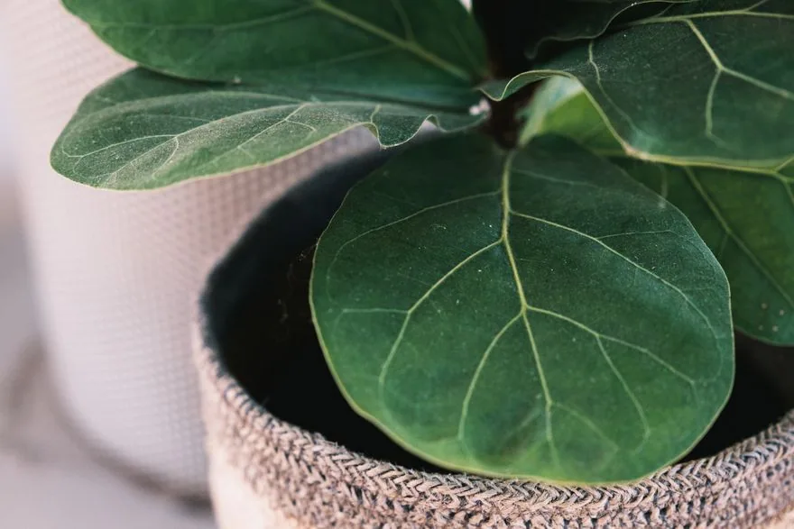
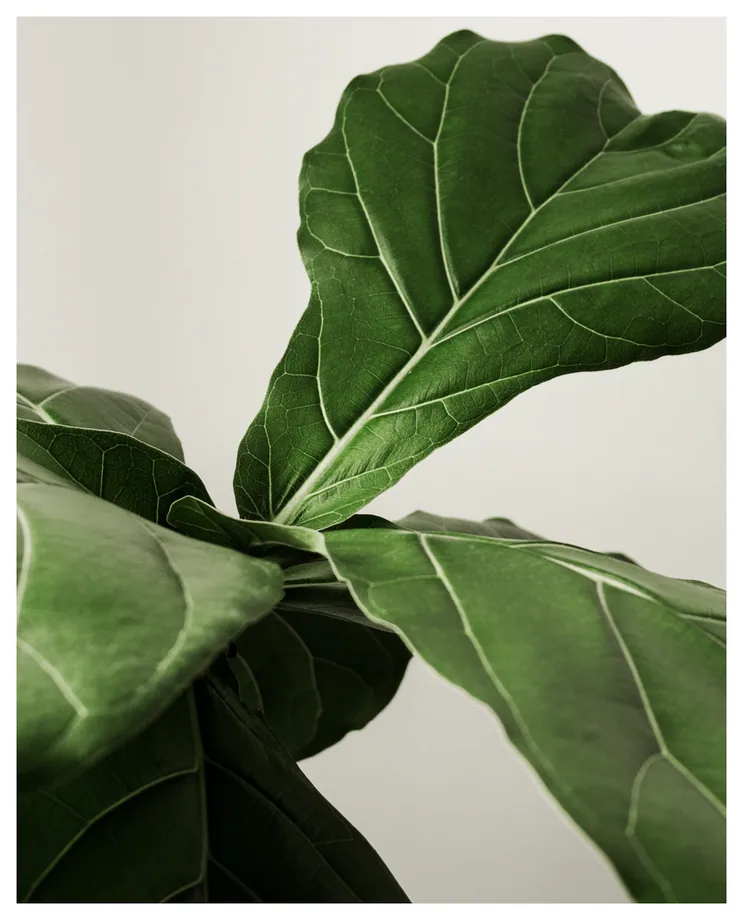
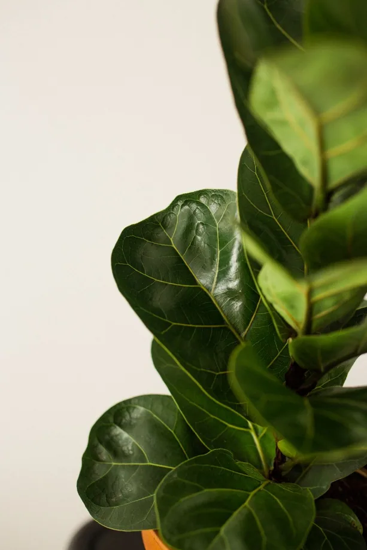

A fiddle-leaf fig can look healthy in the shop and drop leaves a week after coming home. Start with the timeline. A change in light, a cold trip home or a pot collecting water can all leave marks, and each calls for a different response. Check the plant where it actually lives, with its nursery pot out of the cover and the newest leaves in view.

The reputation is partly deserved. A fiddle leaf fig does not like change, it wants more light than most houseplants and it responds to stress by dropping leaves. But it is not mysterious. Most of the trouble comes from a short list of causes, and once you know them, you can usually fix the plant or prevent the problem.

## What you are growing

Ficus lyrata is native to West Africa, where it grows in lowland tropical rainforests and can become a tree up to 40 feet tall, according to the New York Botanical Garden's plant care guide. Indoors it is much smaller, usually a few feet to about 6 to 8 feet, but it keeps the same preferences: warmth, steady conditions, bright light and a regular supply of water.

Check the name when you buy. The University of California's Coastal Gardener column points out that "fiddle leaf fig" can refer either to Ficus lyrata or to a different plant, Philodendron bipennifolium, which has similar-looking leaves but different care needs. This guide is about Ficus lyrata.

## Light: the thing most people get wrong

A fiddle leaf fig needs a lot of light. It wants bright, indirect light for as many hours of the day as possible. Costa Farms says the plant likes bright indirect or filtered light, and gardening sources commonly repeat that light intensity is critical. A Colorado State University Extension horticulturist quoted in a gardening article syndicated by AOL called light probably the most important thing, since the more light the plant gets, the more energy it has for lush growth.

What does that mean in practice?

- **Best:** right next to a large east-facing window, or just back from a south or west window with a sheer curtain
- **Acceptable:** a bright room with large windows, if the plant is within a few feet of the glass
- **Poor:** a dim corner, a spot far from a window, or a north window with little sun. The plant may survive for a while but will gradually lose leaves and look sparse

Direct hot sun through glass can scorch the leaves, leaving crisp, pale or brown patches. If the plant has been in lower light, move it to brighter light gradually over a week or two.

Rotate the pot a quarter turn every week or two so it grows evenly instead of leaning. Dust the big leaves with a damp cloth every couple of weeks. Dust blocks light, and one gardening guide recommends this as a way to help the leaves absorb the light they need.

If you do not have a good window, a strong grow light placed above the plant can help. Our [winter houseplant care guide](/winter-houseplant-care/) covers lights in more detail.

## Pick a spot and leave it

This is the second big rule. Fiddle leaf figs hate being moved. The NYBG guide says the plant is very sensitive to temperature changes and reacts by dropping leaves, and it describes sudden leaf drop as the language of distress for the plant, telling you that something is wrong in its environment. Costa Farms notes that unlike some other ficus that drop lots of leaves at once, Ficus lyrata tends to lose leaves one at a time when stressed.

So:

- Choose a bright spot with steady temperatures, ideally in the range of 65 to 75 degrees Fahrenheit (about 18 to 24 degrees Celsius), as NYBG recommends, with good air circulation
- Keep it away from heating vents, radiators, air conditioners and cold, drafty doors
- Do not move it around the house every few weeks, and do not rearrange furniture around it unnecessarily
- A newly bought plant often drops a few leaves as it adjusts to your home. That is normal, so give it a few weeks

## Watering

Both too much and too little water cause problems. Pennington's care guide says that if the plant dries out completely or sits in soggy soil you should expect falling leaves, and that leaves usually regrow if conditions improve. The NYBG guide describes the signs:

- **Soft, light-coloured spots around the leaf veins that turn brown** point to too much water in the soil, from overwatering or poor drainage
- **Crisp brown spots** can come from underwatering or irregular watering

How to water:

1. Check the soil with your finger. Water when the top two inches feel dry
2. Water slowly and thoroughly until it runs from the drainage holes
3. Empty the saucer after about 15 minutes
4. Do not let it sit in water

The frequency depends on the pot size, light and season. A plant in bright light in summer may need water weekly. The same plant in a dim room in winter may need it every two to three weeks. Check the soil each time, instead of following a schedule. If you want a primer on spotting root rot, which fiddle leaf figs are prone to, see our [root rot guide](/root-rot-in-houseplants/).

## Soil and pot

Use a well-draining potting mix, such as a general indoor mix with some perlite or bark added. The pot must have drainage holes. A heavy pot helps a tall plant stay stable. Repot every year or two in spring, going up only one size, because a fast-growing plant can become rootbound. Our [repotting guide](/how-to-repot-a-houseplant/) has the full process.

If you use a decorative cover pot, take the inner pot out for watering. Photo by [Lachlan  Ross on Pexels](https://www.pexels.com/photo/ficus-lyrata-with-green-leaves-7084308/).

## Feeding

During spring and summer, feed monthly with a balanced liquid fertilizer at half strength. Some growers choose a formula slightly higher in nitrogen. Skip winter feeding. Too much fertilizer can burn roots, cause yellow leaves or slow growth, as one gardening guide warns. Details are in our [fertilizing guide](/how-to-fertilize-houseplants/).

## Why is my fiddle leaf fig dropping leaves?

This is the question that brings most people here. Work through the likely causes in this order.

**1. Recent change.** Did you just buy it, move it, repot it, or open a cold window nearby? If so, give it a few weeks of stable conditions. Costa Farms and NYBG both note leaf drop in response to change.

**2. Light.** Is it getting bright light? If the plant is more than a few feet from a window, or the leaves have been getting smaller and sparser, it probably needs more light. Lower leaves dropping slowly over weeks often points to low light.

**3. Watering.** Check the soil. Dry, shrunken soil and crisp leaf edges suggest underwatering. Wet, heavy soil and spotted leaves suggest overwatering.

**4. Temperature and drafts.** Is the plant next to a vent, radiator, or a door that opens to cold air?

**5. Roots.** If the soil is constantly wet and the plant keeps dropping leaves, slide it out and check for rotten roots.

**6. Pests.** Look for webbing, white fluffy patches or sticky residue on the undersides of leaves and along the stems. See our [pests guide](/houseplant-pests-spider-mites-mealybugs-scale/).

Make one change at a time, and give it two or three weeks before changing anything else. Dropped leaves will not grow back, but new ones will appear from the top if the plant recovers.

## Brown spots on the leaves

- **Brown edges and tips:** often low humidity, irregular watering or salt build-up. See our [brown leaf tips guide](/brown-leaf-tips-on-houseplants/)
- **Brown spots with a yellow halo, spreading:** may be a bacterial or fungal leaf spot, often linked to wet leaves or overwatering. Remove badly affected leaves, improve airflow and avoid wetting the foliage
- **Dry, brown patches on sunny side:** sunburn
- **Dark spots in the middle of a leaf, with soft edges:** often too much water

Check the upper and lower surfaces for new spots, dry patches and pests. Photo by [Albina White on Pexels](https://www.pexels.com/photo/close-up-view-of-leaves-of-houseplant-7477928/).

## Pruning for a fuller plant

Many fiddle leaf figs grow as a single tall stem. If you want a branched, bushier plant, you can prune the top in spring or early summer. Cutting just above a leaf node can encourage the plant to produce new branches below the cut. Use clean, sharp shears, and expect milky white sap, which can irritate skin. Wear gloves and wipe up drips. You can root the cutting in water or soil; our [propagation guide](/propagate-houseplants-water-vs-soil/) explains how, though fiddle leaf figs root more slowly than pothos and need warmth and patience.

## Humidity

Average household humidity is usually acceptable, though the plant appreciates a bit more. Misting does little. If your air is very dry, a humidifier near the plant is more useful, and wiping the leaves helps them stay healthy. See our [humidity guide](/humidity-for-houseplants/).

## Is a fiddle leaf fig safe for pets?

Keep this fig away from pets that chew. The ASPCA includes fiddle-leaf figs among plants that can cause vomiting or diarrhea and notes that the sap can irritate skin. If an animal chews a leaf or has symptoms, contact your veterinarian. [ASPCA houseplant toxicity guide](https://www.aspca.org/news/houseplant-safe-your-pets). If you want an easier, pet-safe tree look, our [pet-safe houseplants guide](/pet-safe-houseplants/) lists alternatives such as palms.

## A week-by-week routine that keeps it steady

Because the plant dislikes change, a simple routine works better than occasional bursts of attention. Here is one that fits into a normal week:

- **Once a week:** check the soil with a finger, water if the top two inches are dry, and rotate the pot a quarter turn
- **Every two weeks:** wipe the leaves with a damp cloth, and look at the undersides and the stem joints for pests
- **Once a month in spring and summer:** feed at half strength when you water
- **Every season:** look at where the sun falls. In winter the light is lower and weaker, so you may need to move the plant a little closer to the window, or add a grow light, without exposing it to cold glass
- **Every spring:** check the roots for crowding, and repot or refresh the top layer of soil if needed

Write a few notes on a calendar or in your phone: the date you watered, any dropped leaves, any move. If a problem appears, those notes make it much easier to work out what changed, and that is often the whole puzzle with this plant.

## Buying a healthy one

If you do not own one yet, a little care in the shop saves a lot of worry later. Look for firm, glossy leaves with no brown spots, a sturdy stem and soil that is damp but not soggy. Check the undersides of the leaves and the stem for pests. Avoid plants with many bare lower stems, wilting leaves or a sour smell from the soil. If the plant has been sitting in a dim corner of a store, expect it to drop a few leaves when it gets used to brighter light at home. Ask when it was last watered, and bring it home wrapped in cold weather, since a cold car ride can cause leaf drop on its own.

## Follow the pattern on a marked leaf

When a fiddle-leaf fig starts dropping leaves, I would mark the date of the most recent move and take photographs from the same position. Note where damage starts on each leaf and whether it is spreading. A sharply bleached patch on the side pointed toward a bright window can follow a sudden increase in direct sun. Darker damage paired with a pot that is still heavy days after watering gives you a reason to inspect the roots. A photo of the whole silhouette also tells you whether the plant is losing its oldest leaves first or its newest leaves are affected as well.

Try a simple window check if you plan to move a large specimen. Stand at the height of the middle leaves at several times of day and see how long they will have a clear view of the sky. Note what casts a shadow and when the direct sun reaches that spot. A small shift can improve light without changing everything else. After moving it, use the mix and pot weight to determine whether your old watering interval still fits.

A plant that arrives packed in a decorative sleeve needs a drainage check even if you like the pot it came in. Pull out the nursery pot, clear the holes and empty collected water. This is a quicker first step than repotting an apparently healthy tree that has just been moved. [University of California Cooperative Extension fiddle-leaf fig guidance](https://ucanr.edu/blog/coastal-gardener/article/fiddle-leaf-fig-houseplant-proper-care).

Use the newest leaves as a reference when tracking a change in growing conditions. Photo by [Vladimir  Gladkov on Pexels](https://www.pexels.com/photo/ficus-lyrata-with-bright-green-leaves-at-home-6208093/).

## Quick care summary

- **Light:** very bright, indirect. Near a big window
- **Location:** pick a spot and keep it steady
- **Water:** when the top two inches of soil are dry, then thoroughly
- **Temperature:** 65 to 75 degrees Fahrenheit, no drafts
- **Soil:** well-draining mix, drainage holes
- **Feeding:** half strength, monthly in spring and summer
- **Pets:** keep out of reach

## Frequently asked questions

**Is a fiddle leaf fig hard to keep?** It is less forgiving than a pothos or snake plant, but if you give it light and consistency, it is manageable. For an easier start, consider a rubber plant, which tolerates more neglect.

**How fast does it grow?** In good conditions, it can grow a foot or two a year.

**Can it live in low light?** It may survive for a while but will decline. It does best in bright light.

**Should I cut off damaged leaves?** You can remove fully brown or yellow leaves. Trim partly damaged ones only if they bother you, since the green part still works.

## Final thoughts

A fiddle leaf fig does not need a green thumb. It needs a bright window, a spot where it is left alone, water when the soil dries and some patience when it adjusts. Treat leaf drop as information, not failure, change one thing at a time, and most plants recover.

## Sources and further reading

- New York Botanical Garden, [Fiddle-leaf fig care guide](https://libguides.nybg.org/fiddleleaffig) and [Why is my fiddle-leaf fig losing leaves?](https://libanswers.nybg.org/faq/223364)
- University of California, [Coastal Gardener: Fiddle leaf fig houseplant, proper care](https://ucanr.edu/blog/coastal-gardener/article/fiddle-leaf-fig-houseplant-proper-care)
- Costa Farms, [The complexities of the fiddleleaf fig](https://costafarms.com/blogs/get-growing/the-complexities-of-the-fiddleleaf-fig)
- Pennington, [How to grow and care for fiddle leaf fig trees](https://pennington.com/all-products/fertilizer/resources/how-to-grow-and-care-for-fiddle-leaf-fig-trees)
- ASPCA, [Toxic and non-toxic plants](https://www.aspca.org/pet-care/aspca-poison-control/toxic-and-non-toxic-plants)
