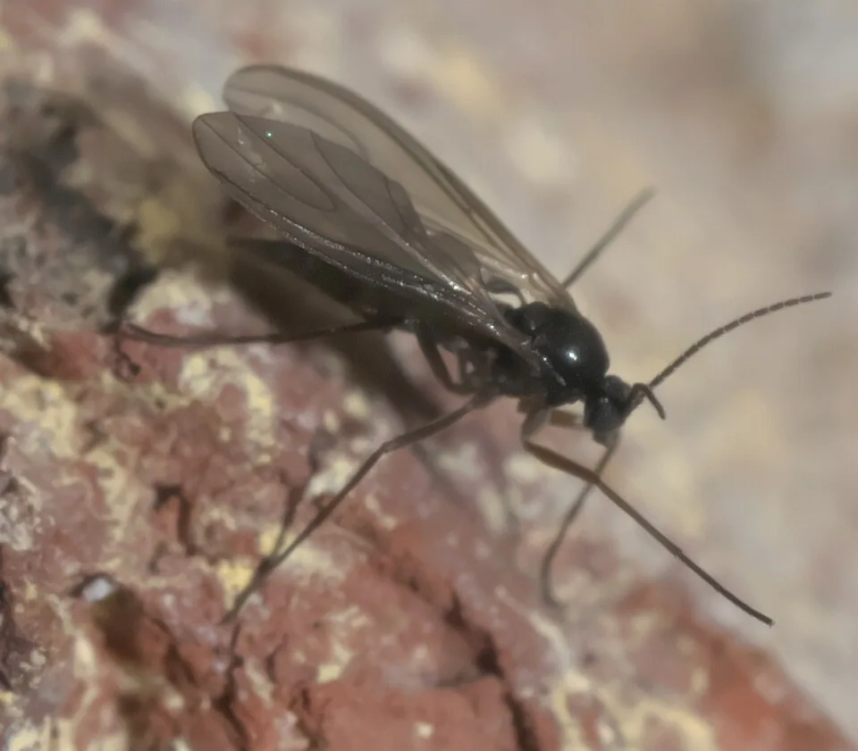
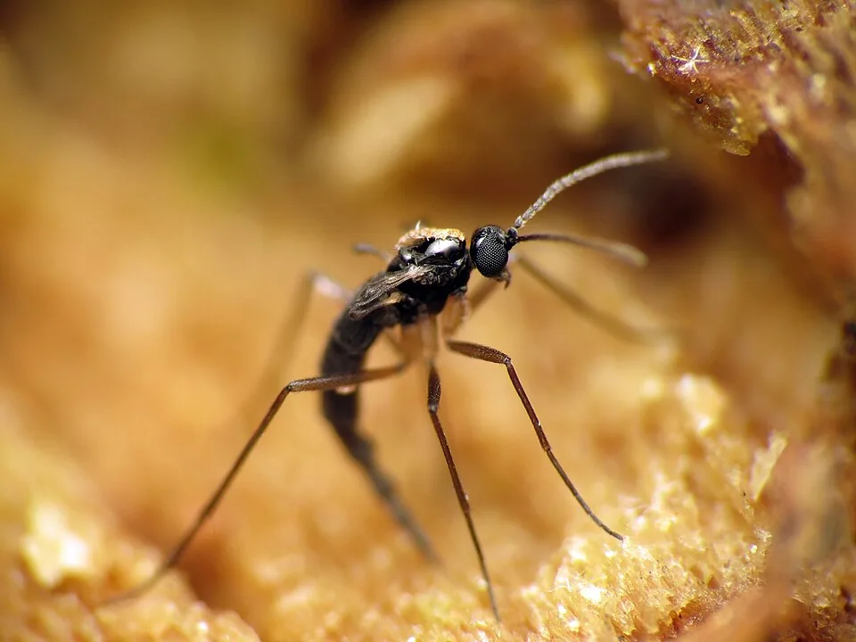
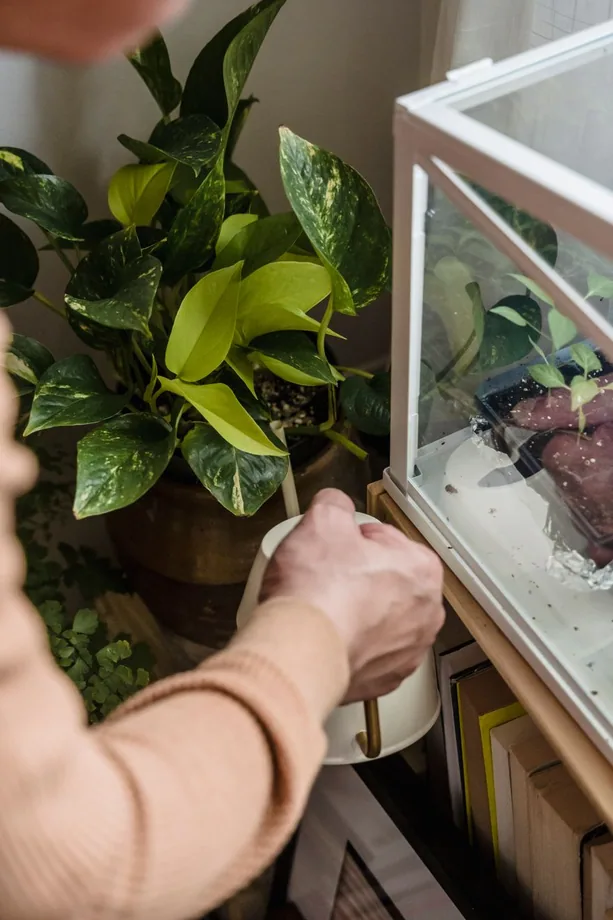

You water your plant, and a cloud of tiny black flies lifts off the soil. A few days later they are circling your lamp, landing in your tea and crawling across the screen of your phone. If that sounds familiar, fungus gnats are a likely suspect. Moist potting mix is a common breeding site. Confirm which pot is producing them before you buy a treatment.

This guide explains what fungus gnats are, why they show up, how to confirm them, and a step-by-step plan to get rid of them and keep them away.

## What are fungus gnats?

Fungus gnats are tiny, dark, slender flies about one-eighth of an inch (3 millimeters) long, with long legs and a pair of transparent wings. They belong to the family Sciaridae. Adults are weak fliers, and you will see them hovering around plants, windows and lights, or running across the soil surface.

The adults do not bite and do not damage plants. They are a nuisance. The real damage, when there is any, comes from the larvae. These are small, translucent, whitish worms with a shiny black head that live in the top inch or so of the potting mix. They feed on decaying organic matter and fungi in the soil, and, according to university extension sources, in some cases they also chew on roots, especially in seedlings, cuttings and weak plants. On healthy, established houseplants, many extension services describe the problem as mainly cosmetic, but a heavy infestation can slow growth and stress young plants.

Look for the slender body and long antennae of a dark-winged fungus gnat. Photo by xpda, [Sciaridae P1330284a.jpg](https://commons.wikimedia.org/wiki/File:Sciaridae_P1330284a.jpg), [CC BY-SA 4.0](https://creativecommons.org/licenses/by-sa/4.0). Resized for the web.

## Why do you have them?

Female gnats lay eggs in moist, organic-rich soil. According to Virginia Cooperative Extension, overwatering and constantly wet soil encourage the fungal growth and root rot that support larvae. The University of Tennessee notes that eggs, laid in small strings, begin to hatch in about four days, and warm indoor temperatures speed up the whole life cycle, so numbers can build quickly.

Common ways they arrive:

- **A new plant** brought home with eggs or larvae already in the soil
- **Houseplants moved indoors** after summer outside
- **Potting mix** that has been stored damp or open, or is full of peat and compost that stays wet
- **Overwatering**, poor drainage, or a decorative pot with water pooling at the bottom
- **Decaying leaves** left on the soil

In other words, the gnats are a symptom. If the conditions stay wet, new ones will keep coming.

This outdoor example shows a fungus gnat seeking a moist surface to lay eggs. Photo by Katja Schulz from Washington, D. C., USA, [Dark Fungus Gnat ovipositing - Flickr - treegrow.jpg](https://commons.wikimedia.org/wiki/File:Dark_Fungus_Gnat_ovipositing_-_Flickr_-_treegrow.jpg), [CC BY 2.0](https://creativecommons.org/licenses/by/2.0). Resized for the web.

## How to confirm it's fungus gnats

Fruit flies are bigger, rounder and often tan. Fungus gnats are darker and thinner, and they hang near plants. To check, you can use these two simple methods:

1. **Yellow sticky cards.** Place one or two near the plants. Extension services including Washington State University suggest these to monitor and help control adults. If small black flies stick to them, you have your answer.
2. **The potato test.** The University of Wisconsin suggests placing a few slices of raw potato on the soil surface. After three to four days, lift the slices. If larvae are present, you will see tiny maggots feeding on the underside.

(Vinegar traps, the usual fix for fruit flies, don't work for fungus gnats, according to the same Wisconsin guide.)

## Step-by-step: how to get rid of them

The most effective plan combines drying the soil, trapping adults and, if needed, treating larvae. You don't have to use all the steps at once.

### Step 1: Let the soil dry out

This is the single most useful step, recommended by essentially every extension service. Larvae live in the top layer and need moisture. Virginia Tech's extension guide suggests letting the top half inch of soil dry out, calling it probably the best and easiest control, because larvae in the top layer die without moisture and females have no good place to lay eggs. NC State Extension gives the same advice: let the soil dry thoroughly between waterings.

For most plants, that means:

- Water only when the top inch or two is dry (check with your finger or a skewer)
- Water less in winter
- Make sure the pot drains freely and never sits in a full saucer
- Consider a moisture meter if you tend to overwater

For plants that like to stay a little moist, you can water from the bottom by standing the pot in a tray for a short time, which keeps the surface drier.

### Step 2: Trap the adults

Put yellow sticky traps horizontally on the soil or vertically in the pot. Adults are attracted to the yellow color and get stuck. This reduces egg laying and also tells you whether your plan is working. Replace the cards when they fill up.

### Step 3: Kill the larvae

If drying the soil is not enough, the next step many extension services mention is a biological control, Bti (Bacillus thuringiensis subspecies israelensis). The University of Wisconsin explains that Bti products sold to homeowners, such as mosquito bits or gnat-control products, are available, target only the larvae, and are mixed with water and poured into the soil. They do not affect eggs, pupae or adults, so you need several applications, spaced five to seven days apart, to catch newly hatched larvae until the infestation is gone.

Another method is beneficial nematodes, microscopic worms that attack larvae in the soil. They are sold online and in garden centers, and they work best in moist soil that is not too cold.

### Step 4: Repot badly infested plants

If a plant is heavily infested and you can't let the soil dry out without harming it, repotting can help. Washington State University's pest guide suggests repotting with fresh, well-draining soil to knock down the larvae population. Shake off as much old soil as you can, replace it with fresh mix, and clean the pot.

### Step 5: Pesticides, last and only if needed

Extension advice varies, but it tends to agree that chemical sprays are rarely necessary. The University of Wisconsin says that, unless the infestation is severe, chemical controls are not warranted, and Washington State University does not recommend pesticides for fungus gnats on houseplants. If you do decide to use one, choose a product labeled for houseplants, follow the label exactly, and never use one on edible plants such as indoor herbs unless the label allows it. Chemicals will not fix the problem on their own if the soil stays wet.

## How to prevent fungus gnats

Once you have cleared them, these habits keep them away:

- **Water based on soil moisture,** not on a calendar
- **Quarantine new plants** for two to three weeks. Oregon State University Extension suggests keeping new plants apart from the others, adding a sticky trap and inspecting daily
- **Inspect before you buy.** Gently move the soil at the base and look for larvae or flying gnats
- **Use fresh, sterile potting mix,** and store opened bags sealed and dry
- **Remove dead leaves and flowers** from the soil surface
- **Check plants before bringing them indoors** in autumn
- **Avoid overly peaty, water-holding mix** for plants that like it dry. Adding perlite or coarse material improves drainage
- **Empty saucers** after watering

A thin layer of coarse sand or fine gravel on top of the soil is sometimes used as a barrier, because it dries quickly and makes laying eggs harder. Treat it as a helper, not a cure.

## What doesn't work well

- **Watering less but only on the surface,** while deeper soil stays wet
- **Vinegar or fruit-fly traps,** which Wisconsin says are ineffective for fungus gnats
- **Spraying the flies with a pesticide aerosol** while ignoring the soil. Adults are replaced quickly from the larvae in the pot
- **Waiting it out.** In warm homes, populations can rise fast

## Are fungus gnats harmful to people or pets?

Adults do not bite, and they are not considered a health risk. They are mainly annoying. The concern is the effect on your plants, particularly seedlings, cuttings and stressed plants.

## Find the pot that is producing the flies

I would look for where the adults emerge before deciding which pots to treat. A few flies by a window tell you where the adults are gathering. The source could be an orchid behind the curtain or an open bag of damp potting mix under the bench. Put equal-sized yellow cards at soil height beside the most likely pots and mark each one with the plant name and date. Place a card at the shelf's other end as a comparison. Keep the traps where children and pets cannot reach them.

Check again after two or three days. If the propagation tray catches many more than the others and a potato check there turns up larvae, you have a useful lead. If every trap has roughly the same catch, separate the two dampest pots for several days and check again. A single fly on a card is weak evidence, especially if pots sit close together. Look for the pot whose catch stays high, whose mix remains damp well after watering, or where activity increases when you move the pot.

## What to change in a pot that stays wet

Start by pulling the inner pot out of its cover after watering. The hole sometimes works perfectly while the cover quietly collects water. Pour it out and wait until the inner pot has finished dripping before sliding it back. Then inspect the drainage holes. A root-packed plant or a container with a blocked hole can stay wet at the bottom despite having a dry-looking surface.

On an established pothos in a dim room, spacing out watering may be enough. For a young seedling or thin-leaved fern, a long dry spell can do more harm than the gnats. Keep the plant's usual moisture needs in mind and use traps to monitor adults while you correct drainage. If you need a larval treatment for plants that cannot tolerate drying, choose a product whose label allows the use, organism and site involved. Measure the dose using the actual quantity of water you prepare, and avoid giving the container extra irrigation simply to apply the product.

If the wetter half of your collection all shares the same bag of potting mix, inspect the bag, too. Close it so adults cannot move in and out, and store it dry according to the manufacturer's directions. A new infestation beside an open bag is a reason to examine it. It is also worth checking for algae or standing water in saucers and propagation trays.

Inspect each pot before watering. Some containers dry faster than the others. Photo by [Annushka  Ahuja on Pexels](https://www.pexels.com/photo/a-person-watering-the-green-plant-8055440/).

## A three-week follow-up that tells you if it is working

During the first week, take a baseline count before discarding spent cards. Count each trap on the same weekday or photograph it and mark how many flies were already there. Use comparable positions on each pot and replace traps before they are heavily covered in dust or insects. A large initial catch may simply mean the traps are finally collecting adults that were already in the room.

During the second week, look at how long the mix remains damp and whether catches are declining. If one pot still catches a lot while the others improve, check its cover pot, drainage and roots before changing the plan for the entire shelf. The presence of an adult or two does not tell you that a larval treatment failed. Some adults can continue appearing while immature stages already present complete development.

By the third week, try to explain the trend. A falling catch alongside normal leaf growth is a reason to keep the current routine. Persistently high catches in a pot that dries normally point toward a nearby source. A plant that is wilting in damp mix needs a root inspection regardless of the trap count. Once catches have stayed low, remove most of the cards and keep a monitor near the shelf where the problem started. This leaves you with an early warning when a new plant or especially wet stretch changes the conditions again.

## When the flies are coming from somewhere else

Compare the insects before treating more pots. Fungus gnats are slender and relatively weak fliers. A stout fly that gathers around fruit deserves a look at the fruit, recycling bin or fermenting scraps. Fuzzy, mothlike flies gathering around a drain also point to a different source. When the larvae are hard to see, a clear close-up of an adult plus a note about where it was caught gives a local extension office more to work with than a description of “tiny black flies.” [University of Minnesota Extension identification guide](https://apps.extension.umn.edu/garden/diagnose/insect/indoor/flies/small/fungus-gnats.html).

An empty card at the pot is only one clue. Combine it with a soil inspection and a comparison trap near the suspected alternative source. If the drain or fruit area has the heavier activity, fixing that source takes priority over repotting a healthy plant.

## Quick action plan

1. Stop watering until the top 1 to 2 inches of soil are dry
2. Put out yellow sticky traps
3. Treat the soil with Bti, repeating every 5 to 7 days
4. Repot if the plant is badly infested and cannot be dried out
5. Quarantine new plants and adjust your watering habits

Expect to see results in two to three weeks. If gnats are still around after a month, look for a hidden source, such as another pot, a plant tray or damp organic matter.

## Final thoughts

Fungus gnats are annoying, but they are also a useful signal that your plants are staying too wet. Fix the moisture, break the life cycle with traps and Bti, and you will usually be rid of them within a few weeks.

## Sources and further reading

- University of California IPM, [Fungus gnat identification and management](https://ipm.ucanr.edu/home-and-landscape/fungus-gnats/)

- Virginia Cooperative Extension, [Fungus Gnats](https://www.pubs.ext.vt.edu/3104/3104-1579/3104-1579.html)
- University of Wisconsin-Madison Extension, [Fungus Gnats on Houseplants](https://hort.extension.wisc.edu/articles/fungus-gnats-on-houseplants)
- NC State Extension, [Fungus Gnats: a Common Problem of Over-Watered Houseplants](https://union.ces.ncsu.edu/2020/02/fungus-gnats-a-common-problem-of-over-watered-houseplants)
- Washington State University, [Fungus gnats](https://pestsense.cahnrs.wsu.edu/fact-sheet/fungus-gnats/)
- Oregon State University Extension, [I have fungus gnats everywhere. Can you help?](https://extension.oregonstate.edu/ask-extension/featured/i-have-fungus-gnats-everywhere-can-you-help)
