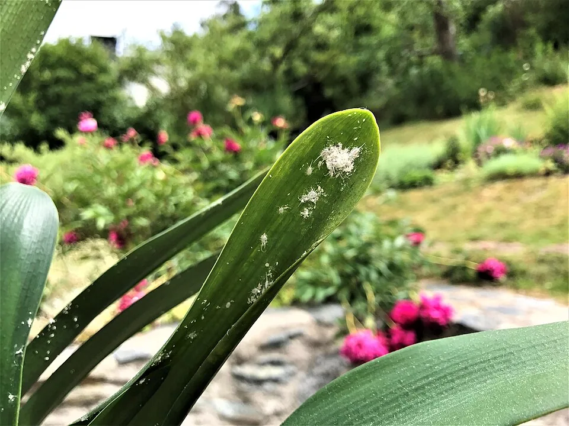
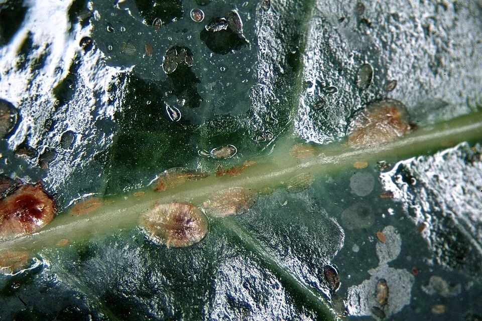
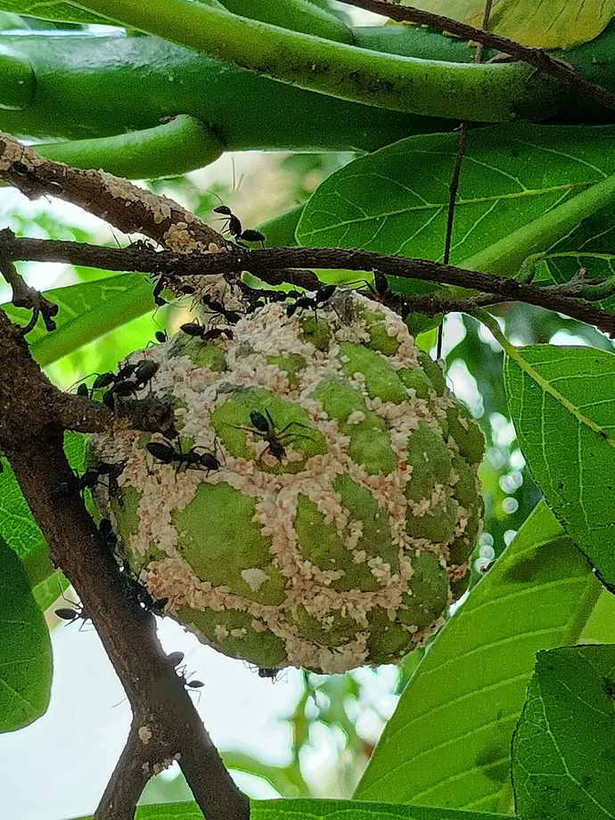

It usually starts with a small detail. A leaf that looks dusty and pale. A tiny cottony tuft where a leaf meets the stem. A sticky film on the shelf under your plant. When you look closely, you realize something is living on it. Houseplant pests are discouraging when you first meet them, but three of the most common, spider mites, mealybugs and scale, are manageable if you catch them early and stay consistent.

This guide shows you how to identify each pest, why they appear, and what to do, in order from gentlest to strongest.

## Why plants get pests

Pests rarely come from nowhere. Extension sources point to a few common routes: new plants brought home already infested, plants moved indoors after summer outside, and stressed plants that are easier targets. One extension fact sheet notes that infestations of scale insects and mealybugs are almost always established from plants recently purchased or received as gifts. Spider mites tend to be a bigger problem in hot, dry conditions: an Oklahoma State University specialist notes they are a greater problem during periods of high temperature and low humidity.

That means the most useful prevention is simple: look at plants before you buy them, keep new ones apart from your collection for a few weeks, and check your plants regularly.

## Pest 1: Spider mites

**What they are.** Spider mites are not insects. They are related to spiders, and they are extremely small, so infestations are often noticed late. The University of Kentucky's extension notes that mites suck sap from the plant, causing leaves to yellow and drop, and that infestations may be overlooked until they become numerous or the mites start to spin webbing.

**How to spot them:**

- Fine, pale speckles (stippling) on leaves
- Leaves that look dusty, bronzed or faded
- Delicate webbing between leaves and stems, especially on undersides
- Tiny moving dots: tap a leaf over a sheet of white paper and look for specks that crawl

**How to treat them:**

1. **Isolate the plant** so mites don't spread.
2. **Rinse it.** A brisk shower or spray of water knocks many mites off. The University of Kentucky notes that pressure spraying can remove or greatly reduce aphids, mites, mealybugs or thrips, as long as the water is strong enough to dislodge them but too gentle to damage the plant. Oklahoma State suggests showering houseplants once or twice a month to help control mites.
3. **Wipe the leaves** on both sides with a damp cloth.
4. **Use insecticidal soap or horticultural oil.** Choose a product labeled for indoor houseplants and the pest. Follow its mixing and coverage directions.
5. **Repeat.** Eggs can survive contact treatments. Inspect for new activity and follow the label for repeat applications.
6. **Raise humidity** if your home is very dry, because mites thrive in hot, dry air.

## Pest 2: Mealybugs

**What they are.** Mealybugs are soft-bodied insects covered in white, powdery wax. The University of Kentucky describes them as sap-suckers that gather in leaf axils (where the leaf joins the stem) and branch crotches. They produce a sticky substance called honeydew, which makes leaves and surfaces sticky and can lead to black sooty mold.

**How to spot them:**

- White, cottony tufts on stems, leaf bases and undersides of leaves
- Sticky residue on leaves or on the shelf below
- Stunted, yellowing or dropping leaves
- Ants, which are attracted to honeydew

**How to treat them:**

1. **Isolate the plant.**
2. **Remove them by hand.** The University of Kentucky says handpicking is usually simpler and more effective than other control techniques. A damp swab or tweezers can help reach individual insects around a stem. UMN Extension also describes using a swab dipped in alcohol on individual mealybugs. Spot-test any method that could injure the plant and avoid spraying alcohol broadly.
3. **Spray with insecticidal soap or horticultural oil,** getting into every crevice. Missouri Extension notes that a quick wipe is not enough where mealybugs are present in large numbers.
4. **Check the roots** if the plant keeps declining. One extension bulletin notes that a type of mealybug feeds on roots. Slide the plant out of the pot and look for white fluff on the root ball.
5. **Repeat weekly** for several weeks until you can't find any more.

Look for white waxy clumps where leaves meet the stem. Photo by Sinikka Halme, [Citrus mealybug Planococcus citrus on Clivia miniata 01.jpg](https://commons.wikimedia.org/wiki/File:Citrus_mealybug_Planococcus_citrus_on_Clivia_miniata_01.jpg), [CC BY-SA 4.0](https://creativecommons.org/licenses/by-sa/4.0). Resized for the web.

## Pest 3: Scale insects

**What they are.** Scale insects are stationary pests that look like small brown, tan or yellow bumps stuck to stems and the undersides of leaves. Each has a shell-like covering that protects it. Extension descriptions note that they are round to oval with no visible eyes, antennae or legs. They suck sap, causing stunted growth, yellowing, wilting or premature leaf drop, and they excrete sticky honeydew.

**How to spot them:**

- Small, hard or waxy bumps along stems and leaf veins that don't wipe away easily at first
- Sticky leaves and surfaces
- Sooty black mold on honeydew
- A plant that slowly declines for no obvious reason

**How to treat them:**

1. **Isolate the plant.**
2. **Scrape or wipe them off.** One extension guide says small infestations can be removed by gently scraping them off. Use a soft brush or swab and take care around tender tissue.
3. **Use horticultural oil or insecticidal soap.** Oils smother adult scale, and soap is most effective on the young, mobile stage called crawlers, according to extension sources.
4. **Repeat every week or two** until no live scale can be found. Because adults have protective shells, you will usually need several rounds.
5. **Prune off badly infested stems** if the plant can spare them.

Scale is often the hardest of the three to remove, so patience matters. Dead scales may stay stuck to the plant, so look for fresh, soft, live ones.

Soft scale and honeydew can appear together along leaf veins and stems. Photo by Whitney Cranshaw, Colorado State University, United States, Bugwood.org, [Coccus hesperidum01.jpg](https://commons.wikimedia.org/wiki/File:Coccus_hesperidum01.jpg), [CC BY 3.0 us](https://creativecommons.org/licenses/by/3.0/us/deed.en). Resized for the web.

## A simple treatment routine for any of the three

1. **Isolate** the plant from others, and check nearby plants too
2. **Inspect** closely using a magnifying glass or phone camera zoom
3. **Rinse** the plant with water (take it to a sink or shower)
4. **Remove** visible pests with a damp swab or by hand where practical
5. **Treat when needed.** Follow the directions of a product labeled for the plant, indoor setting and pest
6. **Reinspect** regularly and follow the product label for any repeat application
7. **Keep checking** for a month after you stop seeing pests

Test any spray on a small leaf first and wait a day to check for damage, since some plants are sensitive to soaps and oils. Don't apply oil or soap to plants in strong sun, and always follow label directions.

## What about chemical pesticides?

Many extension publications list stronger pesticides, including systemic products, as options for serious infestations. Oklahoma State advises not to apply pesticides without a proper reason and to read all label warnings. For a home grower with a few plants, handpicking, washing and soap or oil are usually enough, physical removal also limits how much pesticide you need to use indoors. If you do use a product, check that its label lists houseplants and the pest in question, keep pets and children away during treatment, and never use a product on edible plants unless the label allows it.

## How to prevent pests

- **Inspect new plants** carefully, including the undersides of leaves and the stems
- **Quarantine** new arrivals for two to three weeks
- **Wipe leaves** with a damp cloth from time to time, which removes dust and lets you spot problems
- **Avoid overfertilizing.** Missouri Extension notes that mealybugs, scale and aphids thrive on soft, overly lush growth caused by high nitrogen
- **Keep plants healthy** with proper light and watering, since stressed plants are more vulnerable
- **Maintain humidity** for plants prone to spider mites
- **Check plants weekly** when you water

## What to inspect before buying a treatment

I would start with one healthy-looking leaf and one damaged leaf from the same plant, looking at both surfaces under a bright light. A dusty leaf that wipes perfectly clean and has an even green surface underneath tells you something different from a leaf with pale marks embedded in its surface. Look for fine threads very close to the leaf and moving specks on a white sheet. Old webbing by itself can belong to a harmless spider, so look for feeding damage as well.

For cottony material, check where the stem meets the leaf and where two branches meet. Use a phone camera to photograph bumps or tufts at full size before removing them. Compare several bumps in different locations. Natural bumps on a stem are often evenly distributed and part of the tissue. Scale can occur in irregular clusters, particularly along veins and around sheltered stems. Dark residue that wipes off may be sooty mold growing on honeydew. Look upward from the sticky leaf to see whether soft scale or mealybugs are feeding above it.

A plant on a crowded shelf may have more than one problem. A sticky ficus above a dotted calathea can have soft scale while the calathea has mites. Treating the shelf based on the sticky patch alone could miss half the problem. Check the plant directly above any residue on furniture and check all touching plants before you carry them elsewhere.

A close-up can help you separate the insect itself from dust and residue. Photo by Krishnaveni krish29, [Planococcus citri-Insects.jpg](https://commons.wikimedia.org/wiki/File:Planococcus_citri-Insects.jpg), [CC BY-SA 4.0](https://creativecommons.org/licenses/by-sa/4.0). Resized for the web.

## Set up a treatment area and a follow-up record

Choose a temporary location with useful light and no contact with the rest of the collection. A bathroom can work if there's a window and a place to set the plant without a pet interfering. Dark isolation for several weeks adds stress. Move the plant upright and keep leaves away from other pots along the way. Bag any clippings for disposal and wash your hands and tools before handling other plants.

On day one, count affected leaves on one or two representative stems. Take an underside photo and put a date on it. Remove a small, isolated infestation by hand or with a rinse according to the pest and the plant's sensitivity. If you rinse, keep the pot from becoming saturated and allow excess water to drain. Some plants with soft, hairy leaves are harder to wipe. Use the method that avoids damaging the foliage and consult an extension guide if you are unsure which treatment fits.

For an indoor pesticide, confirm the label permits use on that houseplant and target pest in your setting. Follow the required dilution, protective measures, re-entry directions and repeat intervals. Protect children and pets from both the application area and stored products. A spot test on a leaf can reveal plant sensitivity when the label permits it. Keep oils and soaps separate unless the product directions specifically allow a combination. Ordinary dish detergent formulations vary and can damage foliage. [University of Minnesota Extension indoor pest guidance](https://extension.umn.edu/garden-and-home/yard-and-garden/yard-and-garden-insects/insects-on-indoor-plants).

## Use fresh activity to decide when to stop

A damaged leaf may stay stippled after the last mite is gone. An old scale cover can remain attached. These are reasons to check for change. Compare a new photo to your original one. Look for fresh webbing on new leaves, new cotton at growing tips, new small scale along a clean section of stem or renewed honeydew after you wiped the shelf. If the new growth stays clean but the old damage remains, give yourself time to confirm the trend.

There are times when discarding a heavily infested plant is the practical choice, especially when several small pots share a narrow windowsill and you cannot isolate the worst one. Before making that call for a plant you want to save, ask whether you can reach the undersides and stem joints, maintain suitable conditions away from the collection and keep checking under the product's directions where applicable. A repeatable routine matters more than applying several different products in a single afternoon.

One simple inspection route is to go from the cleanest plants to the affected plants. Start with the pots farthest away, check touching leaves and hanging vines next, then work on the isolated pot. Use a fresh cloth for each plant. Look under the rim of an untreated nursery pot that stood next to the infested one, where small insects can hide. Keep notes about what you find and where. If you consistently see renewed mealybugs on the same shoot, removing that shoot can make the remaining infestation much easier to monitor.

## Quick identification chart

- **Fine webs, pale speckles, dusty look:** spider mites
- **White, cottony tufts in leaf joints:** mealybugs
- **Brown or tan bumps on stems and leaf undersides:** scale
- **Sticky leaves:** check for mealybugs and soft scale nearby. Armored scale and spider mites do not produce honeydew.

## Final thoughts

Houseplant pests feel like a failure, but they are normal and fixable. Catch them early, isolate the plant, remove what you can by hand and keep up a weekly routine. Persistence matters more than the choice of product.

## Sources and further reading

- University of Kentucky Extension, [Houseplant Insect Control (ENTFACT-406)](https://entomology.mgcafe.uky.edu/ef406)
- University of Missouri Extension, [Least-toxic pest control options for houseplants (G7273)](https://extension.missouri.edu/g7273)
- Oklahoma State University Extension, [Houseplant Pests](https://extension.okstate.edu/announcements/horticulture-tips/hort-tips-2026/mid-to-late-october/house-plant-pests)
- University of Tennessee Extension, [Houseplant pests (PB1157)](https://utia.tennessee.edu/publications/wp-content/uploads/sites/269/2023/10/PB1157.pdf)
- University of Alaska Fairbanks Cooperative Extension, [Houseplant Pests and Control](https://uaf.edu/ces/publications/database/insects-pests/houseplant-pests.php)
