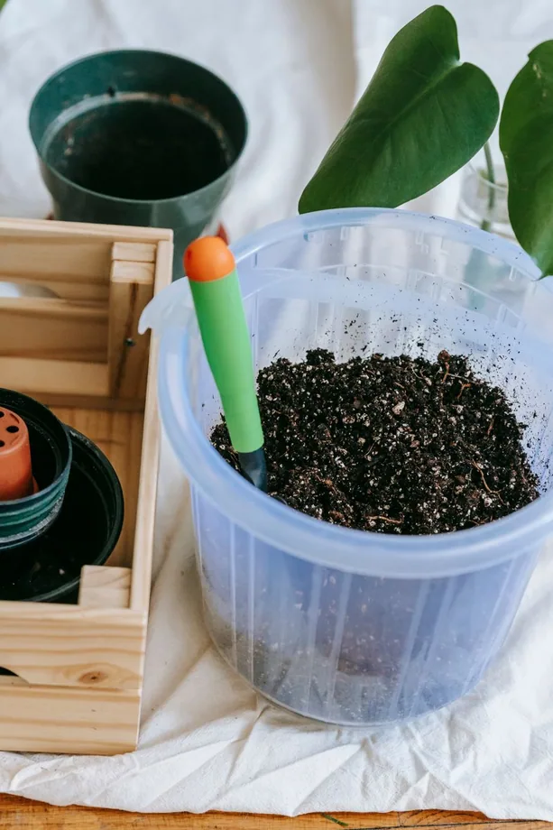
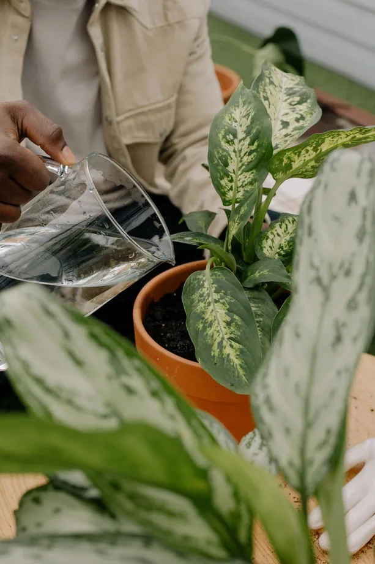
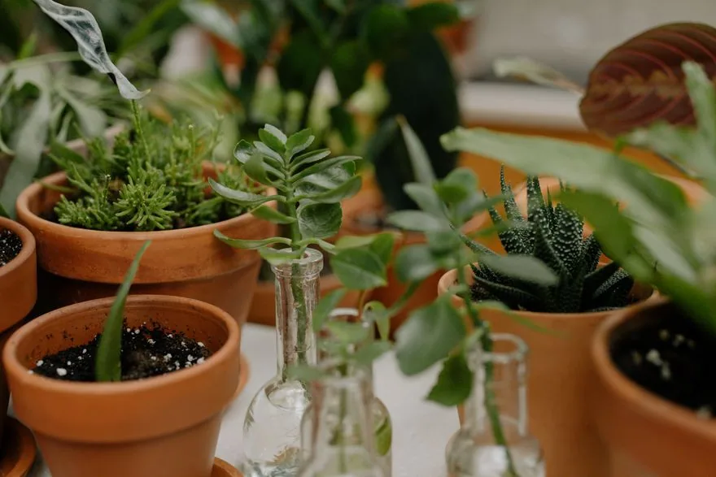

Fertilizer is one of the most misunderstood parts of houseplant care. Some people never feed their plants and wonder why growth stalls. Others feed too much, too often, and end up with brown leaf tips and a crust of salt on the soil. The truth is somewhere in the middle, and it is simpler than the labels on the bottles make it look.

This guide explains what fertilizer actually does, how to read the numbers on a label, when and how often to feed, how to dilute it safely, and how to tell if you have overdone it.

## What fertilizer does (and doesn't do)

Plants make their own food from light through photosynthesis. Fertilizer isn't food in that sense. It supplies mineral nutrients that plants need in order to build leaves, roots and flowers. Outdoors, soil holds a large supply of nutrients. In a pot, the supply is limited, and each time you water, some nutrients wash out through the drainage holes. Over months and years, a pot of potting mix runs low, so feeding helps.

Fertilizer will not fix a plant that is struggling with the wrong light, overwatering or root rot. Extra nutrients can even make a stressed plant worse. Before you reach for fertilizer, check light, watering and drainage first.

## What the NPK numbers mean

Most fertilizers show three numbers, such as 10-10-10 or 20-20-20. They stand for the percentage by weight of three main nutrients:

- **N (nitrogen):** supports leafy, green growth
- **P (phosphorus):** supports roots and flowering
- **K (potassium):** supports overall plant health and resistance to stress

For most foliage houseplants, a balanced fertilizer, one with roughly equal numbers, or one slightly higher in nitrogen, is appropriate. Specialized fertilizers exist for orchids, African violets and succulents, and they are worth using if you grow many of those. Good fertilizers also contain small amounts of micronutrients such as iron, magnesium and calcium.

## Types of fertilizer

**Liquid (water-soluble).** The most popular choice for houseplants. You dilute it in water and apply it when you water. It is easy to control, quick-acting and easy to stop if something goes wrong.

**Slow-release granules or spikes.** These feed over weeks or months and are convenient, but you can't easily adjust the dose. They are better for large, stable plants than for small or sensitive ones.

**Organic options.** Compost tea, worm castings and fish emulsion all provide nutrients, but strength varies and some smell. They can work well, but follow the label.

If you are a beginner, liquid fertilizer is the easiest to use safely.

Check whether your potting mix already contains fertilizer before adding more. Photo by [Teona Swift on Pexels](https://www.pexels.com/photo/gardening-tool-soil-and-pots-for-cultivating-home-plants-6913411/).

## When to fertilize

Plants use nutrients when they are actively growing, which is mostly when they get plenty of light and warmth. University extension advice on this is quite consistent:

- **Feed in spring and summer,** when plants produce new leaves and roots.
- **Reduce or stop in autumn and winter.** The University of Connecticut Extension notes that reduced light and cooler temperatures usually make plants inactive in winter and recommends not fertilizing at that time. Iowa State University's extension similarly names spring and summer as the best time to feed.
- **Some regional guidance** treats roughly March through September as the active season in temperate climates. The exact months depend on where you live, so watch your plants. If you see new leaves unfurling, it is growing. If nothing has changed for weeks, it is resting.

If you live in the southern hemisphere, the seasons are reversed. If you live in a warm climate with plenty of year-round light, your plants may grow for more months of the year, so use new growth as your guide.

There are exceptions. Plants that flower in winter, such as some orchids or Christmas cactus, may need feeding while they bloom, but follow guidance for those specific plants.

## How often to fertilize

The UConn fact sheet explains that labels on most water-soluble fertilizers recommend monthly applications, and that is a sensible starting point. A common plan is:

- **Once a month** during the growing season, at the strength recommended on the label or less
- **Or lower doses more often,** such as a very dilute solution with every watering (sometimes called "weakly, weekly"), which extension specialists describe as an alternate method, especially for flowering plants such as African violets

Pick one method and stick with it. Mixing them can lead to an overdose.

## How to dilute fertilizer

Start with a fertilizer labeled for your type of plant and growing medium. Follow its indoor container instructions. A lower strength can make sense for regular feeding where the label and species guidance allow it. Be particularly cautious with recently repotted plants or products already included in the mix.

A simple routine:

1. **Check that the soil is already moist.** The UConn guidance says to apply fertilizer to moist potting soil to avoid root damage. Don't apply it to bone-dry soil.
2. **Mix the fertilizer in a watering can** at the diluted strength you chose.
3. **Pour it onto the soil,** not on the leaves, until a little drains out of the bottom.
4. **Empty the saucer** afterward.
5. **Write the date** on your calendar or on the pot, so you don't double up.

Give each pot the amount of liquid it needs and allow the excess to drain. Photo by [cottonbro studio on Pexels](https://www.pexels.com/photo/a-person-watering-a-plant-9730593/).

## Signs of too much fertilizer

Over-fertilizing is more common than under-feeding. Excess nutrients build up as salts in the soil, and these can damage roots. Watch for:

- **Brown, crispy leaf tips and edges**
- **White or yellow crust** on the soil surface or the rim of the pot
- **Wilting even though the soil is wet**
- **Stunted or distorted new growth**
- **Dropped lower leaves**

If you think you've overdone it:

1. Stop fertilizing.
2. **Flush the soil.** Slowly pour plain water through the pot, using about three to four times the volume of the pot, and let it drain completely. This washes out excess salts.
3. Scrape off any crust on the surface, and clean the pot rim.
4. Wait at least a month before feeding again, and use a weaker dose.
5. If the plant continues to decline, check the roots and repot in fresh mix.

## Signs your plant may need feeding

- **Slow or stalled growth** during spring and summer
- **Small, pale new leaves**
- **Older leaves turning uniformly pale or yellow** while the plant is otherwise getting good light and water (this can indicate low nitrogen)
- **Soil that hasn't been changed in years**

Be careful with this list. Yellow leaves are often caused by overwatering, not hunger. Check the soil moisture before you feed.

## When not to fertilize

- **When the plant is dormant** or growth has stopped for the season
- **When the soil is completely dry**
- **When the plant is sick, stressed, or recently repotted.** Fresh potting mix often contains some nutrients, so wait several weeks to a couple of months after repotting
- **When you've just treated roots for rot or cut back heavily.** Let it recover first
- **When you've already applied slow-release fertilizer.** Don't add liquid on top without checking the instructions

## Special cases

**Succulents and cacti.** They need less fertilizer than most plants. Use a diluted cactus-specific formula once or twice during the growing season.

**Orchids.** Many growers use a very dilute orchid fertilizer regularly during growth and reduce it when the plant isn't growing.

**Flowering plants.** Plants such as African violets benefit from regular, very dilute feeding with a fertilizer suited to flowering.

**New plants from the nursery.** Many are fertilized heavily before sale. You can usually wait a couple of months before adding more.

## Simple year-round plan

- **Spring (new growth starts):** begin feeding monthly at half strength
- **Summer:** continue monthly; flush the soil with plain water once during the season
- **Early autumn:** reduce, then stop as growth slows
- **Winter:** no fertilizer for most plants; consider flushing the pots once to clear salts
- **Always:** check light and watering first, and write feeding dates down

## A label calculation you can do with any measuring cup

My starting point is the labeled **indoor container rate** and the amount of water I actually plan to mix. Suppose the label gives 4 milliliters per liter for a full-strength indoor feed and you choose a half-strength application. That is 2 milliliters per liter. For half a liter of solution it is 1 milliliter. For two liters it is 4 milliliters. Write the calculation on your plant notes if the label uses a different volume from your watering can. These figures are an example. Use the directions for your own product.

Use a marked measuring cup or syringe set aside for gardening. If a cap has markings, check whether the line is measured in milliliters or is simply a fill line specified in the directions. For a powder, use the measuring method on the package because a gram of one product can occupy a different amount of space than a gram of another. Mix until it dissolves as directed. The amount printed on the bottle is for a volume of water, so pouring the entire calculated dose directly into a small pot would expose the roots to a much stronger solution.

Make only enough for the plants that need feeding now. If three pots are ready to water and two are still damp, feed the three only if they are growing and their labels or recent potting history call for it. Give them the usual amount of prepared solution, allow them to drain, and empty their saucers. Keep concentrates and measuring equipment where children and pets cannot access them.

## Three pots on one shelf can need different decisions

Picture a pothos opening new leaves under a light, a snake plant on the same shelf that has hardly grown this month, and a small peace lily repotted last week. The pothos may be ready for a modest feed at its next watering if its medium has no added fertilizer. The snake plant can wait for active growth. For the peace lily, read the potting mix bag before you add anything. The mix may already contain a starter charge or controlled-release granules. If it does, use the bag's guidance for how long it supplies nutrients.

Now imagine the pothos stops growing and its last three leaves are progressively smaller. Fertilizer is one possibility. If it was moved deeper into the room, small pale growth and longer spaces between leaves make light a sensible thing to check first. If the pot stays damp far longer than it used to, inspect drainage and roots. Restoring the growing conditions often gives you a clearer signal about whether nutrition was involved.

A spray bottle of fertilizer does not make feeding simpler unless the product explicitly supports foliar use. Drops dry unevenly, salts can be left on leaves, and plants can react differently to the same concentration. For an ordinary potted houseplant, use the labeled application method and keep a note of the date and volume mixed.

Plants on the same shelf can be growing at different rates. Photo by [cottonbro studio on Pexels](https://www.pexels.com/photo/beautiful-indoor-house-plants-9707464/).

## Read the response on the next growth

I would write down three things at each feeding. Record the date, the actual mixing rate and which pots received it. Put an asterisk by any plant whose mix already contains fertilizer. A short record answers common questions later, such as whether the leaf tips browned after an increase or whether two people in the household fed the same plant in one week.

Photograph the same growing tip before feeding, then compare it after the plant produces new leaves. Look for whether the new growth is holding its color and becoming a normal size for that cultivar in that location. A scarred old tip will stay scarred even when the next leaves grow normally. Look at several leaves before you interpret the response. A single smaller leaf can follow a temporary temperature change, a move or damage to the developing bud.

If you suspect salt build-up, check whether crust appears only on the outside of a porous clay pot or also in the mix and around the drainage holes. Mineral deposits can come from repeated hard-water use as well as fertilizers. Pause feeding while you assess it. An otherwise healthy, freely draining plant may benefit from being watered thoroughly with low-mineral water and allowed to drain fully. A heavy, soggy pot needs a drainage or root check before you pour more water through. Our [brown leaf tips guide](/brown-leaf-tips-on-houseplants/) walks through that distinction.

## Final thoughts

Houseplants don't need a lot of fertilizer. They need the right amount at the right time. Feed lightly during active growth, skip it when the plant is resting, and when you are unsure, use less. A weak solution you apply carefully will do more good than a strong one that burns the roots.

## Sources and further reading

- University of Connecticut Extension, [Fertilizing Houseplants](https://homegarden.cahnr.uconn.edu/factsheets/houseplant-fertilization/)
- UConn Extension, [Houseplant Fertilization fact sheet (PDF)](https://homegarden-cahnr.media.uconn.edu/wp-content/uploads/sites/3479/2022/08/Houseplant-Fertilization.pdf)
- Iowa State University Extension, [How often should I fertilize houseplants?](https://yardandgarden.extension.iastate.edu/faq/how-often-should-i-fertilize-houseplants)
- University of Maryland Extension and UNH Extension publish guides on indoor plant fertilizer (search "fertilizer for indoor plants" on extension.umd.edu and extension.unh.edu)
