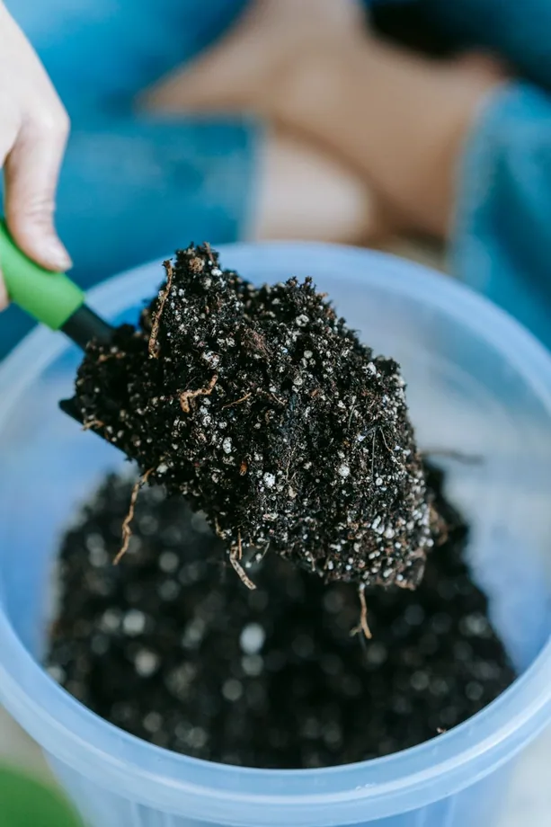
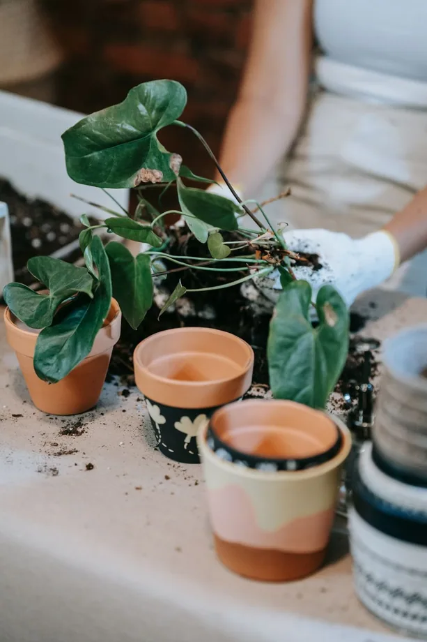
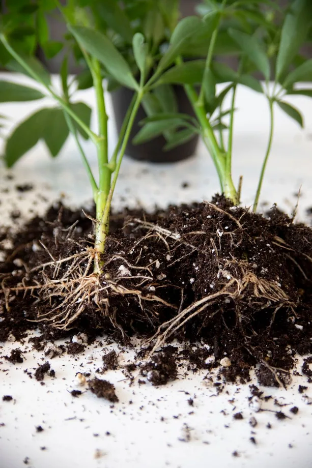

Before ordering a larger pot, slide the plant partway out of its nursery container and look at the roots. Two plants can sit in pots of the same size and need opposite decisions. One might have a dense root ball that dries the day after watering. Another may have a small root system in old, compacted mix that stays wet. The root ball helps you choose the size and the mix before you repot.

This guide covers each of those questions using advice from university extension services and a botanic garden, and ends with a checklist you can follow while you have a plant in your hands.

## What repotting actually does

Repotting does one or both of two things: it gives roots more room, and it replaces tired potting mix. Over time, the mix breaks down, compacts and loses nutrients, and roots fill the pot until there is little space left for water. The Brooklyn Botanic Garden notes that soil becomes less nutritious over time, so fresh soil along with a larger pot can create another growth spurt.

It also helps to know what repotting is not. It is not a cure-all for a struggling plant. If the real problem is light, overwatering or pests, a new pot will not fix it, and it can add stress. If a plant is sick, treat the cause first.

## Signs a plant needs repotting

Penn State Extension lists several signs of a pot-bound plant, and asks you to start by looking at your watering pattern. Look for these:

- **Roots growing out of the drainage holes** or circling the surface of the soil
- **The potting mix dries out very fast,** even in cool weather, so you are watering far more often than before
- **Water runs straight through** without soaking in, because there is more root than soil
- **Growth has slowed or stopped** during the growing season
- **The plant is top-heavy** and keeps tipping over
- **The pot is bulging or cracking** (thick roots can split plastic pots)

Be careful about one thing: slow growth in winter is normal. Many plants rest when light drops, so do not judge by winter growth.

Not every plant needs a bigger pot. Penn State Extension points out that the size of the container and root ball limits the size of the plant, so if you are happy with your plant's current size, you can refresh the mix or trim roots and return it to the same pot. A plant growing in compacted, exhausted soil may just need new mix.

## When to repot

For most tropical houseplants, spring is the best time. The garden website Gardenia advises that spring is usually ideal for common tropical foliage plants such as monstera, pothos and peace lily, because increasing daylight encourages growth and helps roots settle in fresh mix. Early summer is also fine. Avoid repotting in the middle of winter unless there is an emergency, such as root rot, because the plant is resting and will not recover quickly.

How often? Many houseplants need it about every one to two years, but fast growers may need it annually and slow growers, such as snake plants, much less. Check the roots instead of following a calendar. Our [snake plant guide](/snake-plant-care/) and monstera guide both mention plant-specific signs.

## Choosing the right pot

### Size: go up only a little

This is the rule that most extension sources agree on. The University of Illinois Extension recommends moving up one pot size, a container 1 to 2 inches larger in diameter, and warns that an oversized pot can result in poor growth or root rot. The reasoning is simple: a large pot holds a lot of wet soil that the small root system cannot use, so it stays wet for too long and roots rot.

Some other sources are a bit more generous for large floor plants, suggesting going up 2 to 4 inches for big specimens. For most plants on a shelf or table, 1 to 2 inches is the safe choice.

### Drainage holes

Choose a pot with drainage holes. Penn State Extension says it is best to choose a container with drainage holes, so excess water can drain freely, and this helps prevent overwatering and oversaturated soil. If you love a decorative pot with no holes, use it as a cover pot: keep the plant in a plain nursery pot with holes inside it, lift it out to water, let it drain and put it back. Make sure no water collects at the bottom of the decorative pot.

### Material

- **Plastic:** light, holds moisture longer, good for plants that like steady moisture
- **Terracotta (unglazed clay):** porous, dries faster, good for plants prone to rot such as succulents and snake plants, and for people who tend to overwater
- **Glazed ceramic:** heavy and attractive, holds moisture like plastic, but make sure it has drainage

### Do not add gravel to the bottom

This one is surprisingly common. People are told to put a layer of stones or broken pots in the bottom for drainage. Clemson Extension advises against adding a layer of clay pieces or rocks, because this actually slows water movement through the pot. The Gardenia guide says the same: adding gravel at the bottom does not improve drainage through the growing medium. Instead, use a proper pot with holes and a suitable mix.

## Choosing the potting mix

Use a fresh, good-quality indoor potting mix, not garden soil. Penn State Extension warns that using garden soil in indoor containers could lead to disease and pest problems, and recommends a good-quality soilless potting mix made for potted plants. The University of Illinois Extension suggests using disease- and pest-free, sterilized mix that provides good drainage, and mentions a blend of roughly one-third soil, one-third peat moss and one-third perlite or vermiculite as one mix that works for most houseplants.

Adjust it for the plant:

- **Most tropical foliage plants** (pothos, philodendron, monstera, peace lily): a general indoor mix with some perlite or orchid bark added for airiness
- **Succulents and cacti:** a sandy, fast-draining cactus mix
- **Orchids:** coarse orchid bark, not soil. See our [orchid care guide](/orchid-care-for-beginners/)
- **Plants that like consistent moisture** (ferns, calatheas): a mix with a little more peat or coco coir, but still draining well

If you want to mix your own, our monstera guide has a simple chunky mix recipe.

Open, species-appropriate mix helps water drain and air reach roots. Photo by [Teona Swift on Pexels](https://www.pexels.com/photo/crop-horticulturist-with-soil-on-gardening-trowel-6913399/).

## Step-by-step: how to repot

You will need: a new pot with drainage holes, fresh potting mix, a trowel or scoop, a clean knife or scissors, and something to protect your work surface.

Support the root ball and fill around it at the right depth. Photo by [Sasha  Kim on Pexels](https://www.pexels.com/photo/person-transferring-the-plant-in-the-clay-pot-9413766/).

### 1. Water the plant a day or two before

A moist root ball slides out more easily and the roots are less stressed. Penn State Extension also advises moistening the potting mix before repotting so that it absorbs water evenly. If the mix is dry and peaty, wet it first, because peat-based mix is hard to rewet once it dries out.

### 2. Prepare the new pot

Add a layer of fresh mix to the bottom of the pot. The aim is that the top of the root ball ends up about an inch below the rim. Clemson Extension suggests placing enough dry mix at the bottom so that the top of the root ball sits within 1 inch of the container top, and the Brooklyn Botanic Garden recommends leaving half an inch to an inch at the top so you have room to water without overflow.

### 3. Remove the plant

Tip the pot sideways and gently ease the plant out, holding the base of the stems. If it is stuck, squeeze a flexible plastic pot, or run a knife around the edge. Never yank it by the leaves.

### 4. Check and loosen the roots

Shake off loose old soil. Look at the roots:

- **Healthy roots** are firm and light-coloured
- **Circling roots** should be gently teased apart. If they are packed in a tight mass, loosen the outer layer with your fingers, or make a few shallow vertical cuts down the sides with a clean knife
- **Dead, black or mushy roots** should be cut off with clean scissors. If you find a lot of rot, see our [root rot guide](/root-rot-in-houseplants/)

### 5. Place the plant at the same depth

The University of Illinois Extension is clear on this: replant using fresh mix at the same depth the plant was growing in the old pot. Burying the stem deeper can cause rot at the base.

### 6. Fill in and firm gently

Add mix around the root ball and press lightly to remove large air pockets. Penn State Extension says to firm the top layer gently so the mix fills the container, but not so much that it is compacted and restricts water and air.

### 7. Water thoroughly

Water immediately and let the excess drain. Illinois Extension says to water straight away after replanting. If the mix sinks, top it up.

### 8. Let it settle

Place the plant in its usual spot, or somewhere with bright, indirect light, and keep it out of direct sun and cold drafts for a week or two. Some drooping or a pause in growth is normal.

## After repotting: what to do and what not to do

- **Water carefully.** Keep the mix evenly moist for the first few weeks, but never soggy
- **Skip fertilizer for a while.** Penn State Extension says fertilizing is not necessary right after repotting if the potting mix contains compost or other amendments, because it already has nutrients. A good rule is to wait four to eight weeks. Our [fertilizer guide](/how-to-fertilize-houseplants/) explains more
- **Do not repot again too soon.** One repotting a year is usually enough
- **Expect a sulk.** Some leaf drop or drooping in the first two weeks is normal. If it continues, check the soil moisture and roots

## When you cannot repot: refreshing the soil instead

For very large plants in heavy pots, full repotting may be impossible. Clemson Extension suggests topdressing: remove the top two to three inches of soil and replace it with fresh mix about every other year. This is a good compromise if your plant is healthy and you do not want to disturb the roots.

## Plants that prefer to be snug

Some plants flower or grow better when slightly rootbound. Peace lilies, snake plants, spider plants and many orchids often do well in a snug pot, and repotting them too early or into too large a pot can reduce flowering. For those, wait until roots are clearly pushing out of the pot, or the plant tips over.

## Common mistakes

- **A pot that is far too big,** causing wet soil and rot
- **Gravel at the bottom,** which does not improve drainage
- **No drainage holes**
- **Garden soil** in an indoor pot
- **Burying the stem** deeper than it was before
- **Repotting a sick or dormant plant** unless it is an emergency
- **Fertilizing right after repotting**
- **Compacting the mix too firmly**
- **Not watering after repotting**, leaving air pockets around the roots

## Frequently asked questions

**Can I reuse the old soil?** It is better to use fresh mix. Old soil can be compacted, low in nutrients and carry pests or disease. If you must reuse some, make sure the plant had no disease or pests.

**Can I repot a plant that is flowering?** Where possible, wait until the flowers fade. Repotting can stress a plant and cause blooms to drop.

**Should I wash the old pot?** Yes, scrub it with hot, soapy water before reuse, especially if the previous plant had pests or disease.

**What if my plant is drooping after repotting?** Check that the mix is moist but not soggy and keep it out of strong light. Most plants recover in one to three weeks. See our [drooping houseplant guide](/why-is-my-houseplant-drooping/).

**What about plants bought from the store?** They are often in a tight nursery pot. You can repot within a few weeks if roots are crowded, but if the plant looks healthy, waiting for spring is fine.

## Use the exposed root ball to choose the pot

Set two possible pots beside the plant before you unpot it. Start with the old size and one modest step up. If the roots are firmly circling all the way around a healthy ball, the slightly larger one is likely to help. If the outer mix falls away and reveals a tiny root system, the plant may do better in the current size with fresh mix. When the roots have been trimmed after rot, a smaller pot can be appropriate. The amount of mix beyond the roots affects how long the plant sits wet.

Keep the old soil level in mind while you test the fit. Use a little mix below the root ball to place the crown at the original depth. A large plant can sit crooked if you fill one side all at once. Add mix in small amounts around the pot, tap the sides gently and hold the plant straight. Then check how the container drains when you water according to its species.

Write down the date and the materials you used. An old peat-heavy mix and a new bark-rich mix can absorb water differently in the same container. Check where the two materials meet in the first weeks. This catches cases where one part is still wet while the other dries out. [Penn State Extension repotting guide](https://extension.psu.edu/repotting-houseplants).

Compare the size of the actual root ball with the pot you plan to use. Photo by [Prathyusha Mettupalle on Pexels](https://www.pexels.com/photo/potting-houseplants-18864975/).

## Final thoughts

Good repotting is mostly about restraint: a pot only a little bigger, fresh airy mix, the same planting depth, a good drink and a few weeks of patience. Do those, and most plants will reward you with fresh growth.

## Sources and further reading

- University of California IPM, [Diagnosing common houseplant problems](https://ipm.ucanr.edu/home-and-landscape/houseplant-problems/)

- Penn State Extension, [Repotting Houseplants](https://extension.psu.edu/repotting-houseplants) and [Caring for Houseplants](https://extension.psu.edu/caring-for-houseplants)
- University of Illinois Extension, [Repotting houseplants](https://extension.illinois.edu/houseplants/repotting) and [Houseplants: get started](https://extension.illinois.edu/houseplants/get-started)
- Clemson Cooperative Extension, [Indoor plants: transplanting and repotting](https://hgic.clemson.edu/factsheet/indoor-plants-transplanting-repotting/)
- Brooklyn Botanic Garden, [When, why and how to repot your houseplants](https://www.bbg.org/article/when_why_and_how_to_repot_your_houseplants)
- Gardenia, [When to repot houseplants: signs, pot sizes and soil](https://www.gardenia.net/guide/when-to-repot-houseplants-signs-pot-sizes-soil)
