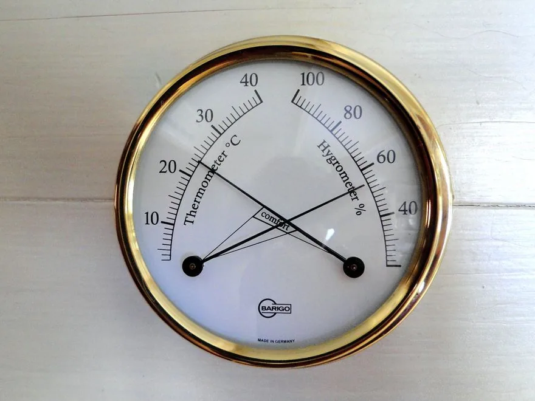
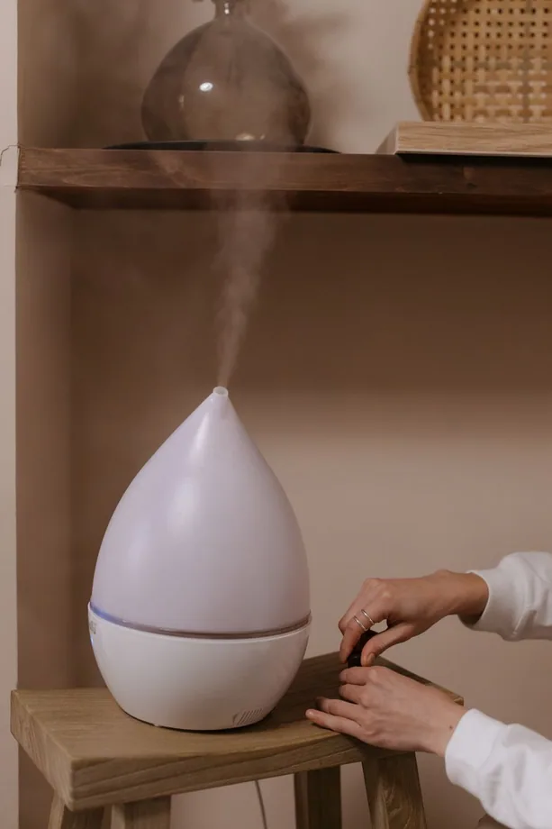
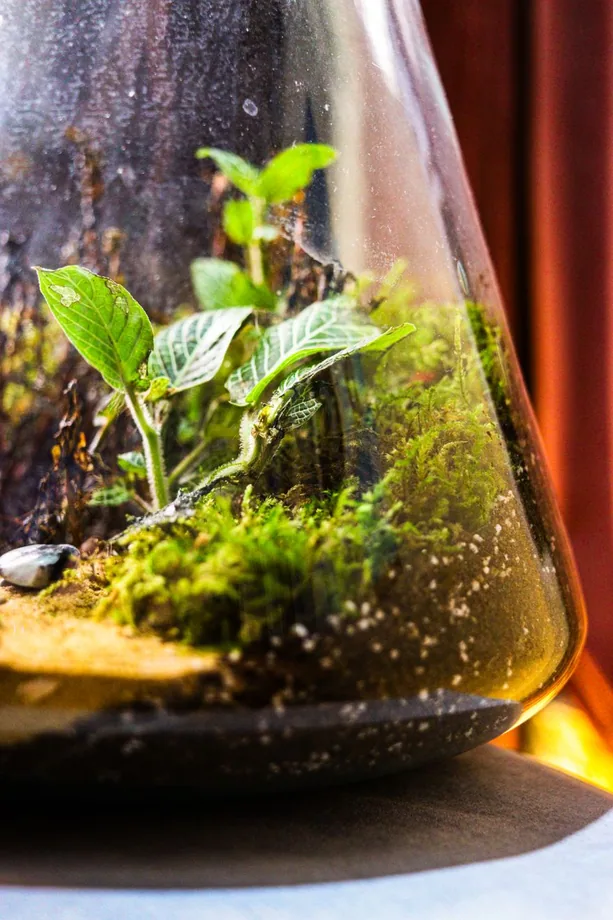

Walk into any plant shop and you will hear that tropical plants need humidity. You will also hear a long list of tricks to provide it: misting, pebble trays, plastic bags, terrariums, even moving into the bathroom. Some of those ideas help, some barely do anything, and some can cause more trouble than they solve. This guide sorts out what humidity is, which plants truly need more of it, and what works in a real home.

## What humidity means

Relative humidity is the amount of moisture in the air compared with the most it could hold at that temperature, shown as a percentage. Many homes sit around 30 to 50 percent, though it can drop well below that in winter when heating is on, and in air-conditioned rooms or dry climates. Rainforests, where many popular houseplants originate, are far more humid.

A simple hygrometer, a small digital device that costs very little, will tell you what your room's humidity really is. Measure it near your plants before deciding whether you need to do anything. Guessing is the main reason people spend effort fixing a problem that doesn't exist.

## Do all houseplants need high humidity?

No, and this is the most important point. Plants adapted to dry conditions, such as cacti, succulents and snake plants, don't want extra humidity at all, and too much can encourage rot and fungal problems. Many common foliage plants, such as pothos, philodendron, ZZ plant, rubber plant and spider plant, cope well with average household humidity.

The plants that usually struggle in dry air are the more demanding tropicals:

- **Calatheas and prayer plants**
- **Ferns,** such as Boston and maidenhair ferns
- **Some palms**
- **Fittonia (nerve plant)**
- **Orchids,** in many cases
- **Alocasia and some other aroids**

For these, low humidity can show up as brown, crispy leaf tips and edges, curling leaves, or slow growth. Iowa State Extension notes that the humidity in homes is often low, especially during winter, and names low humidity as the most likely cause of brown leaf tips on houseplants. It says that people can raise humidity levels by using a humidifier, a pebble tray, a terrarium, or by grouping plants together so their foliage holds more moisture.

But brown tips can have other causes too, as the University of California notes: overwatering, excessively dry soil, fertilizer or salts, and some mineral toxicities. Before blaming the air, check these too in the [brown leaf tips guide](/brown-leaf-tips-on-houseplants/).

## Ways to raise humidity, ranked by usefulness

### 1. A humidifier (most effective)

A room humidifier can change relative humidity enough to measure. Keep the mist clear of leaves, furniture and windows. Follow the manufacturer’s cleaning and water instructions, and keep the space at or below 50 percent relative humidity when humidifying, in line with US EPA guidance.

### 2. Grouping plants together

Plants release water vapor through their leaves, so a cluster of plants creates a slightly more humid pocket of air. Extension sources recommend grouping as a simple method. It is modest in effect, but free, and it also makes watering and care easier.

### 3. Choosing a naturally humid room

Bathrooms and kitchens usually have higher humidity because of showers and cooking. If the room has enough light, a bathroom windowsill can be a good home for ferns and calatheas. Remember that many bathrooms have little natural light, and light is more important than humidity. A fern in a dark bathroom will decline however humid it is.

### 4. Terrariums and cloches

Enclosed glass containers hold humidity very well. They are ideal for small plants that crave moist air, such as fittonia or small ferns. Make sure the container has some airflow, avoid direct sun, which can overheat it, and don't use it for plants that prefer dry conditions.

### 5. Pebble trays (small effect)

A tray filled with pebbles and water, with the pot sitting on top of the stones but not in the water, is often suggested. As the water evaporates, it adds a little moisture to the air right around the plant. In practice, the effect is small and confined to the area directly above the tray. It is harmless if you keep the pot out of the water, but don't count on it to fix a serious humidity problem.

### 6. Misting (very short-lived)

Misting is the most popular method, and the least effective. A fine spray raises humidity for only a few minutes before it disappears. It can also leave water sitting on leaves, which in poorly ventilated spots may encourage leaf spots and fungal problems in some plants. If you enjoy misting as a way to check on your plants, there's no harm in doing it occasionally, but don't rely on it as your humidity plan. One gardening site puts it plainly: avoid misting as your only humidity strategy.

## Other things that help dry-air plants

Humidity is only one part of the picture. These steps often matter just as much:

- **Water consistently.** Letting a plant dry out too far between waterings causes browning on its own, as Iowa State points out
- **Keep plants away from heaters, vents and drafts.** Hot, dry air blowing on leaves dries them quickly
- **Use filtered or rainwater for sensitive plants** such as calathea, prayer plant and spider plant. Iowa State lists chlorine and fluoride in tap water as a possible cause of tip burn on these species
- **Flush the soil** every few months to remove mineral build-up
- **Make sure the light is right,** because a plant in poor light is less able to cope with other stresses

## Humidity and pests

Dry air also encourages some pests. Spider mites, for example, are a greater problem during periods of high temperature and low humidity, according to Oklahoma State University extension. If your humidity-loving plants have dusty, speckled leaves, look closely for mites using the [houseplant pests guide](/houseplant-pests-spider-mites-mealybugs-scale/).

## Can humidity be too high?

Yes. Very humid, still air can encourage mildew, leaf spots and rot, especially in a closed room with poor airflow. Water that sits on leaves for long periods causes trouble for plants with fuzzy or thick leaves. Keep some ventilation, space plants so that air can move between them, and use a hygrometer to avoid going overboard.

## A simple plan

1. **Measure your humidity** with a hygrometer next to the plants
2. **Identify which plants really need more.** If you only have pothos, snake plants and succulents, you may not need to do anything
3. **Group the humidity-loving plants** in one bright spot, away from vents and heaters
4. **Add a humidifier** if the readings are low and the plants show stress
5. **Water consistently and use better water** for sensitive plants
6. **Check results over a month.** New leaves should come in healthier. Old damaged leaves won't recover

## Measure the shelf where the leaves actually sit

A thermometer and hygrometer on the other side of the room can miss what a plant experiences beside a window or above a radiator. I would place the sensor around the height of the leaves, out of direct sun and clear of mist. Check it before the heating comes on, while the room is warm, and later in the evening. Repeat for a few days, ideally including a laundry day or a day you open the windows. This gives you a range and tells you which event is responsible for the lowest readings.

For example, a fern on a shelf can see lower readings whenever the heater runs, while a meter near the kitchen sink hardly changes. If the fern has crisp edges and the pot repeatedly goes very light and dry, the root zone needs attention too. Move the fern away from the hot airflow to a spot with comparable light and reassess. If the dry edges keep appearing on new fronds, and the measured humidity remains low, then a humidifier or another well-lit room may be worth trying.

Check the bathroom at mid-afternoon before you move an entire collection there. A shower raises humidity temporarily. The same room can have a low reading once the fan clears it and can stay too dark even if it is consistently more humid. A plant on a bathroom windowsill needs usable light, appropriate temperature and a manageable watering routine.

Compare readings before and after heat or ventilation comes on. Photo by [Peter Klauss on Pexels](https://www.pexels.com/photo/thermometer-and-hydrometer-in-golden-frame-3726313/).

## Operate a humidifier without soaking the shelf

Place it where the airflow can mix with the room air, beyond the reach of children and pets. Keep the jet away from the plant leaves, windows, power outlets and shelves. Let the meter sit outside that plume. Start with a modest setting, then check whether the shelf actually gets less dry. The US EPA advises keeping indoor relative humidity at or below 50 percent when humidifying. If moisture condenses on windows or walls, reduce the setting or run time even if your plant's reading looks acceptable. [US EPA home humidifier guidance](https://www.epa.gov/indoor-air-quality-iaq/use-and-care-home-humidifiers).

The EPA also recommends emptying and refilling portable units daily and cleaning them every three days. Follow your device instructions for disassembly, cleaning and suitable water. An ultrasonic or impeller model can disperse minerals as fine dust when filled with mineral-rich water. Distilled water is an option the agency offers for reducing mineral dispersal. If the room already has a damp patch, address its cause before adding moisture to help one plant.

This is where a fan or spacing can help without creating a draft at the leaves. Allow air to travel between pots and give the group enough room for inspections. A humidifier should make the air a little less dry. Wet leaves, a damp shelf or readings that only rise when you hold the meter directly in the mist tell you the setup needs adjustment.

Direct mist away from leaves, windows and furniture. Photo by [cottonbro studio on Pexels](https://www.pexels.com/photo/humidifier-on-wooden-stool-7417506/).

## Make a humid spot for one small plant

For a small humidity-loving plant you can use a well-lit open terrarium or a partially vented enclosure when the species suits it. Check how the pot drains inside and leave room for air around the leaves. Watch daily at first. Persistent heavy condensation, water at the bottom or leaves pressing against the wet walls are signs to ventilate and reconsider the size of the enclosure. Keep it out of direct sun, since glass can let temperatures rise rapidly inside. Give a dry-loving plant a place outside the enclosure.

If the growing spot is genuinely limiting and the room cannot take more moisture, swapping plant positions may do more than buying equipment. Put the fern or prayer plant at the spot you actually measured, and move the snake plant to the drier shelf if the light and temperature suit it. Label the date on a photo of the new growth. Damaged edges stay visible, so look for cleaner new leaves over the following growth cycles.

A ventilated enclosure can help a single humidity-loving plant. Photo by [Mr.  Pugo on Pexels](https://www.pexels.com/photo/vibrant-terrarium-with-lush-greenery-35451963/).

## Take readings when the weather changes

Save your usual readings so you have something to compare against after a cold spell or a week of air conditioning. A humidity change that appears only while a room warms up may resolve when the heating stops or when you move the pot out of the direct airflow. If the change lasts all day, repeat your leaf-height measurements and compare your plant with another of the same species in a different spot. Different species can respond so differently that they make a poor comparison.

Plan where water goes at the end of each day. Drain the humidifier as directed, keep runoff away from window frames, and clean any standing water in saucers. In an enclosed plant cabinet, leave space between the foliage and the walls and check the back panel for condensation. If a shelf needs frequent wiping to stay dry, adjust the enclosure and let the plants establish at a lower setting. [Iowa State Extension tips for indoor plant humidity](https://yardandgarden.extension.iastate.edu/faq/how-can-i-raise-relative-humidity-indoors-my-houseplants).

## Quick summary

- Not every houseplant wants high humidity: cacti, succulents and snake plants prefer dry air
- Calatheas, ferns, fittonia and some palms struggle in dry air
- A humidifier is the most effective tool. Grouping plants and a humid room help a little
- Pebble trays have a small effect and misting a very short one
- Always rule out watering, salts and water quality before blaming humidity

## Final thoughts

Humidity matters, but only for some plants, and only after the basics of light and watering are right. Measure first, choose methods that actually work, and don't be discouraged if some plants do better than others. Choosing plants that suit the air in your home is often the easiest solution of all.

## Sources and further reading

- US Environmental Protection Agency, [Use and care of home humidifiers](https://www.epa.gov/indoor-air-quality-iaq/use-and-care-home-humidifiers)

- Iowa State University Extension, [Why does my houseplant have brown leaf tips and edges?](https://yardandgarden.extension.iastate.edu/faq/why-does-my-houseplant-have-brown-leaf-tips-and-edges)
- University of California IPM, [Houseplant Problems](https://ipm.ucanr.edu/home-and-landscape/houseplant-problems/)
- Oklahoma State University Extension, [Houseplant Pests](https://extension.okstate.edu/announcements/horticulture-tips/hort-tips-2026/mid-to-late-october/house-plant-pests)
- University of Missouri, [Houseplant problems: an environmentally sensitive approach](https://ipm.missouri.edu/meg/2019/1/houseplantProblems/index.cfm)
