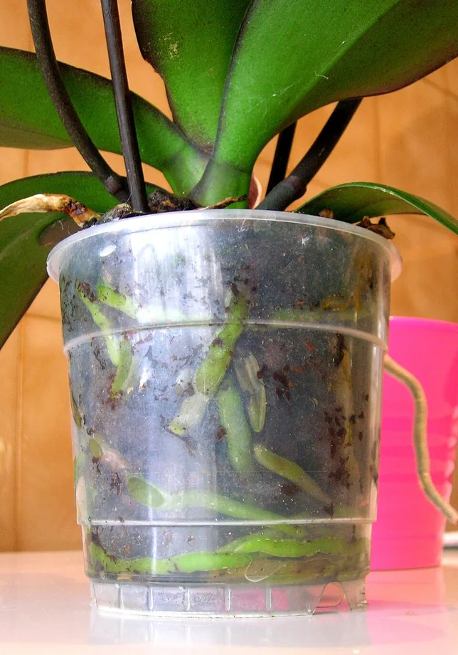
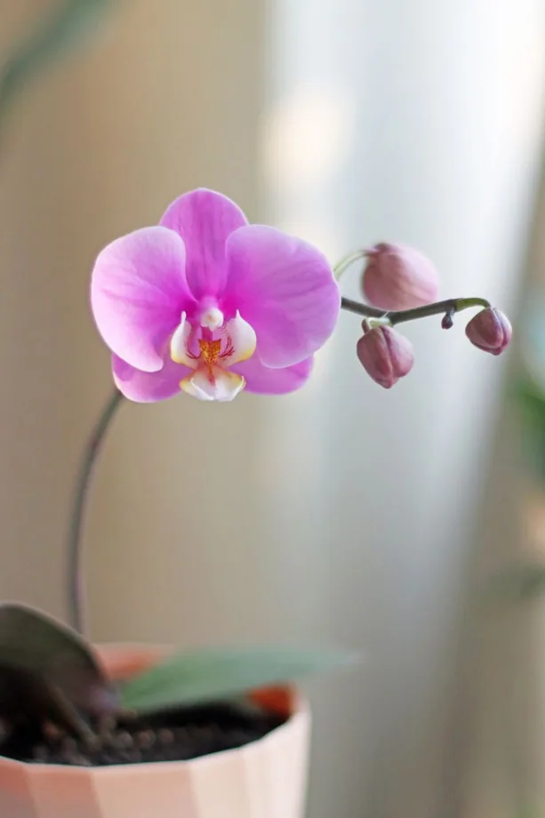
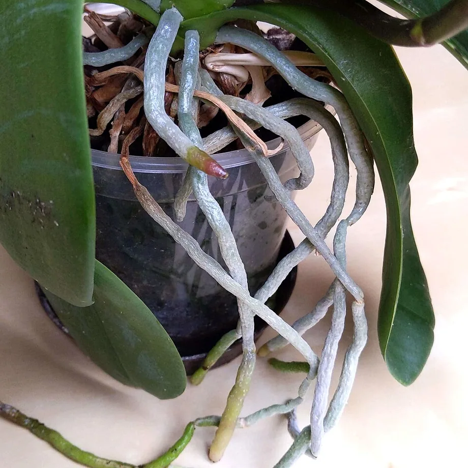

Orchids are the plant people buy on impulse and then worry about. They show up at the supermarket checkout in full bloom, they get handed over as gifts, and then three weeks later the flowers fall off and you are left staring at a pot with a few flat leaves and a lot of strange roots, wondering whether you have already failed.

You have not failed. The orchid you almost certainly own is a moth orchid (Phalaenopsis), and it is the easiest orchid to grow in a normal home. It is also the one people ask about most. When a UK nursery looked at a year of Google search data (September 2025 to September 2026), it reported that orchid care questions outnumbered every other houseplant question by a wide margin, with the nursery's founder noting that orchids get gifted and then people do not know what to do with them. If you are one of those people, this guide is for you.

Here is what we will cover: what makes a moth orchid different from other houseplants, how to water without drowning it, how much light it needs, what to do after the flowers drop, how to encourage a new flower spike, and the mistakes that kill most orchids. Where I cite advice, it comes from university extension services and a botanic garden, and the links are at the end if you want to read the originals.

## Why orchids are different from most houseplants

Most houseplants grow in soil, with roots buried in it. Moth orchids do not. In the wild, Phalaenopsis grow on tree trunks and branches in warm tropical regions, clinging to the bark and sending roots into the air. University of Maryland Extension describes them as plants that hang on tree bark and send aerial roots along the stem. That explains almost everything about how they behave in your living room:

- They are **potted in bark, not soil.** The chunky bark lets air reach the roots and water drain quickly
- Their roots **like air.** Thick silvery-green roots growing over the edge of the pot are normal
- They have **no water-storing bulbs.** Many orchids store water in swollen stems called pseudobulbs, but Phalaenopsis do not, so Maryland Extension notes that low humidity and too little water will make the leaves wrinkle
- They **flower on a spike** that grows from between the leaves

If you treat a moth orchid like a normal pot plant, watering a little every few days, the roots rot. If you treat it like a tree-dweller that gets a heavy rain followed by a dry spell, it does very well.

## Watering: the part that kills most orchids

Every source I read agrees on this one. Clemson Extension says that one of the fastest ways to kill an orchid is to let it sit in a waterlogged pot. The University of Illinois Extension says overwatering is by far the easiest way to kill one. Cambridge University Botanic Garden says the key to healthy orchids is to avoid overwatering them, using a wet and dry cycle that lets the roots dry before watering again, but without letting them completely shrivel.

So what does that mean in real terms?

**Use the roots as your guide.** If your orchid is in a clear plastic pot (most supermarket ones are), look at the roots. Healthy roots that have recently been watered look green. Roots that need water look silvery-grey or white. When the roots are silvery and the bark feels dry, it is time to water.

**Water thoroughly, then let it drain.** University of Maryland Extension suggests running warm water over the plant, bark and aerial roots in several drenches over about ten minutes so the water is absorbed gradually. The University of Vermont Extension gives a simpler version: use room-temperature water when the potting material is dry, give the plant a good watering and let the excess drain out of the pot.

**Do not let it sit in water.** If the pot is inside a decorative cover pot, lift it out after watering and let it drain before putting it back. A saucer full of water under the pot is the same problem.

**How often?** One extension blog from the University of Illinois says once a week is about right for most orchids, while Clemson says that plants in clay or small pots or in open bark may need watering up to twice a week. In practice the frequency depends on your pot, your bark, your temperature and your light, so do not follow a fixed calendar. A rough starting point is once a week in a warm room and every ten to fourteen days in a cool room, then adjust using the roots.

**What about ice cubes?** You will see advice to put a few ice cubes on the bark once a week. The Illinois Extension blog mentions this as a convenient method, but University of Maryland Extension and the other sources recommend a proper drench, which wets the roots evenly and flushes out salts. I would go with the drench.

**Misting does very little.** Maryland Extension says misting an orchid usually does not provide enough moisture under indoor home conditions. If you want to raise humidity for your orchid and other plants, see our [guide to humidity for houseplants](/humidity-for-houseplants/).

A clear inner pot lets you see moisture and roots between waterings. Photo by Javier Mediavilla Ezquibela, [Tiesto transparente phalaenopsis.JPG](https://commons.wikimedia.org/wiki/File:Tiesto_transparente_phalaenopsis.JPG), [CC BY 2.5](https://creativecommons.org/licenses/by/2.5). Resized for the web.

## Light: bright but never harsh

Moth orchids are woodland plants that would normally sit under a tree canopy, so they like bright light without direct sun. University of Maryland Extension recommends indirect light from an east or west window, and notes that in the short days of winter they can even go in a south window. Clemson Extension says they adapt well to indoor light and perform best in a bright window with little or no direct sun, such as an east window. UConn Extension suggests a sheer curtain in front of south or west windows to soften the light.

You can read the leaves like a gauge. According to Maryland Extension:

- **Light green leaves** mean the plant is getting about the right amount
- **Dark green, stiff leaves** mean the light is too low
- **Reddish or pink edges, or yellow-green leaves** mean the light is too strong

That last part matters, because low light is the most common reason an orchid will not flower again. Maryland Extension says the most common cause for not flowering is low light levels, and UConn Extension also says low light prevents reblooming.

If you do not have a bright window, a grow light works. Clemson Extension says artificial light can be the only light source for Phalaenopsis, with fixtures placed 6 to 12 inches above the leaves and run for 12 to 16 hours a day, following natural day length. That recommendation uses fluorescent tubes. Modern LED grow lights are the usual choice today, so follow the distance and timing instructions on the light you buy. Our [winter houseplant care guide](/winter-houseplant-care/) has more on using lights when the days get short.

## Temperature

Moth orchids are happy at normal room temperatures. The University of Vermont Extension puts the preferred range at 65 to 75 degrees Fahrenheit (about 18 to 24 degrees Celsius) with bright, indirect light. Cambridge Botanic Garden says Phalaenopsis grow best above 18 degrees Celsius. Keep them away from cold drafts and heater vents, which will drop buds and flowers.

## Potting mix and pots

Do not plant a moth orchid in regular potting soil. It will stay wet and the roots will rot. Orchids need a coarse, open mix, usually fir bark, sometimes with sphagnum moss or perlite. Cambridge Botanic Garden recommends coarse bark, and UConn Extension suggests a porous pot such as unfinished terracotta, or pots with holes in the sides, to let air reach the roots, while stressing that drainage holes are a must.

A clear plastic pot inside a decorative cover pot is a good setup. It lets you see the roots, and it makes watering easy to judge.

## Feeding

Orchids do not need much fertilizer, and sources differ on exactly how much. That is a useful reminder that there is no single right answer:

- University of Vermont Extension suggests an orchid fertilizer according to package directions, or a urea-free houseplant fertilizer at half strength once a month when watering, or at one-quarter strength with each watering
- University of Maryland Extension says to fertilize actively growing and flowering plants every third or fourth watering with a commercial orchid fertilizer, and to skip fertilizing in the cooler, darker winter months. It also warns that overfeeding often produces lush leaves at the expense of flowers
- UConn Extension recommends fertilizing every two weeks in spring, summer and fall for orchids in bark, using a higher nitrogen formula

The common thread is simple: feed lightly, only when the plant is growing, and never feed a sick plant or one with rotting roots. If you are not sure, go lighter. You can read more about feeding houseplants in our [fertilizing guide](/how-to-fertilize-houseplants/).

## What to do when the flowers fall

This is the moment most people give up, and it is where most of the advice you find online gets confusing. Moth orchid flowers can last for a month or two. When they drop, you have a few options for the flower spike, depending on its colour.

According to the University of Vermont Extension, once the stem begins to turn brown and die on its own, you can cut it back to where it meets the leaves, and keep caring for the plant as usual. If the spike is still green, University of Maryland Extension suggests watching the old spike closely for signs of new buds, because Phalaenopsis tend to form new flowering branches along old spikes. A common approach is:

1. **If the spike is green,** leave it. Look for a small bump (a node) lower on the spike. A new flower branch may grow from it
2. **If the spike is turning brown or yellow,** cut it off near the base with clean scissors
3. **Keep watering and giving good light.** The plant now spends a few months growing leaves and roots, which is normal

Clemson Extension notes that orchids rest after flowering, and watering should be reduced at that time. In practice, that means letting the bark dry a little more between waterings, not stopping altogether.

## How to get a moth orchid to bloom again

This is the part everyone wants to know. The honest answer is that it takes patience and the right conditions, and it may take several months.

**Give it enough light.** This is the most important factor, as both Maryland and UConn extension sources say.

**Give it cooler nights.** The University of Illinois Extension says that moth orchids need nights of around 55 to 65 degrees Fahrenheit and days of 70 to 80 degrees for six to eight weeks before a flowering stalk will appear. Cambridge Botanic Garden suggests reducing watering during winter or moving the orchid to a cooler place in the house, and says a new flower stalk should emerge within weeks afterward. A spot near a window that gets cooler at night can provide this.

**Do not overfeed.** Too much nitrogen can push leaves instead of flowers.

**Be patient.** UConn Extension says new flowers are generally produced in six to nine weeks once conditions are right. For many people, a rebloom comes six to twelve months after the first flowering.

If your orchid has healthy green leaves and roots and has not rebloomed after a year, the first thing to change is the light.

Watch new buds and protect the plant from temperature swings while it blooms. Photo by [Amelia  Cui on Pexels](https://www.pexels.com/photo/purple-moth-orchids-in-bloom-6974685/).

## Repotting

Moth orchids do not need repotting often. Every one to two years, or when the bark has broken down into soggy mush or the roots are overflowing, is usually enough. The best time is after flowering, when new roots start to grow. The steps are:

1. Gently remove the plant and shake off the old bark
2. Cut away roots that are brown, mushy or hollow, using clean scissors. Healthy roots are firm, and plump when wet
3. Place the plant in fresh orchid bark in a pot only slightly larger, with drainage holes
4. Water lightly and wait a few days before a full watering

UConn Extension has an Orchid Care and Repotting factsheet with photos if you would like to see each step. For general repotting rules that apply to other plants, see our [repotting guide](/how-to-repot-a-houseplant/).

It is normal for moth orchids to grow roots above the mix. Photo by Nefronus, [Aerial roots.jpg](https://commons.wikimedia.org/wiki/File:Aerial_roots.jpg), [CC BY-SA 4.0](https://creativecommons.org/licenses/by-sa/4.0). Resized for the web.

## Common problems

**Wrinkled, leathery leaves.** Usually thirsty roots, rotted roots that can no longer take up water, or very low humidity. Check the roots before you water more.

**Yellow lower leaf.** One old lower leaf yellowing and dropping every so often is normal. Several leaves yellowing quickly usually points to overwatering.

**Brown, mushy roots.** Root rot. Cut away the rotten roots, repot in fresh bark and water more carefully. UConn Extension says root, stem and leaf rots from poorly drained media and overwatering are common orchid problems, and advises not fertilizing diseased plants. Our [root rot guide](/root-rot-in-houseplants/) covers the steps in detail, and the same approach works for orchids.

**Buds falling off before opening.** Often caused by a sudden change in temperature, drafts, or being moved.

**White fluffy bits on leaves or between leaves.** Mealybugs. See our guide to [spider mites, mealybugs and scale](/houseplant-pests-spider-mites-mealybugs-scale/).

**Silvery aerial roots growing out of the pot.** This is normal. Do not cut healthy roots.

## Are moth orchids safe for pets?

The ASPCA lists the moth orchid (Phalaenopsis) as non-toxic to cats and dogs, which is one reason it appears on many pet-safe plant lists. You can check any plant yourself with the ASPCA's searchable list, linked below. Our [pet-safe houseplants guide](/pet-safe-houseplants/) has more.

## A simple routine to follow

- **Check the roots once or twice a week.** Water when they look silvery and the bark is dry
- **Soak, drain, return.** Never leave the pot standing in water
- **East window or filtered bright light,** or a grow light
- **Feed lightly** during active growth, and skip winter
- **After flowering,** cut a brown spike, or wait on a green one
- **Give cooler nights in autumn or winter** if you want a new spike
- **Repot only when the bark breaks down** or roots take over

## Frequently asked questions

**Why are the roots growing out of the pot?** That is how orchids grow. Aerial roots are normal and healthy.

**Should I put my orchid in the bathroom?** Only if the room has good light. Humidity helps, but light is more important.

**Is it okay to buy an orchid with no flowers?** Yes. Check that the leaves are firm and the roots are plump and green or silvery, not brown and soft.

**How long do moth orchids live?** With good care they can live for many years, and bloom once or twice a year.

## Check the inner pot when you bring an orchid home

I would take the nursery pot out of its decorative container and inspect it in good light before watering. Check for drainage holes, the condition of the roots and whether it is packed with bark or moss. Notice whether there is standing water below the inner pot. Look for puffed, firm roots near the clear walls and any soft leaves or crown damage. A few roots sticking out over the rim are usual for a moth orchid and can stay in place.

A plant in coarse bark dries differently from one in dense sphagnum moss. You might buy two equally healthy orchids with identical flower colors and find that only one is ready to water after a week. Lift each pot, examine its medium and roots, and establish their individual timing. If you need to repot a healthy flowering plant, waiting until it finishes is generally easier. Decaying medium or actively rotting roots may need earlier attention. [University of Maryland Extension moth orchid care](https://www.extension.umd.edu/resource/care-phalaenopsis-orchids-moth-orchids).

## Final thoughts

An orchid is not a fragile, difficult plant. It is a tree-dweller that wants bright light, air around its roots and a drink only when it is dry. Get those three things right, be patient after the flowers fall, and most people find that the plant they thought they had already killed is quietly growing a new spike.

## Sources and further reading

- University of Maryland Extension, [Care of Phalaenopsis Orchids (Moth Orchids)](https://www.extension.umd.edu/resource/care-phalaenopsis-orchids-moth-orchids)
- Clemson Cooperative Extension, [Orchids](https://hgic.clemson.edu/factsheet/orchids/)
- University of Vermont Extension, [Growing orchids](https://www.uvm.edu/extension/news/growing-orchids)
- University of Illinois Extension, [Orchids: give them a try](https://extension.illinois.edu/blogs/know-how-know-more/2018-01-23-orchids-give-them-try) and [Phalaenopsis: beautiful, picky](https://extension.illinois.edu/blogs/flowers-fruits-and-frass/2018-11-30-phaleonopsis-beautiful-picky)
- Penn State Extension, [Orchids as houseplants](https://extension.psu.edu/orchids-as-houseplants)
- Cambridge University Botanic Garden, [How to care for orchids](https://www.botanic.cam.ac.uk/how-to-care-for-orchids)
- ASPCA, [Toxic and non-toxic plants](https://www.aspca.org/pet-care/aspca-poison-control/toxic-and-non-toxic-plants)
