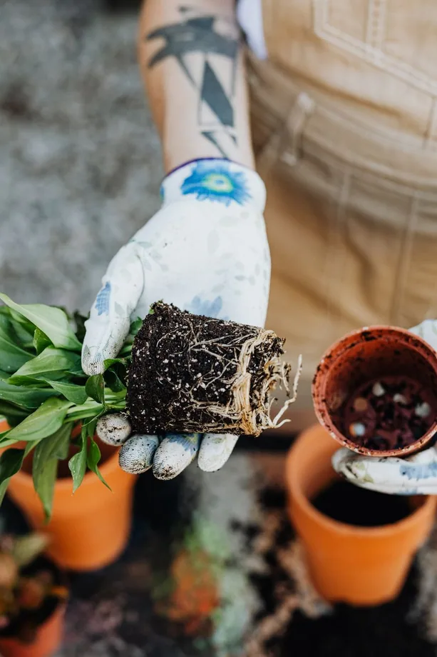
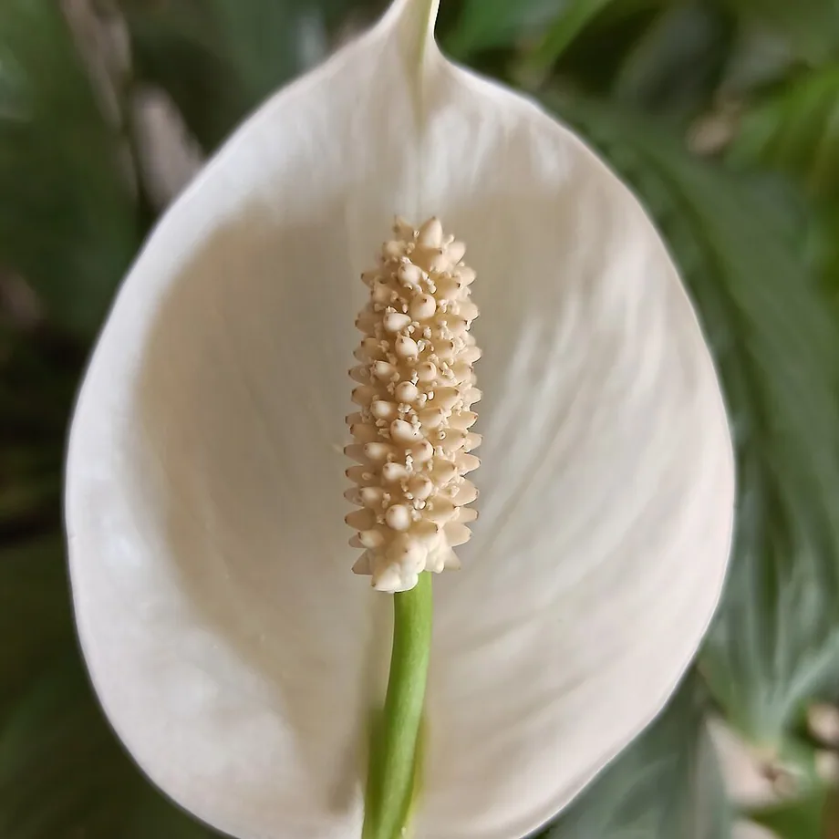
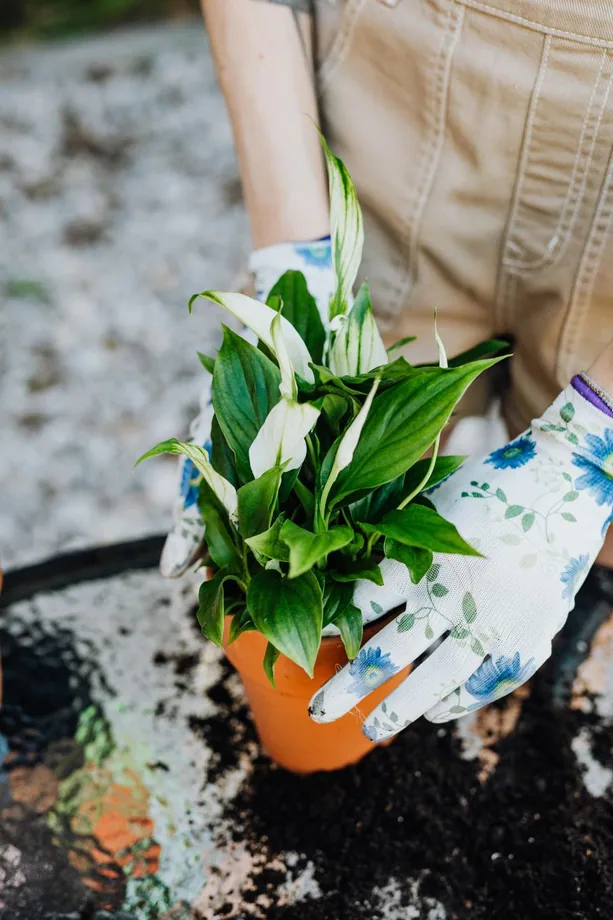

A peace lily has a habit that frightens new owners. One day it looks perfect, with glossy dark leaves and a white flower standing up like a little sail. A few days later it has collapsed. Every leaf is hanging over the edge of the pot as if the plant has given up. You water it, and a couple of hours later it is standing tall again as if nothing happened.

That dramatic wilting is why "why is my peace lily drooping" is one of the most searched houseplant questions around. A UK company that analysed Google Keyword Planner data for plant care questions found it was the most popular question in their study, and a nursery that looked at a full year of searches also listed peace lily care in its top ten. If your plant is doing the same thing, you are in good company, and the fix is usually easy.

This guide explains why peace lilies droop, how to water one properly, what to do about brown tips and yellow leaves, how to get it to flower, when to repot, and whether it is safe around pets.

## What a peace lily is

Peace lilies belong to the genus Spathiphyllum. The common species, Spathiphyllum wallisii, is native to Colombia and Venezuela according to the NC State Extension Gardener Plant Toolbox, which also lists several cultivars from small plants about a foot tall to the large 'Sensation', which can reach over five feet. The plant's "flower" is actually a white leaf-like bract (the spathe) wrapped around a spike of tiny true flowers.

Two things to remember: peace lilies come from warm, humid forest floors, so they like moisture, warmth and gentle light. And despite the name, they are not true lilies. That matters for pet safety, which we will come to.

## Why a peace lily droops

The answer is nearly always water. Here are the possibilities in order of how common they are.

### 1. It is thirsty (the most common cause)

South Dakota State University Extension says drooping or wilting happens when the plant is not receiving enough water. The Old Farmer's Almanac describes the common reason as thirst, noting that peace lilies wilt quickly when the soil dries out but perk up within hours of watering. White Flower Farm says the same, adding that if the soil feels dry a few inches down, you should water thoroughly.

If your plant has gone floppy and the soil is dry, give it a long drink. Take it to the sink, water until it runs out of the bottom, and let it drain. In most cases the leaves lift within a few hours. Some people like to wait for a slight droop before watering, since it is such a clear signal, but I would not make a habit of letting it collapse completely. Repeated hard wilting can leave brown tips and weaken the plant over time.

### 2. It is overwatered

This is the trap. An overwatered peace lily can also droop, which makes people water it more. White Flower Farm notes that an overwatered plant may droop too, though less dramatically. The difference is in the soil and the leaves:

- **Thirsty:** soil dry, leaves droop suddenly but are still green, plant recovers within hours of watering
- **Overwatered:** soil wet or soggy, leaves yellowing, droop does not improve after watering, sour smell, possibly black or mushy roots

If the soil is wet and the plant is drooping, stop watering and check the roots. Healthy roots are firm and light-coloured. Rotten roots are dark and soft. If you find rot, see our [root rot guide](/root-rot-in-houseplants/) for what to do. For a general approach to working out why any plant droops, our [drooping houseplant guide](/why-is-my-houseplant-drooping/) walks through each cause.

### 3. The pot is too small or the plant is rootbound

If the plant wilts again within a couple of days of watering, the roots may have filled the pot so completely that there is not enough soil to hold water. Look for roots coming out of the drainage holes. If so, it needs repotting, which we cover below and in our [repotting guide](/how-to-repot-a-houseplant/).

### 4. Cold, heat or a sudden change

Peace lilies dislike cold drafts, heating vents and sudden moves. If the plant droops after you changed its location or opened a cold window nearby, give it stable conditions and wait.

## How to water a peace lily

Peace lilies like their soil evenly moist but not soggy. That is a phrase that gets repeated everywhere and is not very helpful, so here is what it means in practice:

1. **Check the soil.** Push a finger two inches into the soil. If it is dry at that depth, water. If it is damp, wait a day or two. The Almanac and White Flower Farm both suggest checking the soil with a finger, and watering thoroughly if it feels dry
2. **Water until it drains,** then empty the saucer
3. **Use room-temperature water.** Cold water can shock the roots
4. **Do not let it sit in water.** Peace lilies are prone to root rot
5. **Adjust for the season.** In winter, with less light, the plant will use less water. See our [winter care guide](/winter-houseplant-care/)

In a warm, bright room in summer, expect to water about once a week. In a cooler room or in winter, every ten to fourteen days may be enough. Use the soil, not the calendar, to decide.

If your tap water is hard or heavily treated and you see brown tips, try filtered or rainwater for a few months to see if it helps.

Look at the roots when a peace lily keeps drooping while the mix is wet. Photo by [kaboompics on Pexels](https://www.pexels.com/photo/person-holding-a-small-spathiphyllum-plant-4751965/).

## Light

Peace lilies are among the best flowering plants for lower light, but "low light" does not mean "no light". The Almanac says they thrive in bright, indirect light, and one plant care sheet says to put them in a north window or set back from a sunny window, since direct sun can scorch the leaves.

- **Bright, indirect light** (near an east window, or a few feet from a south or west window): best for growth and flowers
- **Low light:** the plant survives and stays green, but it will rarely flower and may become leggy
- **Direct midday sun:** can cause yellow or brown scorched patches

If your plant has lush dark leaves but never flowers, it is probably getting too little light.

## How to get a peace lily to flower

Peace lilies flower when they are mature, healthy and receiving enough light. A few practical steps:

- **Move it to brighter, indirect light.** This is the most effective change
- **Keep watering consistent.** Plants stressed by repeated wilting rarely flower
- **Feed lightly in spring and summer.** A balanced houseplant fertilizer at half strength about once a month is plenty. More is not better, and overfeeding is a common cause of brown tips. See our [fertilizing guide](/how-to-fertilize-houseplants/)
- **Repot if rootbound,** but only into a slightly larger pot, since peace lilies often flower better when slightly snug
- **Be patient.** A plant that has been in low light may take several weeks of better conditions before a flower bud appears

After the flower fades and turns green or brown, cut the stalk off at the base to keep the plant tidy.

The white spathe surrounds the spike of tiny flowers called the spadix. Photo by Juan Carlos Fonseca Mata, [Spathiphyllum wallisii (Family Araceae) - spadix and spathe I.jpg](https://commons.wikimedia.org/wiki/File:Spathiphyllum_wallisii_%28Family_Araceae%29_-_spadix_and_spathe_I.jpg), [CC BY-SA 4.0](https://creativecommons.org/licenses/by-sa/4.0). Resized for the web.

## Brown tips and yellow leaves

**Brown tips.** Brown leaf tips are very common on peace lilies. Birds & Blooms lists possible causes as overwatering, temperature extremes, lack of water or overfertilizing. Other causes include dry air, minerals in tap water and fertilizer salt build-up. We cover each in our [brown leaf tips guide](/brown-leaf-tips-on-houseplants/). A quick routine: check your watering, flush the soil with plain water, stop fertilizing for a month or two and move the plant away from heaters. Trim brown tips with clean scissors.

**One or two yellow leaves.** Old outer leaves yellow and die naturally. Remove them at the base.

**Many yellow leaves.** Usually overwatering, poor drainage or root problems. Check the roots and the soil.

**Pale, washed-out leaves.** May be too much sun. Move the plant back from the window.

**Dull leaves covered in dust.** Wipe them gently with a damp cloth every month or so. This helps the plant absorb light and lets you inspect for pests.

## Repotting

Peace lilies do not need frequent repotting. Every one to two years in spring is typical, or sooner if roots are crowded. Signs include roots coming out of the drainage holes, water running straight through, and wilting soon after watering.

Choose a pot one size larger, with drainage holes, and a light, well-draining potting mix. The Almanac says that if water runs straight through to the saucer, the soil is too sandy, and the mix should be well-draining and porous. A peace lily can also be divided at repotting time: if the plant has several crowns, gently pull or cut them apart and pot each separately. Water well afterwards and skip fertilizer for a month or two.

Use a container that drains and fits the plant’s root mass. Photo by [kaboompics on Pexels](https://www.pexels.com/photo/person-holding-plant-in-a-pot-4751967/).

## Pests

Peace lilies can attract spider mites, mealybugs and scale, especially in dry heated rooms. Check the leaf undersides and the base of the stems when you water. If you find any, follow the steps in our [pests guide](/houseplant-pests-spider-mites-mealybugs-scale/).

## Are peace lilies toxic to cats and dogs?

Yes, mildly. South Dakota State University Extension notes that all parts of the plant contain calcium oxalate. If chewed, the sharp crystals can cause mouth irritation, drooling, vomiting and difficulty swallowing in cats, dogs and people. It is not considered as dangerous as a true lily, but it is not safe to let pets chew on it.

This is where the name causes confusion. True lilies (Lilium species) and daylilies are extremely dangerous to cats, even in small amounts, and the ASPCA warns about them in its toxic plant list. Peace lilies are a different plant with a different, milder toxin. Even so, if you have a cat, the safest choice is to keep the plant out of reach or choose a pet-safe alternative. You can check any plant on the ASPCA's list, and our [pet-safe houseplants guide](/pet-safe-houseplants/) suggests alternatives.

If your pet has chewed a peace lily, separate it from the plant and contact your veterinarian or an animal poison control service promptly. Do not force water, induce vomiting or give home remedies unless a veterinarian instructs you to. Difficulty breathing or swallowing requires urgent veterinary care. Keep a photo or label of the plant for identification; suspected exposure to true lilies or daylilies in cats is an emergency even before symptoms appear. See the [ASPCA peace lily toxicity listing](https://www.aspca.org/pet-care/aspca-poison-control/toxic-and-non-toxic-plants/peace-lily) and our [pet-safe houseplants guide](/pet-safe-houseplants/).

## Check how evenly the root ball absorbs water

If the leaves droop and the pot feels light, put the nursery pot over the sink and water slowly. In a dry, contracted root ball, part of that water may escape down the sides immediately. Give the surface a few moments to absorb the first pass, then water again and let excess drain. Lift the pot and compare what you feel. A meaningful gain in weight tells you water reached more of the mix. Empty the cover pot and keep the plant in its usual light while you watch for a response.

If the leaves remain limp, repeat the moisture check before pouring in more. A pot that is now wet throughout and contains a firm crown needs some time. If a wet pot smells sour or if new stalks grow soft at their bases, inspect the roots. With a recently divided peace lily, the smaller root mass can take time to support the foliage. Use a pot that fits the division, watch the mix carefully and delay feeding until it is growing again. [South Dakota State University Extension peace lily guide](https://extension.sdstate.edu/peace-lily-houseplant-how).

When the plant is steady, use its healthy appearance to set a baseline. Photograph where the leaf stalks sit after normal watering, and note how the pot feels as it approaches the next one. If a mature plant produces healthy leaves but no flowers, a change in light is a better test than repeatedly allowing it to wilt.

## Quick care summary

- **Light:** bright, indirect. Tolerates low light but flowers less
- **Water:** when the top inch or two is dry. Drooping plus dry soil means water
- **Soil:** light, well-draining mix, pot with drainage holes
- **Feeding:** half strength, monthly in spring and summer
- **Repotting:** every one to two years, one size up
- **Pets:** mildly toxic to cats, dogs and people

## Frequently asked questions

**How quickly does a drooping peace lily recover?** If thirst is the cause, usually within a few hours of a thorough watering.

**Can I mist my peace lily?** You can, but it only raises humidity briefly. Grouping plants or using a humidifier is more effective. See our [humidity guide](/humidity-for-houseplants/).

**Does a peace lily clean the air?** You will see this claim often. It originates from small sealed-chamber experiments, and in a real home with normal ventilation the effect is too small to notice. Grow it because it looks good, not as an air purifier.

**Why are the leaf edges turning black?** Often overwatering, cold damage or fertilizer burn. Check the soil and roots.

## Final thoughts

A peace lily tells you what it needs, loudly. Use that. Learn to read the droop, check the soil before you water, and give it bright, indirect light. You will find it is one of the most forgiving flowering houseplants you can own.

## Sources and further reading

- ASPCA, [Peace lily toxicity listing](https://www.aspca.org/pet-care/aspca-poison-control/toxic-and-non-toxic-plants/peace-lily)
- ASPCA, [Which lilies are toxic to pets?](https://www.aspca.org/news/which-lilies-are-toxic-pets)

- South Dakota State University Extension, [Peace lily houseplant: how to grow and care](https://extension.sdstate.edu/peace-lily-houseplant-how)
- NC State Extension Gardener Plant Toolbox, [Spathiphyllum](https://plants.ces.ncsu.edu/plants/spathiphyllum)
- The Old Farmer's Almanac, [Peace lily care](https://www.almanac.com/plant/peace-lily-care)
- White Flower Farm, [Peace lily care](https://www.whiteflowerfarm.com/peace-lily-care)
- ASPCA, [Toxic and non-toxic plants](https://www.aspca.org/pet-care/aspca-poison-control/toxic-and-non-toxic-plants)
