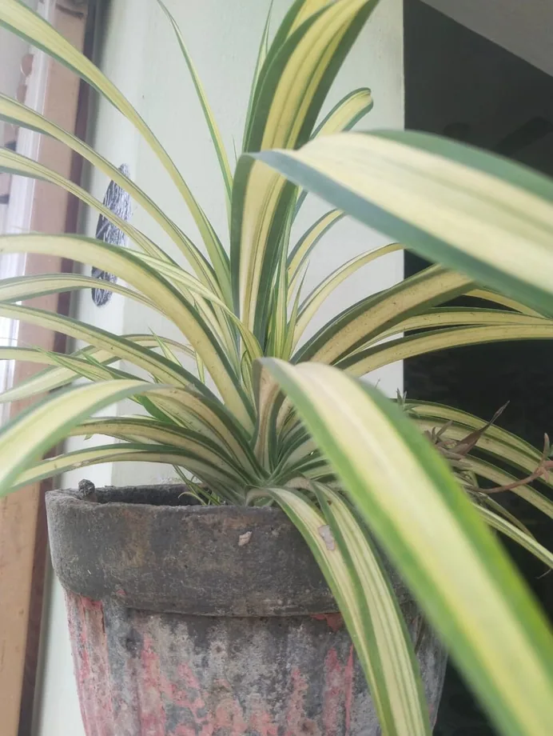
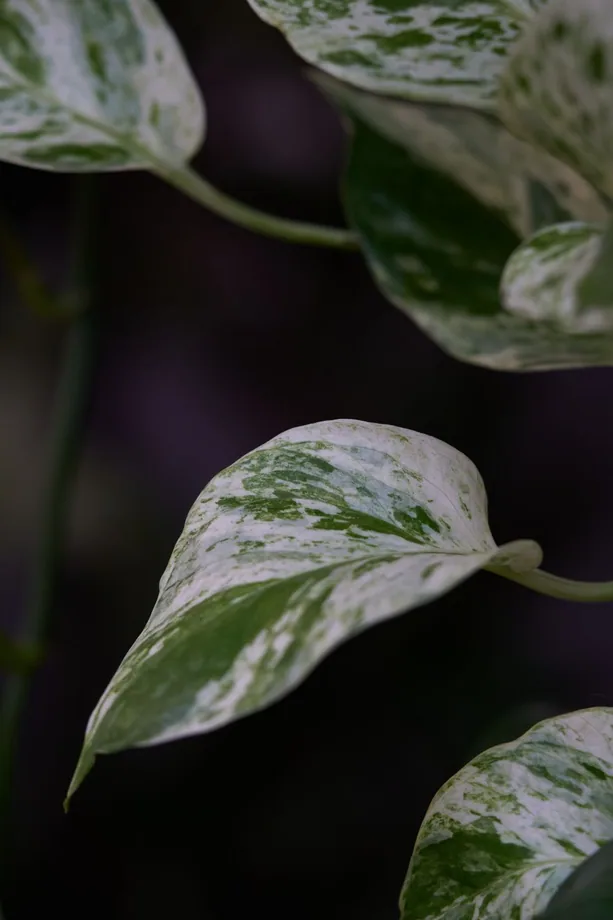
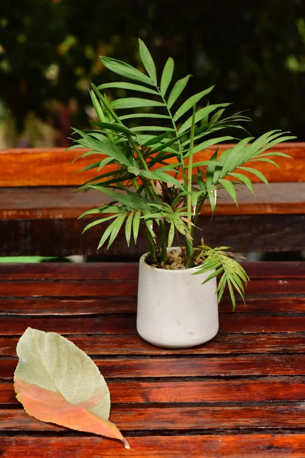

If you share your home with a cat or a dog, a houseplant is never just decoration. It is something that moves, smells interesting and can be chewed. That doesn't mean you have to give up on greenery. It means choosing plants carefully, and knowing which popular ones are better kept out of the house.

This guide covers a list of houseplants that the ASPCA classes as non-toxic to cats and dogs, a list of common plants to avoid, some practical tips for living with both, and what to do in an emergency.

## How the ASPCA classifies plants

The ASPCA's Animal Poison Control Center keeps a searchable database of plants listed as toxic or non-toxic to dogs, cats and horses. I use it here to check the exact species names and to explain when an exposure needs urgent veterinary help. Search by the botanical name, not only the common name, because common names are often shared by several unrelated plants.

Two important points to understand:

- **Non-toxic does not mean "eat as much as you like".** Chewing on any plant can cause an upset stomach, vomiting or diarrhea in some animals. Non-toxic means it is not expected to cause serious poisoning.
- **Toxic does not always mean deadly.** Many popular houseplants cause mild irritation, such as drooling or vomiting, while a small number are dangerous and need urgent veterinary care.

Individual animals vary, so if your pet reacts to something, call your vet.

## Houseplants listed as non-toxic to cats and dogs

The ASPCA and other pet-safety references identify the species below as non-toxic for cats and dogs. Check the exact species before you buy. Always double-check the exact species on the ASPCA website before buying, since some plants share names.

**Spider plant (Chlorophytum comosum).** Probably the best-known pet-safe plant. It is easy to grow in bright to medium light and produces dangling baby plantlets that cats love to bat at. Hang it high if you want it to survive.

**Boston fern (Nephrolepis exaltata) and bird's nest fern (Asplenium nidus).** These two species are examples you can verify by their botanical names. They like humidity and indirect light, so a bathroom or a kitchen window can suit them.

**Calathea and prayer plant (Calathea, Maranta).** Calatheas and the prayer-plant family are known for patterned leaves that fold upward at night. They are considered non-toxic, but they are fussier than others, needing consistent moisture, humidity and filtered water.

**Peperomia.** A large group of compact, easy plants, including the baby rubber plant and ripple peperomia. Good for shelves and desks.

**Parlor palm, areca palm, ponytail palm.** These are three distinct examples. Verify each botanical name separately because plants sold as palms can have very different safety profiles. The parlor palm tolerates lower light and the areca palm wants bright indirect light. The ponytail palm is not a true palm but a succulent, and it needs very bright light.

**Cast iron plant (Aspidistra elatior).** Famous for tolerating dark corners, irregular watering and low humidity.

**Chinese money plant (Pilea peperomioides).** A popular plant with round, coin-like leaves, which is on pet-safe lists.

**African violet.** Compact and flowering, the ASPCA includes it among its non-toxic houseplants. It likes bright, indirect light and careful watering from below.

**Haworthia and echeveria.** Safe succulents for sunny windowsills. Note that many other succulents are not safe, such as jade plant and aloe.

**Moth orchid (Phalaenopsis).** The common supermarket orchid is listed as non-toxic.

**Money tree (Pachira aquatica).** Listed as non-toxic, although some sources note that eating it may still cause an upset stomach.

**Friendship plant, nerve plant (Fittonia), polka dot plant, burro's tail and air plants (Tillandsia).** All appear on non-toxic lists.

The ASPCA lists the spider plant, Chlorophytum comosum, as non-toxic to dogs and cats. Photo by Nithyashree Balasupramaniyan, [Chlorophytum comosum in a pot.jpg](https://commons.wikimedia.org/wiki/File:Chlorophytum_comosum_in_a_pot.jpg), [CC0](http://creativecommons.org/publicdomain/zero/1.0/deed.en). Resized for the web.

## Popular houseplants to keep away from pets

These plants are very common and often sold without any warning. They are listed as toxic or harmful to cats and dogs in sources such as the ASPCA and university plant databases.

- **Pothos and philodendron.** Contain calcium oxalate crystals that irritate the mouth and throat, cause drooling and vomiting
- **Monstera (Swiss cheese plant).** Same calcium oxalate problem
- **Peace lily.** Also contains calcium oxalate. Not a true lily, but still irritating when chewed
- **Dieffenbachia (dumb cane).** Strong mouth irritation and swelling
- **Snake plant.** Mildly toxic, causing stomach upset
- **ZZ plant.** Contains calcium oxalate
- **Aloe vera and jade plant.** Can cause vomiting and other symptoms
- **Sago palm.** Considered one of the most dangerous plants for pets, especially dogs, and can be fatal. Many vets recommend not keeping it at all
- **True lilies (Lilium and Hemerocallis species).** Extremely dangerous to cats, even small amounts, including pollen, can cause kidney failure. If you have a cat, avoid bringing lilies, in bouquets or pots, into the home

Use a room your pet cannot enter for other toxic plants you already own. Keep true lilies and daylilies out of homes with cats because pollen and vase water can also pose a risk. Choose a verified alternative when you cannot reliably restrict access.

A variegated cultivar of toxic golden pothos still needs to stay out of reach. Photo by [Sự Minh  on Pexels](https://www.pexels.com/photo/green-and-white-marble-queen-pothos-in-close-up-photography-13851886/).

## Tips for a pet-friendly plant home

**Make a "safe list" before shopping.** Search the botanical name on the ASPCA database from the nursery, or take a photo of the plant tag. If the label doesn't give the species, don't guess.

**Place plants out of reach.** Hanging baskets, wall shelves and high plant stands protect both plants and pets. Remember that cats can jump high and climb.

**Keep plants behind a physical barrier if your pet chews them.** Use a closed room or secure enclosure. Ask your veterinarian about suitable enrichment or cat grass if chewing is a regular problem.

**Watch for behavior changes.** If a pet suddenly starts chewing plants, discuss it with your vet. It may be boredom, a diet issue or a medical problem.

**Be careful with soil, fertilizer and pesticides.** Pets can get sick from fertilizer granules, slug baits, rodent poison and some houseplant pesticides. Keep them stored out of reach and follow the label. Avoid products that must not be used around animals.

**Use a physical barrier for diggers.** Keep the container where your pet cannot reach it, given the risk from loose stones, soil additives and pot fragments.

**Check cut flowers too.** Bouquets often include lilies and other toxic blooms.

## What to do if your pet eats a plant

1. **Separate the pet from the plant.** If loose material is easy to reach and can be removed safely, follow your veterinarian’s instructions. Keep a photo of the plant and packaging for identification.
2. **Identify the plant,** and take a photo or a leaf sample with you.
3. **Call your veterinarian or an animal poison control service immediately,** even if your pet seems fine. In the United States, the ASPCA Animal Poison Control Center and the Pet Poison Helpline operate hotlines, which may charge a consultation fee. Please confirm current phone numbers on their official websites, and if you live elsewhere, find your local emergency vet and poison service.
4. **Don't induce vomiting** or give home remedies unless a vet tells you to.
5. **Watch for symptoms:** drooling, pawing at the mouth, vomiting, diarrhea, lethargy, trouble breathing or swallowing, tremors or loss of appetite. These need prompt care.

Suspected true lily or daylily exposure in a cat, or sago palm exposure in a pet, calls for immediate veterinary help, even before symptoms appear.

## Shop by plant name and room conditions

I would start with the window the plant will actually get, then check the botanical name on the tag. A bright spot with room for a small pot can suit a moth orchid or an African violet. A well-lit kitchen or bathroom where you can monitor drying might suit a Boston fern. A house with a dog that sweeps low tables with its tail needs a stable location first. A home with a climbing cat needs a shelf without an easy route up from adjacent furniture.

This approach also avoids common-name mix-ups. A ponytail palm, a parlor palm and a sago palm are very different plants. A label that says only “palm” gives you no basis for a safety decision. “Money plant” can mean Chinese money plant, money tree or golden pothos depending on the shop and where you live. Check the written botanical name or ask the seller to confirm it. If they cannot identify it, choose a labeled alternative. A photo identification tool can help narrow the possibilities. Use the tag, a qualified nursery or a botanical reference to verify any uncertain match.

For a first shopping trip, make a list of two or three plant names and save the database pages on your phone. When an unlabeled plant comes bundled with a gift basket, check every plant in the arrangement. A confirmed spider plant in one pot does not identify the companion plant beside it. Keep the group inaccessible while you arrange identification.

Parlor palm is Chamaedorea elegans. Check for the full botanical name at the shop. Photo by [Sóc Năng Động on Pexels](https://www.pexels.com/photo/potted-parlor-palm-on-wooden-bench-in-garden-37188210/).

## Set up the pot so fallen leaves and loose materials stay contained

Look at the paths your pets already use. Remember where the cat lands after climbing a curtain and where the dog waits while you water. Support a trailing plant so stems stay on the shelf as it grows. Check the floor below the shelf after pruning and after a windy day with the window open. Hang a basket only from a fixture rated for the weight of the pot and wet mix, and place it where you can reach it safely for watering.

Use an inner pot with drainage and empty its saucer where a pet cannot drink from it. Collect prunings and spilled mix immediately. A plant listed as non-toxic can still have nursery fertilizer pellets, labels or loose decorative material that a pet might swallow. For a persistent digger, a closed room with a suitable window is easier to supervise than a cover a dog can pry up. I would also keep cuttings in a stable container behind a door or where they can stay high with no access from a counter. These containers can be especially tempting when they hold water.

With visiting pets, do a quick check at their height. Plants that your own animal ignores can attract a curious visitor. Think about gift bouquets and holiday arrangements at the same time. Ask the florist what is in a mixed bouquet before bringing it into a home where cats can reach it. The ASPCA distinguishes true lilies and daylilies from several unrelated plants sold under the same common name. [ASPCA guidance on lilies](https://www.aspca.org/news/which-lilies-are-toxic-pets).

## Have the right information ready for a call

Save your regular veterinarian's number and the nearest emergency clinic. If there is a suspected exposure, photograph the whole plant and both sides of the damaged leaf, then photograph the tag and any product that was recently applied to the pot. Tell the veterinarian which pet was involved, when it could have happened, what you saw, and whether any leaves, bulbs, pollen, fertilizer or vase water may be involved. Report any symptoms and follow their instructions about transport. Collecting a photo is worthwhile when it takes a moment. With a suspected exposure to a true lily or daylily in a cat, seek emergency veterinary advice immediately even if the cat appears well.

A hypothetical example illustrates why the tag helps. A cat is found beside a chewed leaf marked “lily.” A clear photo of the whole plant and a tag that says *Spathiphyllum* give the veterinarian different information from a tag that says *Lilium*. Both calls deserve prompt professional guidance. The second has a time-sensitive kidney risk even before symptoms show. If the tag is absent or the plant was part of a mixed bouquet, say that immediately and describe all possible sources. [ASPCA guidance on plant exposures](https://www.aspca.org/news/do-you-know-which-flowers-and-plants-are-toxic-pets-our-experts-explain).

When replacing a plant an animal could reach, choose an alternative that fills the same spot. A small parlor palm can replace a leafy floor plant where the light suits it. A verified spider plant can serve as a hanging plant with room for its long shoots. Give away or remove a hazardous plant with its name on the tag, and mention the reason if the recipient also has animals at home. [ASPCA listing for parlor palm](https://www.aspca.org/pet-care/aspca-poison-control/toxic-and-non-toxic-plants/parlor-palm).

## Quick summary

- Choose plants confirmed non-toxic by the ASPCA, using the botanical name
- Good starters: spider plant, Boston fern, calathea, peperomia, parlor palm, cast iron plant
- Avoid: lilies (for cats), sago palm, pothos, philodendron, monstera, peace lily, dieffenbachia
- Keep plants out of reach anyway, since non-toxic does not mean harmless in large amounts
- If in doubt, call your vet

## Final thoughts

A home with pets and plants is entirely possible. Start with a few safe, forgiving species, keep dangerous ones out of the house, and check the ASPCA list whenever you bring something new home.

## Sources and further reading

- ASPCA, [Toxic and Non-Toxic Plants](https://www.aspca.org/pet-care/aspca-poison-control/toxic-and-non-toxic-plants)
- Costa Farms Help Center, [Pet-friendly houseplants: safe options for homes with cats and dogs](https://help.costafarms.com/en/knowledge/pet-friendly-houseplants-safe-options-for-homes-with-cats-and-dogs)
- Elanco, [Pet-safe houseplants](https://yourpetandyou.elanco.com/us/health-and-care/pet-safe-houseplants)
- NC State Extension Gardener Plant Toolbox (search plant names at plants.ces.ncsu.edu)

This article is general information only and is not veterinary advice. Always consult a veterinarian about your pet's health.
