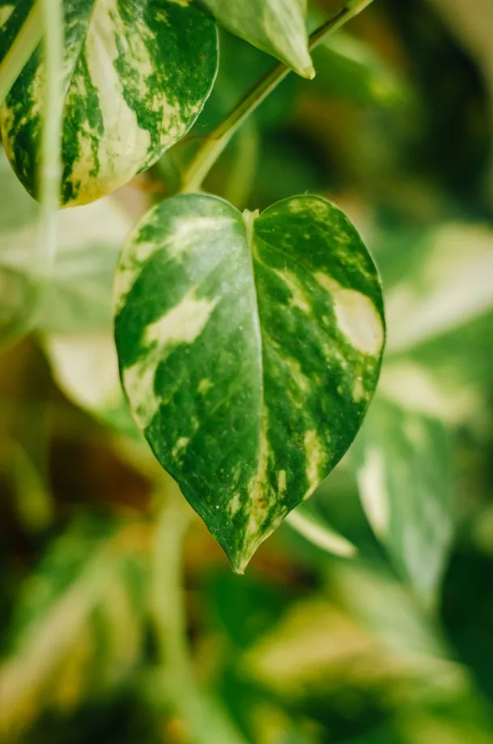
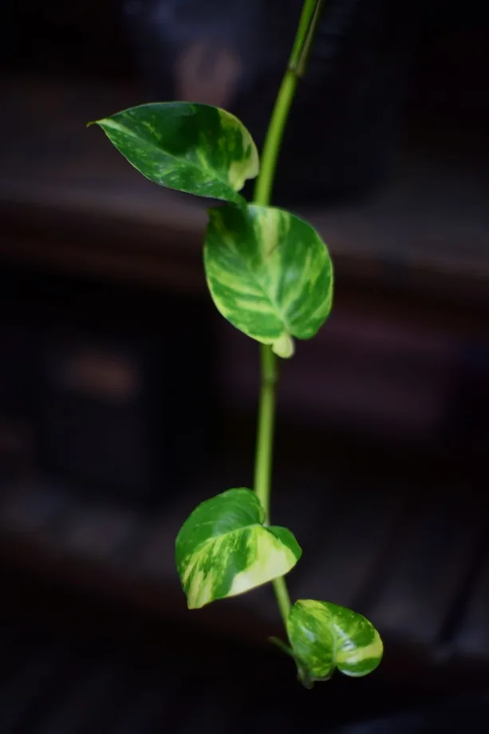
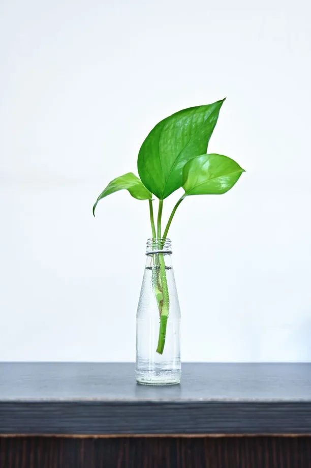

If you have ever seen a plant spilling gracefully over a bookshelf or hanging in an office window, there is a good chance it was a pothos. It grows fast, forgives mistakes, and makes new plants from a single cutting, which is why it is the starter plant for so many people. It is also easy to get wrong in small ways: yellow leaves, leggy stems and fading color are all common, and almost all of them have simple causes.

This guide explains how pothos behaves, how to care for it, how to take cuttings, and how to deal with the problems you are most likely to meet.

## Getting to know pothos

Pothos is Epipremnum aureum, a tropical climbing vine in the arum family. It is also called golden pothos or devil's ivy. In the wild it climbs tree trunks and can grow very long, which is why indoor plants trail so easily and can be trained up a pole. Sources differ on exactly where it originates, with various references pointing to islands of the South Pacific and parts of Southeast Asia, but its care needs are well established.

You will find several popular varieties:

- **Golden pothos:** green leaves marked with yellow
- **Marble Queen:** heavily variegated in creamy white
- **Neon:** bright chartreuse leaves with no variegation
- **Pearls and Jade:** smaller leaves with white and green speckling
- **Manjula:** silver, cream and green markings

The more white or cream a variety has, the more light it generally needs to keep its color. A solid green or lightly marked pothos is the most forgiving choice for a dim room.

Marble Queen is one of several pothos cultivars with distinct variegation. Photo by [ray guesc on Pexels](https://www.pexels.com/photo/close-up-of-a-marble-queen-pothos-houseplant-22710659/).

## Light

Clemson Extension describes pothos as a plant that does best in bright, indirect light, and that matches what most growers find. It will survive in low light, but the stems become long and bare, the leaves get smaller, and variegation fades toward plain green. In too much direct sun, the leaves bleach or develop brown, crispy patches.

A good position is a few feet from an east, south or west window, or directly in an east window where the sun is gentle. If a bright variegated variety is losing its pattern, moving it closer to a window will usually bring the markings back on new growth.

## Watering

Pothos has a helpful trait: when it gets thirsty, it droops visibly, and it perks up within hours of watering. That makes it a good plant to learn on, but don't wait for a collapse every time.

Water when the top inch or two of soil feels dry. Pour until water drains from the bottom, then empty the saucer. In winter, when growth slows and soil stays wet longer, water less often.

Overwatering is more harmful than underwatering. Signs include yellow leaves (often the lower ones first), black or mushy stems near the soil, a sour smell from the pot, and soil that never seems to dry. If you suspect root rot, take the plant out of the pot and check the roots. Healthy roots are white or tan and firm. Rotten roots are dark and soft. Trim away the damaged parts and repot in fresh mix.

## Soil, pots and feeding

Pothos is not fussy about soil, as long as it drains well. A general indoor potting mix with a handful of perlite or orchid bark added is a good choice. Use a pot with drainage holes. If you love a decorative pot without holes, keep the plant in a plain nursery pot and set that inside.

Feeding is optional but helpful for fast growth. During spring and summer, use a balanced liquid houseplant fertilizer diluted to half strength about once a month. Skip it in autumn and winter, when the plant is resting.

Repot every year or two, or when roots circle the pot or escape through the drainage holes. Choose a pot only one size bigger.

## Temperature and humidity

Normal household temperatures are fine, roughly 18 to 30 degrees Celsius (65 to 85 degrees Fahrenheit). Keep pothos away from cold drafts and air conditioner vents. It tolerates average indoor humidity well, though leaf tips may brown in very dry air.

## Pruning and training

A pothos that is never trimmed tends to get long, with big gaps between leaves and a bare base. Pruning solves this. Cut each vine just above a node (the small bump where a leaf joins the stem), and the plant will branch from that point. You can trim stems back as far as you like, as long as some leaves remain.

Pothos is also a natural climber. Give it a moss pole, trellis or wall hooks, and the leaves often grow larger as they climb. If you prefer a hanging look, let the vines trail and trim to the length you want.

## How to propagate pothos from cuttings

Propagating pothos is easy and a good first experiment. Clemson Extension points out that stem cuttings root readily in water or soil, but each needs at least one node, since roots grow from the node.

**In water**

1. Using clean scissors, cut a stem section about 4 to 6 inches long, with at least two leaves and one or two nodes.
2. Remove the lowest leaf so that a node sits below the waterline.
3. Place the cutting in a jar of room-temperature water, in bright indirect light.
4. Change the water every week or so to keep it fresh and prevent algae.
5. Roots usually appear within a few weeks. Once they are 2 to 3 inches long, plant the cutting in soil and keep the soil lightly moist for the first couple of weeks.

Don't leave cuttings in water for many months. Roots grown in water are a little different from soil roots, and the longer they stay there, the harder it can be for the plant to adjust to soil.

**Straight into soil**

Dip the cut end in rooting hormone if you have it (optional), push it into damp, airy mix with the node buried, and keep the soil lightly moist, not wet. A clear plastic bag over the pot can help hold humidity. Resistance when you gently tug the stem after a few weeks is a sign that roots have formed.

The best time to propagate is spring or summer, when the plant is growing actively.

## Common pothos problems

**Yellow leaves.** The most common cause is overwatering. Check the soil. A single old leaf yellowing and dropping from time to time is normal.

**Brown tips or edges.** Often caused by dry air, inconsistent watering or built-up fertilizer salts. Water more consistently, and flush the pot with plain water every few months.

**Pale, small leaves and long gaps between leaves.** A light problem. Move the plant to a brighter location and prune back leggy vines.

**Loss of variegation.** Usually caused by low light. More light will help new leaves develop color.

**Black or dark spots.** Can come from overwatering, cold damage or fungal leaf spots. Remove damaged leaves, improve airflow, and water the soil instead of the leaves.

**Pests.** Mealybugs, spider mites, scale and thrips occasionally show up. NC State's plant database lists banded greenhouse thrips as a common insect problem. Check the undersides of leaves and the nodes. Isolate the plant and identify the pest before choosing a treatment. Our [houseplant pest guide](/houseplant-pests-spider-mites-mealybugs-scale/) explains what to look for and when hand removal is enough.

## Is pothos safe for pets and children?

No. All parts of pothos contain insoluble calcium oxalate crystals. If chewed, they can cause burning and irritation in the mouth, drooling, vomiting and trouble swallowing in cats, dogs and people. The severity varies. Difficulty swallowing or breathing requires urgent veterinary care. Keep pothos out of reach, using a high shelf or a hanging basket that a cat can't climb to, or pick a pet-safe plant such as a spider plant instead. If your pet eats some, contact your vet or an animal poison control line.

The plant's sap can also irritate sensitive skin, so wash your hands after pruning.

## Decide what you want the plant to look like

A pothos with six long vines behaves differently from a fresh nursery pot full of short stems. For a fuller shelf plant, first give it enough light to keep the spaces between leaves reasonably close. Then shorten a few of the sparsest vines just above a healthy node on the original plant. Keep leaf-bearing sections on the remaining plant. If you want the cut pieces to fill gaps later, prepare them separately and return only well-rooted cuttings to open spots in the soil.

For a climbing display, place a support where it will receive the same good light as the foliage. Guide a young vine to it with a loose tie that leaves room for the stem to grow. Check the ties occasionally and keep aerial roots away from paint or soft wood if you are renting. Mature climbing vines may produce larger leaves when the light and support are favorable. A support added to a dim shelf still leaves the plant with the same light limitation.

These are two different maintenance routines. A trailing pot is easier to lift for watering while the growth remains manageable. A tall support can make a pot awkward and top-heavy. Before you buy one, check that you can water the root zone and remove the pot from its cover without dragging the foliage.

## Read the vine from the pot to the tip

If the newest leaves are much smaller, measure the distance between them and compare it to older growth on the same vine. Small leaves spaced farther apart often point you toward light. A lone old leaf turning yellow right next to the soil can be part of normal turnover. Several yellowing leaves along different vines while the pot is heavy deserve a drainage check. If only one vine wilts, trace it from the tip back to the soil for a crease, a crushed point around a tie or a damaged section at the base.

I would check the inner pot before moving the plant or changing its feed. Lift it out, look for collected water and feel the mix below the surface. A dry top layer can sit above a soggy core. If you suspect rot, inspect the roots gently and look for changes in firmness as well as color. A naturally tan, firm root and a soft root whose outer layer slips off tell you very different things. The [root rot guide](/root-rot-in-houseplants/) shows how to decide whether the original plant or cuttings from firm stems should get your attention first.

Compare the spaces between newer leaves with those on older growth. Photo by [Sóc Năng Động on Pexels](https://www.pexels.com/photo/close-up-of-variegated-pothos-plant-vine-33145250/).

## Give the cuttings a stable first month

Set out the container and read the stem before you trim. On each cutting, identify the leaf joint and the little nub beside it. That region is where you expect roots. Leave a small piece of stem below it and keep the leaf above the water. If a cutting's submerged end becomes translucent or soft, take it out, rinse the container and start again from firm tissue with a viable node when there is one left.

Root development varies. Give each cutting enough room that you can lift it without tangling its roots around the others. Once several small roots have formed, move it into a small pot with a slightly moist, open mix. Make the planting hole first so you can lower the roots in without folding them or stripping them against dry particles. Keep the newly potted cutting in bright indirect light, watch when its much smaller pot dries, and let it establish before adding fertilizer.

If you plan to use the cuttings to thicken the original pot, compare how quickly it dries with the small temporary pots. A watering rhythm that works for established roots in a large container can be too infrequent for fresh cuttings near the edge. Separate starter pots let you control that transition and make it easier to count which cuttings take. [University of Wisconsin–Madison Extension pothos reference](https://hort.extension.wisc.edu/articles/pothos-epipremmum-aureum/).

Keep a node in the water and the leaves clear of the waterline. Photo by [小龙 魏 on Pexels](https://www.pexels.com/photo/houseplant-propagation-in-water-5134560/).

## A glass jar and a rooted cutting are different setups

In my winter care guide, I describe the money plant I kept in water in the hall and the changes a nursery specialist made when it turned yellow. Its exact species was never confirmed, so use a plant label or reliable identification before applying species-specific advice. The experience did make me pay attention to how much light reaches the jar and whether the water and roots look healthy when a water-grown plant starts to decline. [Read the winter care story](/winter-houseplant-care/).

For a confirmed pothos you are rooting to plant in soil, a jar is a short stage with a clear goal. Long-term water culture changes how you manage nutrients and water quality. Decide which setup you are keeping before treating every clear jar as the same project.

## Quick care summary

- **Light:** bright, indirect (tolerates lower light)
- **Water:** when the top 1 to 2 inches are dry
- **Soil:** well-draining indoor mix with perlite or bark
- **Feeding:** monthly in spring and summer, half strength
- **Propagation:** stem cuttings with at least one node
- **Pets:** toxic if chewed

## Final thoughts

Pothos succeeds because it is flexible. If you give it decent light, let the soil dry between waterings and prune now and then, it will fill out quickly and reward you with free plants to share.

## Sources and further reading

- ASPCA, [Golden pothos toxicity listing](https://www.aspca.org/pet-care/aspca-poison-control/toxic-and-non-toxic-plants/golden-pothos)

- Clemson Home and Garden Information Center, [How to grow pothos indoors](https://hgic.clemson.edu/factsheet/how-to-grow-pothos-indoors-epipremnum-spp-care-cultivars-and-common-problems/)
- NC State Extension Gardener Plant Toolbox, [Epipremnum aureum](https://plants.ces.ncsu.edu/plants/epipremnum-aureum/)
- University of Wisconsin-Madison Extension, [Pothos (Epipremnum aureum)](https://hort.extension.wisc.edu/articles/pothos-epipremmum-aureum/)
- ASPCA, [Toxic and non-toxic plants](https://www.aspca.org/pet-care/aspca-poison-control/toxic-and-non-toxic-plants)
