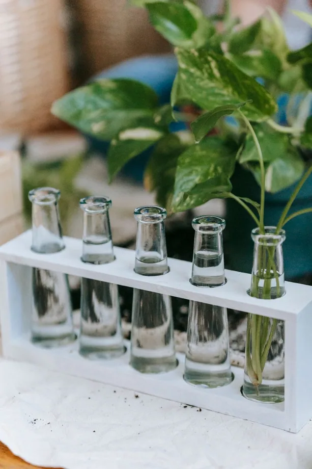
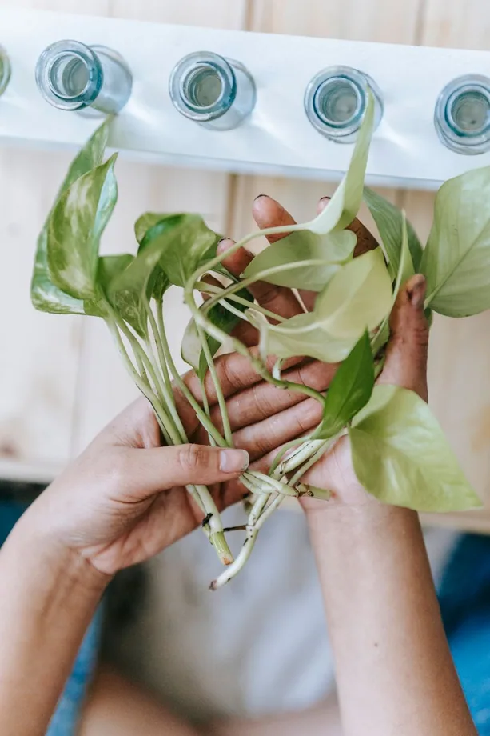
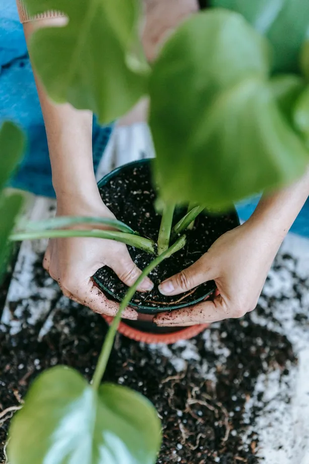

Few things in plant care are as satisfying as turning a single cutting into a new plant. It costs nothing, it needs very little equipment, and it lets you fill your home or share with friends. But as soon as you start, you hit a question that splits plant lovers into two camps: should you root cuttings in water or straight in soil? Both work. They suit different plants and different people, and each has trade-offs.

## What propagation is

Propagation means making new plants from parts of an existing one. The most common houseplant method is the stem cutting: a piece of stem with at least one node, which is the small bump on the stem where a leaf (and often roots) emerge. The new roots grow from the node, so a cutting without a node usually won't root. Clemson Extension makes this point for pothos: stem cuttings root easily in soil or water, but each needs at least one node.

Other methods include leaf cuttings (snake plant, succulents), division (splitting a clump into separate plants), and removing offsets or plantlets (spider plant babies). This guide focuses on stem cuttings, since that is where the water versus soil question arises.

## Method 1: Rooting in water

You place a cutting in a jar of water and wait for roots to appear.

**How to do it**

1. Use clean, sharp scissors. Cut a stem about 4 to 6 inches long just below a node
2. Remove the leaves from the bottom so no leaf sits under the water, but keep at least one or two leaves at the top
3. Put the cutting in a clean glass jar with room-temperature water, so the node is submerged
4. Place it in bright, indirect light
5. Change the water about once a week (or whenever it looks cloudy) to keep it fresh
6. When roots are 2 to 3 inches long, move the cutting into soil

**Advantages**

- You can see the roots grow, which is motivating and tells you when it has worked
- It is easy and requires no special supplies
- It looks attractive in a clear glass on a shelf
- It is hard to overwater a cutting in water

**Disadvantages**

- Water roots are structurally different from soil roots. They're often thinner and more fragile, so a cutting left in water for a long time may struggle when it moves to soil
- Cuttings can rot if the water goes stagnant or if leaves are submerged
- It works best with plants that tolerate it, and not all plants root well in water

A tip from plant guides: don't leave cuttings in water for months. Move them to soil once roots are a couple of inches long. The longer the roots grow in water, the more they have to adjust.

Clear containers make early root growth easy to check. Photo by [Teona Swift on Pexels](https://www.pexels.com/photo/transparent-flasks-with-green-plants-at-home-6913475/).

## Method 2: Rooting in soil (or another medium)

You plant the cutting directly in a damp, airy mix.

**How to do it**

1. Take the cutting as above, with at least one node
2. Optionally dip the cut end in rooting hormone powder or gel, which can speed up and improve rooting for some plants
3. Fill a small pot, with drainage holes, with a light mix, such as potting soil mixed with perlite, or use a seed-starting mix
4. Make a hole with a pencil, insert the cutting so that the node is buried, and gently firm the mix around it
5. Water lightly so the mix is damp but not soggy
6. Place in bright, indirect light. For better humidity, you can cover the pot with a clear plastic bag or a cut-off bottle, with some air holes, and remove it for a short time every few days to let fresh air in
7. Keep the mix lightly moist. After 3 to 6 weeks, a gentle tug that meets resistance means roots have formed

**Advantages**

- Roots develop in the medium they will live in, so there is no transplant shock from water to soil
- Often leads to stronger plants
- Fewer steps, since you don't have to move the cutting later

**Disadvantages**

- You can't see the roots, so you won't know whether it is working until new growth appears
- Needs more careful moisture control. Too wet and it rots, too dry and it shrivels
- Takes a little more setup

## Which method is better?

There is no universal winner, and experienced growers disagree. A reasonable summary:

- **For beginners who want to see progress,** water is the friendlier start, as long as you move the cutting to soil in time
- **For the strongest long-term results,** soil or a similar medium avoids the water-to-soil switch
- **For plants prone to rot,** soil with good drainage, or a gritty medium, is often safer
- **For fussy plants,** check what suits the species

You can also combine them: start in water until roots are an inch or two long, then pot up into a light, well-draining mix, keeping it moist for the first couple of weeks while the roots adjust.

## Plants and the methods that suit them

- **Pothos, philodendron (vining types), tradescantia, monstera:** root readily in water or soil. Take cuttings with a node and an aerial root if present
- **Spider plant:** snip off a plantlet with small roots and pot it up, or root it in water
- **Coleus and many herbs:** easy in water
- **Snake plant:** division is the most reliable method. Leaf cuttings root slowly in soil or water. Variegated types typically lose their yellow edges when grown from leaf cuttings
- **Succulents (jade, echeveria, haworthia):** let cuttings or leaves dry for a day or two (callus) and set them on dry, gritty mix. Water rooting is risky because they rot easily
- **Rubber plant, fiddle leaf fig:** can be rooted from stem cuttings but are slower. They usually do best in a humid, warm spot with rooting hormone
- **Orchids and some other plants:** need specialized methods. Check a plant-specific guide

## Timing and conditions

- **Spring and summer** are best, when plants are actively growing. Cuttings root faster in warm, bright conditions
- **Bright, indirect light** is ideal. Direct sun can cook a cutting
- **Warmth** helps. Room temperature of roughly 20 to 25 degrees Celsius (68 to 77 degrees Fahrenheit) is good
- **Be patient.** Roots may take two to six weeks, sometimes longer. Don't keep pulling it out to check

## Common problems

**The cutting turns black or mushy.** Rot, usually from too much water, dirty water or a dirty tool. Cut above the rot to healthy tissue, use clean scissors and fresh water, and try again.

**Nothing happens.** Many cuttings need more time. Check that there is a node under the water or soil, and that it has enough warmth and light.

**Leaves yellow and drop.** A little leaf loss is normal while the cutting adjusts. If all leaves drop and the stem stays firm, there may still be hope.

**Roots grew but the plant sulks after potting.** This is typical of long-term water roots meeting soil. Keep the mix evenly moist and the plant out of strong sun until it settles.

**Algae in the jar.** Algae grows in light and is harmless to the cutting but makes the water cloudy. Change the water more often, or use an opaque container.

## Hygiene and safety

Always use clean scissors, and wipe the blades with rubbing alcohol between plants to avoid spreading disease. Some plants, such as pothos, monstera and philodendron, have sap that irritates the skin, and they are toxic if chewed, so wash your hands after handling them and keep cuttings away from pets and children.

## A simple beginner plan

1. Choose a healthy parent plant in its growing season
2. Take 3 to 4 cuttings, since not all will succeed
3. Put some in water and some directly in soil, so you can compare
4. Keep all in bright, indirect light
5. Move the water cuttings to soil when roots are 2 to 3 inches long
6. Keep soil cuttings lightly moist, and wait for new growth

## Match the method to the part of the plant that can regrow

Take a close look at the structure before you divide anything. Pothos has spaced leaf joints along its vine. A stem cutting with a node can grow roots and a new shoot. A bare leaf detached from that node has no viable stem bud for growing a new vine. A spider plant's dangling plantlet already has the structure of a small plant, often with little root nubs at the base. Pinning it onto a small pot of mix while it remains attached gives it support while it establishes. A clump-forming peace lily may be divided where a growing crown has its own roots.

I would use a visual test at the cutting table. Point to the spot that is expected to form roots, then point to the bud, crown or shoot that should expand later. If you cannot identify either, read the propagation section for that species first. For plants with several methods, compare how many starting pieces you can afford to lose and how quickly you can detect a problem in each container.

Find a viable node before placing a pothos cutting in water or mix. Photo by [Teona Swift on Pexels](https://www.pexels.com/photo/woman-with-green-sprouts-for-planting-in-bottles-6913472/).

## Run a small comparison with two matched cuttings

Choose adjacent healthy cuttings from a single actively growing vine, each with a similar number of nodes and leaves. Mark the date and put them into matched light. Root one in water so you can observe the node, and put one into a small pot with a moist, aerated rooting medium. Compare the first date you can see several roots in the jar with the first signs of establishment in the pot. A new firm leaf and gentle resistance when holding the soil side are useful signs, though a shoot may continue growing briefly from its own reserves. Avoid repeatedly tugging it out to verify progress.

Your observations will differ by medium. In water you can see early roots and a soft stem end right away. In a pot, you largely track moisture and aboveground changes. Give the soil cutting a small root zone so excess moisture can leave and use a clear nursery pot if you want some visibility. A large pot often stays damp for too long when the cutting has no roots. For the jar, label the stem end you buried and keep leaves above the waterline.

Track establishment after transplanting as well as the first appearance of roots. A cutting that roots quickly in water can still sulk after potting. A stem that takes a little longer in mix can come through without a move. Compare the number that make new leaves four to six weeks after beginning, allowing extra time for slower species and cooler rooms. A tiny home experiment will tell you how the methods behave on your shelf with that species. Take it as a guide to your setup. [Penn State Extension houseplant propagation guide](https://extension.psu.edu/propagating-houseplants).

## Give new roots a smaller pot and steady moisture

When a jar cutting has several usable roots, moisten the potting mix ahead of time and make a wide enough hole for them. Hold the stem at the depth it needs and settle mix around the roots without pushing down hard. Water to settle the mix and drain excess. Keep the small pot evenly, lightly moist while roots establish, adjusting for the species. A humidity dome can help some soft-stem cuttings, provided it has ventilation and the leaves stay clear of wet surfaces. Succulents generally need a freer-draining mix and different handling.

If one cutting sags during the transition, check the mix and look at its stem base. A firm stem in a pot drying quickly may benefit from more even moisture. A soft base and a persistent wet smell point you toward decay. Take a clean cutting above the affected area if there is enough healthy stem and another node. Give a successful new plant time before potting it with mature plants that already have a different watering rhythm.

When sharing several rooted cuttings, label the species, medium and the date you moved them. A recipient who gets a thin-leaved cutting in a small pot needs to know that it dries faster than a large nursery plant of the same species. Notes on light, pet toxicity where relevant and approximate rooting stage are more useful for the first week than a list of everything the species can tolerate.

A small pot helps you manage moisture while a cutting establishes. Photo by [Teona Swift on Pexels](https://www.pexels.com/photo/crop-gardener-replanting-tropical-plant-in-pot-at-home-6913478/).

## Quick summary

- Cuttings need at least one node
- Water rooting is easy to watch but can lead to weaker roots if left too long
- Soil rooting avoids transplant shock but needs careful moisture control
- Start in water, move to soil once roots are 2 to 3 inches long, or root straight in a light mix
- Spring and summer are the best seasons, and patience is the key ingredient

## Final thoughts

Neither method is wrong. Start with whichever suits your plant and your patience, take several cuttings so that a few fail without worry, and keep notes on what worked. Within a few months, you'll have your own results to trust.

## Sources and further reading

- Clemson Home and Garden Information Center, [How to grow pothos indoors](https://hgic.clemson.edu/factsheet/how-to-grow-pothos-indoors-epipremnum-spp-care-cultivars-and-common-problems/)
- University of Wisconsin-Madison Extension, [Pothos (Epipremnum aureum)](https://hort.extension.wisc.edu/articles/pothos-epipremmum-aureum/)
- NC State Extension Gardener Plant Toolbox (search the plant you are growing at plants.ces.ncsu.edu)
