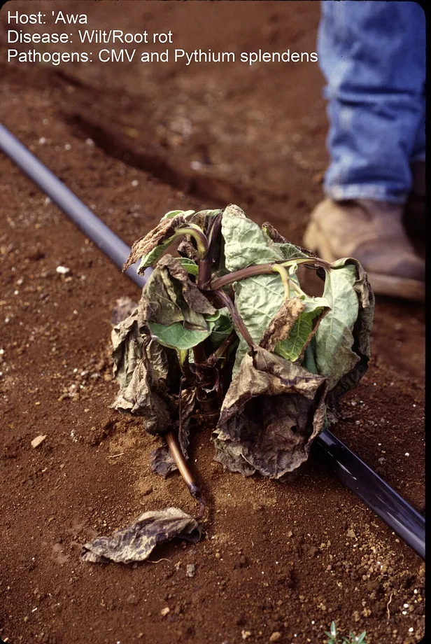
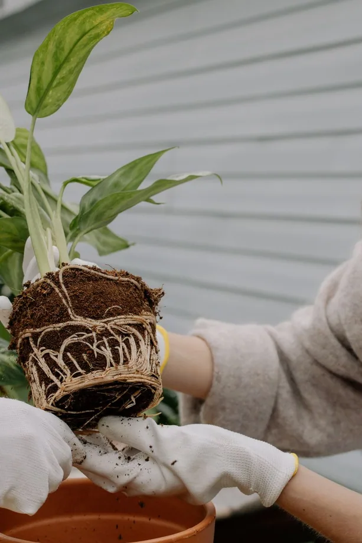
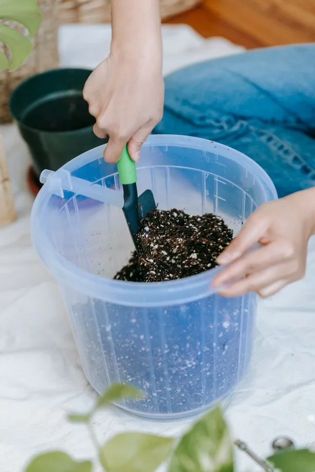

If you ask experienced plant growers what kills more houseplants than anything else, many will give the same answer: too much water. It rarely looks dramatic at first. The leaves yellow, the plant droops, the soil stays damp, and the natural reaction is to water again, which makes things worse. The culprit underneath is often root rot, and the good news is that it can sometimes be fixed if you act quickly.

This guide explains what root rot is, how to confirm it, how to rescue a plant step by step, and how to avoid it from now on.

## What is root rot?

Roots need oxygen as much as water. In soil that stays saturated, the air spaces fill with water, and roots begin to suffocate and die. Dead and weakened roots are then attacked by water-loving fungi and other organisms (often called water molds), which make the rot spread. Once roots can't absorb water and nutrients, the plant above the soil begins to fail, even though the pot is wet.

University of California's pest management guide lists poor root health, caused by overwatering, excessive dryness, root disease or too much fertilizer, among the causes of several common symptoms, including wilting and yellowing leaves. In other words, many different problems look alike above ground. You have to look below the soil to know for sure.

## Signs of root rot

Above the soil:

- **Yellowing leaves,** often starting with lower ones
- **Wilting or drooping** even though the soil is wet
- **Leaves that turn brown, soft or black**
- **Stunted or stopped growth**
- **Leaves dropping**
- **Soft, mushy or blackened stems** at the soil line

In the pot:

- **Soil that stays wet for days** or a week or more
- **A sour, swampy or rotten smell**
- **Fungus gnats** hovering around (they are drawn to constantly wet soil)
- **Green algae or mold** on the soil surface

Be careful: wilting can also mean a plant is too dry, or has insects feeding on it. Always check the soil moisture before deciding.

This kava plant shows aboveground wilting caused by root rot. Inspect roots to confirm the cause in your own pot. Photo by Scot Nelson, [Root rot awa.jpg](https://commons.wikimedia.org/wiki/File:Root_rot_awa.jpg), [CC0](http://creativecommons.org/publicdomain/zero/1.0/deed.en). Resized for the web.

## How to check the roots

The only way to be sure is to look.

1. **Remove the plant from its pot.** Tip it sideways and gently slide it out. If it is stuck, run a knife around the edge.
2. **Shake off loose soil** or rinse the roots with lukewarm water so you can see them clearly.
3. **Examine the roots.**

- **Healthy roots** are firm, and white, tan or light-colored depending on the plant. They smell earthy.
- **Rotten roots** are brown or black, soft, mushy, slimy and may fall apart when touched. They often smell bad.

If most roots are healthy and only a few are rotten, the plant has a good chance. If almost all roots are gone and the base of the stem is mushy, saving the whole plant is unlikely, but you may be able to rescue cuttings.

## How to rescue a plant with root rot

You'll need clean scissors or pruning shears, rubbing alcohol for cleaning blades, fresh potting mix, and a clean pot with drainage holes.

### Step 1: Remove the rotten roots

Clean and disinfect your blades. Cut back roots with obvious decay to firm tissue and keep firm roots even if they are naturally dark. Disinfect tools between diseased and healthy tissue.

### Step 2: Remove dead foliage

Remove leaves that are fully dead, mushy or clearly diseased. Leave viable leaves on the plant so it can continue to photosynthesize as the roots recover.

### Step 3: Prepare the remaining roots for potting

Keep fine, healthy roots out of the sun and repot promptly. Succulents need different handling after substantial cuts. Check the care recommendations for the species before replanting.

### Step 4: Clean the pot

A clean replacement pot is a simple option. If you reuse the pot, scrub off all old mix, rinse it and sanitize it using the directions for the product and pot material. Keep the drainage holes clear and discard the old mix.

### Step 5: Repot in fresh, well-draining mix

Use fresh potting mix that drains easily. For many plants, adding perlite or orchid bark (roughly one part to two or three parts of mix) improves drainage. Choose a pot that is the same size as before, or even slightly smaller, because a big pot holds more wet soil around a small root system. Set the plant at the same depth as before.

### Step 6: Water carefully

Water lightly after repotting just to settle the soil, and then let the top layer dry before watering again. Don't fertilize. Fertilizer salts stress damaged roots, and the plant can't use extra nutrients while it recovers.

### Step 7: Provide recovery conditions

Put the plant in bright, indirect light, in a stable, comfortable temperature. Skip direct sun and cold drafts. Recovery takes weeks to months. New leaves are the sign that roots are growing again.

## When the rescue won't work

If the stem base is soft and brown or black, and no healthy roots remain, the plant itself may be too far gone. You can still try to save a part of it:

- **Take stem cuttings** from healthy, firm parts of the plant, below the rot-free nodes, and root them in clean water or fresh mix (this works well with pothos, philodendron and many others)
- **Use a leaf cutting** from plants that can grow from leaves, such as snake plants or succulents

Even then, success is not guaranteed. Don't be discouraged, since it is a very common learning experience.

## Should you use fungicides or other treatments?

Correct drainage and watering first. University of California IPM recommends identifying the problem and improving the root environment. Home remedies can injure damaged roots. If disease is suspected in a valuable plant, seek a diagnosis before selecting any product. Read the label for the target organism, houseplant and indoor setting. The University of California's guidance on houseplant problems notes that when a plant is in very poor condition, it may be better to discard it and buy a new one. If the plant is badly diseased, throw away the soil rather than composting it, and clean the pot well.

## How to prevent root rot

Most prevention comes down to a few habits:

- **Always use pots with drainage holes.** A decorative pot with no holes is fine as an outer cover, but keep the plant in a plain pot inside it, and empty the outer pot after watering
- **Check the soil before watering.** Push a finger two inches deep. If it is damp, wait
- **Water less in winter,** when light is low and plants use less water
- **Use a well-draining mix** suited to the plant. Cacti and succulents need very gritty soil, while tropical foliage plants like a chunky, airy mix
- **Choose the right pot size.** Too big a pot holds extra wet soil
- **Empty saucers** after about 15 minutes
- **Don't let plants sit in water.** If you water from the bottom, remove the pot after the soil has soaked up what it needs
- **Don't water on a fixed schedule.** Use the plant's needs, not the calendar
- **Give plants enough light,** because low light slows down water use
- **Repot when needed,** since old, compacted soil drains poorly

A moisture meter or a wooden skewer pushed to the bottom of the pot can help if you find it hard to judge by touch.

## Which plants are most at risk?

Plants adapted to dry conditions, including succulents, cacti, snake plants, ZZ plants and many others, are especially prone to rot. Others, like ferns and calatheas, like steady moisture but still need drainage. In every case, the problem is usually not water itself but water that has nowhere to go.

## What to look for on the first inspection

I would lift the nursery pot out of its cover and smell the mix near the drainage holes. Take note of standing water and how heavy the pot feels. Check the same plant again after a normal interval between waterings if it is stable and the roots are still firm. If the foliage is wilting while the pot stays heavy, slide the root ball out gently over a washable surface so you can examine the outer layer. Root color on its own is a poor test. Roots can be tan or brown from the medium. Focus on whether they bend and hold together or crush and lose their outer layer with gentle contact.

Look from the bottom of the root ball up toward the crown. If the surface roots remain firm and the deepest roots are soft, the standing water may explain the pattern. If the lower stem is soft where it enters the mix, check whether the damage has already reached the growing points. When inspecting an orchid, plump aerial roots can look silvery while dry. That color is normal. Hollow, collapsed roots or a soft base deserve attention. [University of California IPM root, stem and crown rot reference](https://ipm.ucanr.edu/home-and-landscape/root-stem-and-crown-rots/).

Check the bottom and sides of the root ball when inspecting for decay. Photo by [cottonbro studio on Pexels](https://www.pexels.com/photo/gardener-holding-the-roots-of-a-plant-9724434/).

## Decide what to save while the roots are exposed

Imagine a pothos whose longest vine still has four firm nodes and healthy leaves. Its root ball contains some firm roots around the upper edge, while the lowest third is mushy. You can trim affected tissue, keep the viable roots, choose a pot that fits the remaining root mass and take a healthy tip as a backup. Keep the cuttings away from the discarded medium and wash your tools before moving from rotten tissue to a live stem.

In a second pot, the crown is soft and none of the lower stems remain firm. Any viable backup has to come from a healthy section further up. For a plant whose only growing point is already soft, the kindest use of your time may be to remove it and focus on nearby pots. Inspect shared saucers, reusable tools or water that flowed between containers. If several plants with no shared watering mistake decline together and you want to identify a disease, an extension diagnostic service may ask for photographs and a fresh sample.

Set up the replacement pot before you begin trimming. I would choose the smallest one that fits the remaining roots naturally with room for a little fresh mix. If you retain a small root ball, the old pot might now hold too much mix. Set the crown at its usual depth, use fresh medium suited to the species and keep the area easy to clean. Avoid heavily compressing the mix around fragile roots.

Replace the saturated medium with fresh mix suited to the species. Photo by [Teona Swift on Pexels](https://www.pexels.com/photo/crop-gardener-hoeing-soil-with-shovel-in-pot-at-home-6913408/).

## Recovery across the next watering cycles

Look for stability before new growth. In the first several days, the leaves may stay tired as the surviving roots adjust. Check moisture near the middle of the new pot. Record the date you watered and when its weight dropped. A smaller root zone can change the timing substantially, especially if you switch from a glazed pot to unglazed clay or reduce the container diameter.

If the plant has firm stems and is gradually drying between appropriate waterings, give it time in good indirect light. Skip fertilizer until the plant has resumed active growth. Check whether new yellow leaves are continuing to appear and whether the crown is staying firm. Once new growth does appear, treat that as a reason to continue the current conditions while you watch the next set of leaves.

If decline resumes, look for the constraint that the first rescue missed. A pot can drain into a saucer that fills and touches the base again. A decorative wrap may cover the holes. Cool air close to winter glass can slow drying. If the plant now sits in fresh mix that is dry enough but still collapses, inspect the crown and consider propagation from any sound tissue. [Houseplant drooping guide](/why-is-my-houseplant-drooping/).

## Quick summary

- Root rot is caused by soil that stays wet and starves roots of oxygen
- Check the roots: healthy ones are firm and light, rotten ones are dark, soft and smelly
- Cut away all rotten roots, repot in fresh, well-draining mix in a clean pot, and water lightly
- Don't fertilize until new growth appears
- Prevent it with drainage holes, a suitable soil mix, and watering only when the soil is dry

## Final thoughts

Root rot is stressful to find, but it is also a clear lesson in how plants work. Learn to check the soil before you water, make sure water can drain, and you will prevent most of the problems you are likely to meet.

## Sources and further reading

- University of California IPM, [Root, stem and crown rots](https://ipm.ucanr.edu/home-and-landscape/root-stem-and-crown-rots/)

- University of California IPM, [Houseplant Problems](https://ipm.ucanr.edu/home-and-landscape/houseplant-problems/)
- University of Missouri, [Houseplant problems: an environmentally sensitive approach](https://ipm.missouri.edu/meg/2019/1/houseplantProblems/index.cfm)
- Virginia Cooperative Extension, [Fungus Gnats](https://www.pubs.ext.vt.edu/3104/3104-1579/3104-1579.html) (on the link between overwatering, wet soil and root rot)
