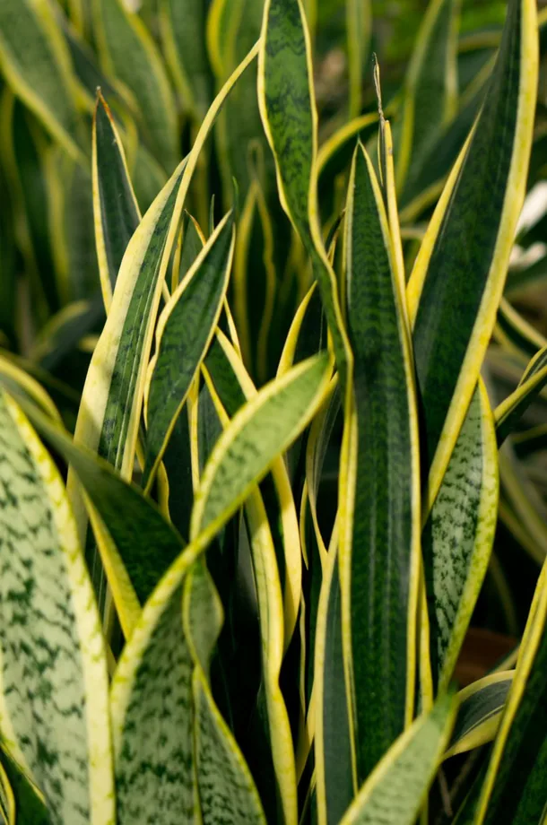
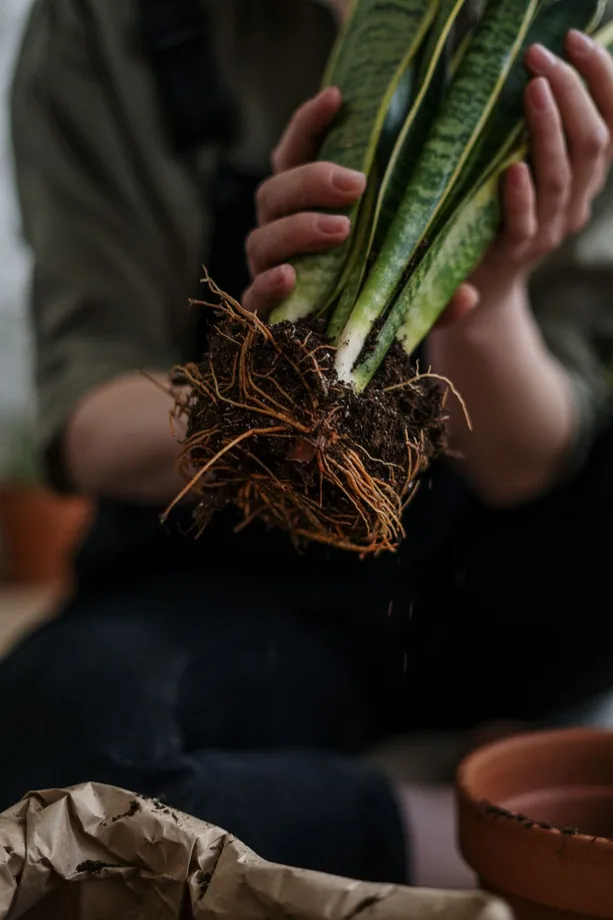
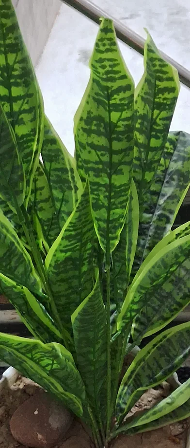

Snake plants have a reputation for being almost impossible to kill, and that reputation is mostly deserved. They put up with dim corners, forgotten waterings and dry indoor air better than nearly any other houseplant. But "hard to kill" is not the same as "needs nothing", and the one thing that really does kill them, too much water, is exactly what caring owners tend to provide.

This guide covers what a snake plant is, how to give it the right light, how to water it without rotting the roots, which soil and pot to use, and how to propagate it. I've also included the problems people run into most often, plus a look at the claim that snake plants clean your air.

## What you're actually growing

The snake plant is sold under several names: mother-in-law's tongue, Saint George's sword, viper's bowstring hemp, and Sansevieria. NC State Extension uses the accepted name Dracaena trifasciata and lists Sansevieria trifasciata as a former name. You will still see the old name on plant tags and in older books, and both refer to the same plant.

It comes from tropical West Africa and has thick, upright, sword-shaped leaves that store water. Those fleshy leaves are the key to understanding its care: this is a plant built to survive dry spells, not constant wetness. There are many varieties, from the tall, banded "Laurentii" with yellow edges to the squat "Hahnii" (bird's nest) that stays under a foot tall, and the cylindrical types sold as dragon's fingers. Their basic care is close enough that the advice below applies to all of them.

## Light: flexible, but not magic

Snake plants tolerate low light, and that is why they are so popular for offices, hallways and bathrooms. Tolerate is the right word, though. In a dim spot a snake plant will stay alive for years, but it will grow slowly and the leaves may lose some of their contrast.

For the best growth, give it bright, indirect light, such as a spot a few feet from an east, south or west window. It can also handle a few hours of direct sun once it has adjusted, but a plant that has lived in shade for a long time can scorch if you suddenly move it into strong afternoon sun. Move it gradually over a week or two.

A useful rule is to look at the new leaves. If they grow upright, firm and well colored, the light is working. If the plant leans, stretches or produces leaves that flop open, it wants more light.

Watch new leaves for color, firmness and upright growth. Photo by [Olha Ruskykh on Pexels](https://www.pexels.com/photo/lush-sansevieria-plant-leaves-in-light-room-6279940/).

## Watering: the part that matters most

University extension advice on snake plants is remarkably consistent: let the soil dry out between waterings, and err on the side of too little. The University of Vermont's extension notes, for instance, say the plant tolerates irregular watering but its roots rot if it is watered too much.

How often is that? Sources quote anything from every two weeks to every eight, and that wide range is the honest answer. It depends on pot size, soil, light and season. A small plant in a sunny room in July may need water every two weeks. A large plant in a dim room in January may go a month or longer.

A method that works better than a schedule:

1. Push a finger or a wooden skewer all the way to the bottom of the pot.
2. If it comes out with damp soil clinging to it, wait.
3. When the soil is dry through most of the pot, water thoroughly until it runs out of the drainage holes.
4. Empty the saucer so the pot never sits in standing water.

In winter, when light is lower and growth nearly stops, water much less. A snake plant that is sitting in cold, wet soil in January is the classic setup for root rot.

Aim the water at the soil, not into the center of the leaf rosette. Water that collects at the base of the leaves can encourage rot there too.

## Soil and pots

Because the plant stores water in its leaves, it wants a mix that drains fast. A commercial cactus or succulent mix works well on its own. If you only have regular potting soil, mix in roughly one part perlite or coarse sand to two parts soil to make it looser.

Terracotta pots are a good match. The clay is porous, so it pulls moisture out of the soil faster than plastic or glazed ceramic, which gives you a bit of extra protection if you tend to overwater. Whatever pot you choose must have drainage holes.

Snake plants like to be snug in their pots. Don't repot just because it has been a year. Repot when roots are pushing the plant up out of the soil, when the pot is bulging or cracked (thick roots can break plastic pots), or when the plant keeps tipping over. Spring is the best time, before new growth starts, and you only need to go up one pot size.

## Temperature, humidity and feeding

Snake plants are comfortable at normal room temperatures. They don't like the cold: keep them away from drafty windows in winter, and avoid temperatures much below about 10 degrees Celsius (50 degrees Fahrenheit), which can leave mushy, damaged leaves.

Dry indoor air is not a problem, so there is no need for misting or humidifiers. Feeding is optional. If you want to, use a balanced liquid houseplant fertilizer diluted to half strength once or twice during spring and summer, and skip fertilizer entirely in autumn and winter.

## How to propagate a snake plant

There are two main ways, and they give different results.

**Division (the reliable method).** When you repot, you may notice thick, horizontal underground stems called rhizomes, with new shoots (pups) coming off them. Cut a pup away with a clean knife so that it has some roots, plant it in fresh succulent mix, and water lightly. This keeps the plant identical to its parent, which matters a lot for variegated types.

**Leaf cuttings (the slow method).** Cut a healthy leaf near the base, and slice it into sections about 3 to 4 inches long, remembering which end was the bottom. Let the cut ends dry for a day or two, then push the bottom end into a damp, gritty mix, or place it in a little water. Roots can take weeks to appear, and new shoots take longer, sometimes a couple of months.

One important catch: variegated varieties such as 'Laurentii', with golden leaf edges, usually revert to plain green when grown from leaf cuttings. If you want to keep the yellow edges, divide the plant instead.

## Common problems and how to fix them

**Soft, yellowing or collapsing leaves.** Check for wet mix, damaged roots or a recent cold exposure. Slide the plant out of the pot and look at the roots. Healthy roots are firm and pale to orange. Rotten roots are brown or black, soft and often smelly. Cut away all rotten parts with clean scissors, let the plant dry for a day, and repot in fresh, dry, fast-draining mix. Wait a week or so before watering again. If the rhizome itself has turned to mush, you may only be able to save healthy leaves as cuttings.

**Wrinkled, curling or thin leaves.** The opposite problem: the plant has been dry for too long and is drawing on its stored water. Give it a thorough soak, and it should plump back up over a few days.

**Brown, dry tips.** Often caused by inconsistent watering, fertilizer build-up or tap water high in salts. Trim the brown part with clean scissors, following the natural point of the leaf.

**Leaves splitting or falling over.** Overwatering weakens the base of the leaf. Low light can also make the leaves thin and floppy. Check the soil first.

**Pests.** Examine the base and edges of the leaves for mealybugs or spider mites. Isolate the pot if you find any. See the [houseplant pest guide](/houseplant-pests-spider-mites-mealybugs-scale/) to match treatment to what you find.

## Are snake plants safe for pets?

The ASPCA lists snake plant as toxic to both cats and dogs. The plant contains saponins. Ingestion can cause nausea, vomiting and diarrhea. Keep plants and cuttings inaccessible to animals. If you suspect your pet has eaten part of one, call your veterinarian or an animal poison control service. [ASPCA snake plant listing](https://www.aspca.org/pet-care/aspca-poison-control/toxic-and-non-toxic-plants/snake-plant).

## Do snake plants clean the air?

You will often read that snake plants purify indoor air, usually pointing to a 1989 NASA study. That research tested plants in small, sealed chambers, and later reviews have concluded that in real homes, with normal ventilation, you would need an impractically large number of plants to measurably change air quality. Enjoy a snake plant for how it looks and how little it asks of you, and open a window if you want fresher air.

## Diagnose a soft leaf before you change the routine

Start with the place the leaf bends. A dry crease halfway up a blade can come from being folded during a move, and the tissue on either side may still feel firm. A leaf that tips over from a wet, soft base points to the crown and roots. If several leaves are leaning together toward a window and the base is firm, check how much light reaches the pot and whether the top-heavy growth has simply shifted.

Imagine two snake plants with yellow at the base. The first is in a dark hallway, its glazed outer pot contains a puddle, and the leaf slips away at a soft joint. The second is next to an open winter window. Only the side touching the cold glass has translucent patches, the mix is dry and the base is firm. In the first case I would inspect the roots and remove standing water. In the second I would move it back from the glass and monitor the firm tissue. Changing the watering schedule for both plants would miss the evidence that separates them.

## Get the pot size right when a new shoot appears

The horizontal underground stems that produce new shoots need space to expand. A new shoot at the side is a reason to look at the pot. A flexible nursery pot bulging out, roots blocking the drain holes or a cracked wall are stronger reasons to move it up a size. If the mix still drains and the plant is stable, a new shoot alone can stay where it is.

When selecting a replacement, check the diameter across the actual root mass. A wide shallow pot gives a broad clump stability, while a much deeper pot may hold wet mix beyond the roots. Put an empty pot on the surface where the plant will live and check whether you can lift it easily after watering. If the main issue is a light nursery pot tipping over, a snug, heavier cover pot can provide stability. Pull the inner pot out to water and return it after it drains. [Step-by-step repotting guide](/how-to-repot-a-houseplant/).

Decide whether to move up in pot size after you can see the roots. Photo by [cottonbro studio on Pexels](https://www.pexels.com/photo/green-and-brown-plant-on-black-textile-4505172/).

## Choose whether you want to preserve the yellow margins

Dividing a striped snake plant gives you a section of the existing clump with its own growing point and roots. Leaf cuttings of yellow-edged cultivars such as ‘Laurentii’ commonly produce green offspring. If the margins are what you want to keep, choose division. Before cutting, uncover enough mix to see which shoot has roots of its own and where it attaches to the rhizome. Have the smaller pot ready and keep the fresh division at a similar depth.

For leaf sections, mark the end that was nearest the soil as you cut. A small notch or a written layout makes it easier to keep the sections upright. Keep the nursery pot warm and bright with indirect light and give the sections time. Established plants can go much longer without water than young divisions do in small pots. Check the mix and let rooting conditions guide you. [NC State Extension snake plant profile](https://plants.ces.ncsu.edu/plants/dracaena-trifasciata/).

Leaf cuttings and rooted divisions can give different results in variegated cultivars. Photo by Krishnav25, [Snake plant (Sansevieria trifasciata).jpg](https://commons.wikimedia.org/wiki/File:Snake_plant_%28Sansevieria_trifasciata%29.jpg), [CC0](http://creativecommons.org/publicdomain/zero/1.0/deed.en). Resized for the web.

## Quick care summary

- **Light:** bright indirect is best, low light tolerated
- **Water:** water thoroughly after the mix dries through
- **Soil:** fast-draining cactus or succulent mix
- **Pot:** drainage holes, snug fit, terracotta is a good choice
- **Temperature:** normal room temperature, avoid cold drafts
- **Feeding:** optional, half strength, spring and summer only
- **Pets:** mildly toxic

## Final thoughts

Choose a stable pot that drains freely, give the plant steady light and check the mix at depth before watering it again.

## Sources and further reading

- University of Vermont Extension, [Houseplants for a dorm room](https://www.uvm.edu/extension/news/houseplants-dorm-room)
- NC State Extension, [Snake plant profile](https://plants.ces.ncsu.edu/plants/dracaena-trifasciata/)
- Bryan E. Cummings and Michael S. Waring, [Review of potted plants and indoor air quality](https://pubmed.ncbi.nlm.nih.gov/31695112/)
- ASPCA, [Toxic and non-toxic plants](https://www.aspca.org/pet-care/aspca-poison-control/toxic-and-non-toxic-plants)
