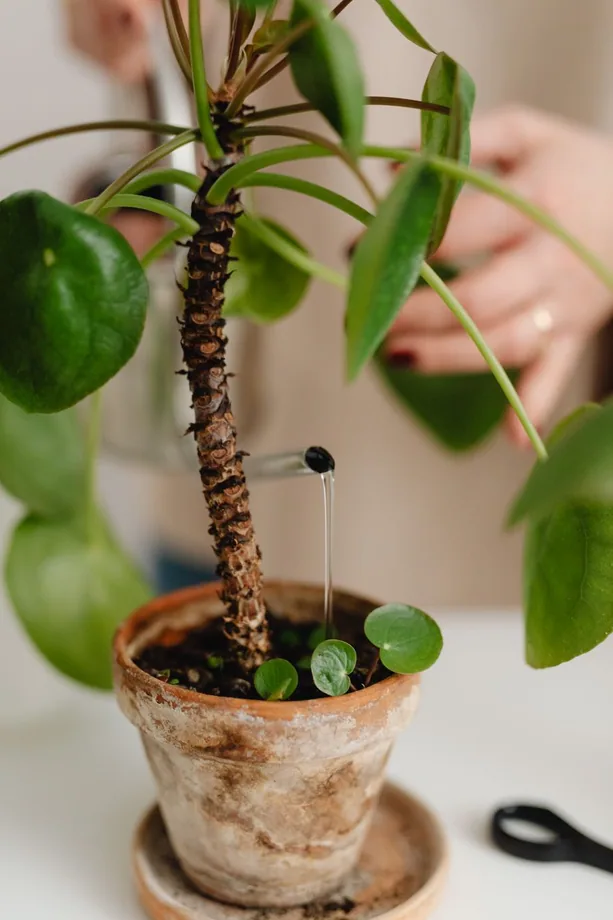
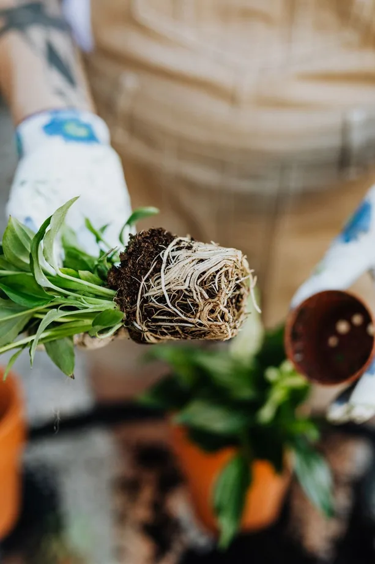
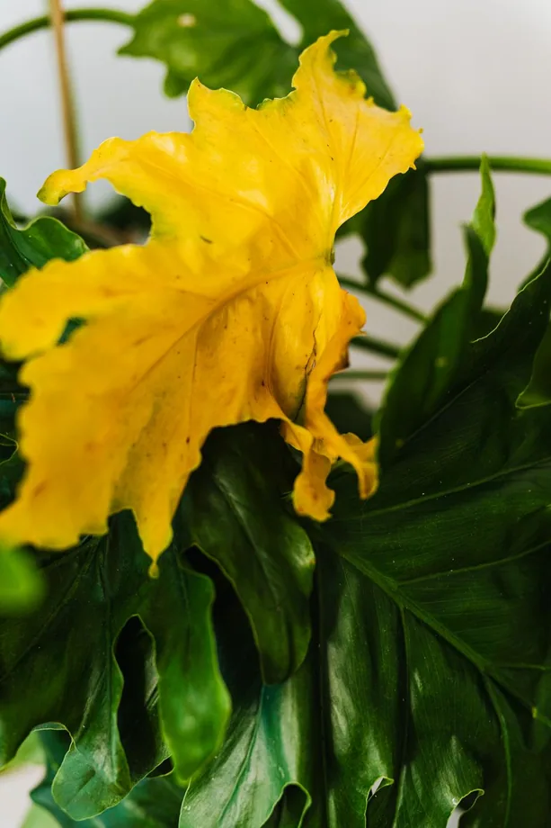

You walk past your plant and something is wrong. The leaves hang down, the stems look tired, and the whole plant seems to have lost its energy. Drooping is one of the most common houseplant symptoms, and one of the most misleading, because very different problems cause it. A thirsty plant droops. So does a drowning one. The answer is rarely obvious from the leaves alone, so the best approach is to work through a short checklist.

## Why plants droop at all

Plant leaves and stems stay upright because their cells are full of water, which creates internal pressure called turgor. When the plant can't take in enough water, or loses water faster than it takes it up, the cells lose pressure and the leaves and stems go soft. That is wilting. Anything that disrupts water uptake or water loss can cause it.

University of California's pest management guide lists several possible causes of wilting or drooping leaves, including root disease or poor health, chemical damage, sucking insects such as mealybugs, scale and aphids, and dry soil. That is a useful list because it shows that wilting does not always mean thirst, and watering more is not always the answer.

## Step 1: Check the soil

This single check answers the question in many cases.

Push your finger two inches into the soil, or use a wooden skewer pushed to the bottom of the pot.

- **Dry and crumbly, pulling away from the pot edge:** the plant is probably thirsty. Go to the "thirsty plant" section
- **Damp or wet:** do not water. Go to the "too much water" section
- **Wet at the bottom but dry on top:** the pot may not be draining, or you may have been watering lightly and often. Check the roots

## Cause 1: The plant is thirsty

**Signs:** dry soil, droopy but otherwise green leaves, leaves that perk up within hours of a good drink, soil shrinking away from the pot.

**What to do:**

1. Water thoroughly until it runs out of the drainage holes
2. If water runs straight through without soaking in, the soil may have become hydrophobic. Stand the pot in a bucket or sink with a few inches of water for 20 to 30 minutes so it can soak up from the bottom
3. Empty the saucer afterward
4. Check the plant again in a few hours. Many plants recover quickly

A plant that wilted badly may keep some crisp or brown leaf edges. These won't recover, but new growth will be fine.

To prevent a repeat, check the soil regularly, and consider whether the pot is too small or the plant is rootbound and drying out too fast.

If the mix is dry and the base is firm, water evenly and check the plant again. Photo by [kaboompics on Pexels](https://www.pexels.com/photo/close-up-view-of-watering-houseplant-6640461/).

## Cause 2: Too much water

**Signs:** soil that is wet or soggy, drooping that gets worse after watering, yellowing leaves (often the lower ones), a sour smell, fungus gnats, soft or blackened stems at the base.

This is the classic trap: a drooping plant looks dry, so you water, which makes the roots worse.

**What to do:**

1. Stop watering
2. Slide the plant out of its pot and check the roots. Healthy roots are firm and light, and rotten roots are brown or black, soft and smelly
3. If roots are rotting, follow the steps in our root rot guide: trim away the rotten roots, repot in fresh, well-draining mix in a clean pot, and water lightly
4. If the roots are healthy but the soil is just wet, let it dry out in a bright spot, and wrap the root ball in dry newspaper or paper towels to draw out moisture if needed
5. Make sure the pot has drainage holes and empty any saucer

Inspect the root ball when a plant remains wilted in moist mix. Photo by [kaboompics on Pexels](https://www.pexels.com/photo/person-holding-a-green-rooted-plant-on-brown-pot-4751960/).

## Cause 3: Root problems that aren't rot

Even without rot, roots can fail to supply the plant. University of California's guide lists poor root health from overwatering, excessive dryness, root disease, excess fertilizer or soluble salts, as well as compacted soil or pot-bound roots.

**Signs:** roots circling the pot or poking out of the drainage holes, soil that dries within a day or two, water running straight down the sides, soil that has turned hard or sour, or white crust on the surface.

**What to do:**

- **Rootbound:** repot into a pot one size larger with fresh mix
- **Salt build-up:** flush the soil thoroughly with plain water, scrape off the crust, and cut back on fertilizer
- **Compacted soil:** repot in a lighter, better-draining mix

## Cause 4: Pests

Sap-sucking pests can weaken a plant until it wilts, even when it is watered well. Mealybugs, scale, aphids and spider mites all take fluids from leaves and stems.

**Signs:** sticky leaves, white cottony tufts, small brown bumps on stems, fine webbing, speckled or dusty-looking leaves, or leaves that drop.

**What to do:** inspect the undersides of leaves, stems and leaf joints with a magnifying glass or your phone camera. If you find pests, follow the steps in our pests guide: isolate the plant, rinse it, wipe or swab off visible pests, and treat with insecticidal soap or horticultural oil, repeating weekly.

## Cause 5: Temperature, light and shock

Plants can droop in response to sudden change.

- **Cold drafts or chilly windows:** many tropical plants droop or even turn dark after exposure to cold air
- **Heat and direct sun:** leaves can wilt in strong afternoon sun, especially when soil is dry
- **A new location:** moving a plant, or bringing it home from a shop, often causes some drooping as it adjusts to the new light, humidity and temperature
- **Repotting:** a plant may droop for a week or two after its roots are disturbed

University of California's guide notes that sudden changes in light, temperature or relative humidity can cause problems. If this is the cause, give the plant stable conditions, bright indirect light and consistent watering, and be patient. Most recover in one to three weeks.

## Cause 6: Chemical damage

Sprays, cleaning products, fertilizer, or leaking gas can injure plants. Too much fertilizer is the most common, because excess salts damage roots.

**Signs:** drooping soon after fertilizing or spraying, brown leaf tips and edges, a white crust on the soil.

**What to do:** flush the soil with plenty of plain water, stop fertilizing, and rinse leaves if a spray was used.

## A quick diagnostic table

- **Dry soil + droopy + quick perk-up after watering:** thirsty
- **Wet soil + droopy + yellow leaves:** overwatering or root rot
- **Roots circling or soil dries in a day:** rootbound
- **Sticky leaves, webbing, bumps:** pests
- **Sudden droop after a move, a draft or repotting:** shock
- **Droop after fertilizing or spraying:** chemical damage or salts

## What not to do

- **Don't water automatically.** Always check the soil first
- **Don't repot a stressed plant** unless you have a reason, such as rot or a root-bound pot
- **Don't fertilize a drooping plant.** Feeding a plant that can't take up water makes things worse
- **Don't change five things at once.** Fix the most likely cause, then wait a few days to see the result
- **Don't give up too soon.** Many plants regrow from the base even after losing most of their leaves

## How long does recovery take?

A thirsty plant often perks up within hours to a day. A plant recovering from shock may take one to three weeks. A plant recovering from root rot can take weeks to months, and new leaf growth is the sign that roots are working again. If a plant continues to decline after you have corrected the cause, consider whether it is too far gone, and try to save cuttings.

## Prevention

- Learn how thirsty each of your plants is, and check the soil before watering
- Use well-draining soil and pots with drainage holes
- Choose a pot size that fits the root ball
- Place plants where light and temperature are steady
- Inspect plants weekly for pests
- Fertilize lightly and only during active growth
- Make changes gradually

## Try a two-minute inspection before watering

First I would look at the whole plant. Did every leaf relax at once, or is one old leaf hanging over the rim? Is the newest growth limp, or is it reaching steadily toward the window? Check the pot's weight and look on the shelf for water marks. Pull a nursery pot out of its cover and see if its base is sitting in runoff. Feel the mix around the middle of the root ball where you can do so gently. A finger at the surface gives you one reading and a short wooden skewer inserted near the edge can tell you more about deeper moisture. Use these clues together.

Next, press a stem gently near the base. A firm stem and a dry pot suit a thirst check. A soft stem in a heavy pot calls for checking roots and the crown. A single affected stem might have been folded under the weight of its leaves, caught on a curtain or squeezed in a pot hanger. Trace that stem to its base before treating everything above it.

Finally, check which conditions changed. A cold car ride, a new window, a burst of hot air from a heater, a recent repot and a change in who waters the plant all offer useful clues. Write down the date if something changed recently. This gives you a better diagnosis than changing all the conditions on the same afternoon.

## Three drooping plants and the next observation for each

**A peace lily feels very light, and water runs down the sides.** The mix may have shrunk away from the pot and begun repelling water. Water slowly in passes and check that the root ball becomes heavier. Give the pot time to drain. When leaves perk up, check the drying time before assuming it needs daily water. If the small container repeatedly dries extremely fast with a dense root mass, look at repotting. [Peace lily care](/peace-lily-care-and-drooping/).

**A pothos looks thirsty while the bottom of the pot is wet.** Empty the cover pot and inspect the drainage. Check the roots if several stems or leaves keep declining. If healthy portions remain, choose a smaller pot or an airier mix if poor drainage is confirmed. Take a backup cutting from firm tissue where useful. Check the next watering against actual moisture rather than the day marked on your calendar. [Root rot diagnosis](/root-rot-in-houseplants/).

**A prayer plant droops after a move and mostly looks different at night.** Look at it again in daylight. Some plants change leaf position over the day as part of normal movement. If the foliage is evenly green and firm, and the pot's moisture suits the plant, keep observing. If the plant stays limp, look for cold drafts, dry edges, damage in fresh growth or pests on leaf undersides. The timing helps you tell whether you saw ordinary movement or growing stress.

## What to record after you act

Take a picture with the pot and the outermost leaves in frame before changing anything. In the follow-up photo, look for how many leaves have recovered their angle and how many are becoming yellow or soft. Compare at the same time of day, especially for plants that change leaf position with light. If the plant was genuinely thirsty, a day is often enough to see whether it responded to thorough watering, though older damaged leaves can stay floppy. Roots damaged by soggy conditions need longer to recover. A healthy new leaf or stable growing point is a more useful sign there.

When the foliage remains limp and the reason is unclear, ask for a second look with the plant's name, a photo of the whole plant, a close-up of the base, an underside photo of one leaf and recent watering details. A label, a ruler or a coin in a pest close-up provides scale. A message that says the pot had water standing inside it after five days tells the reader more than “I water once a week.” [Iowa State Extension wilting guide](https://yardandgarden.extension.iastate.edu/faq/why-my-houseplant-wilting).

Note whether new discoloration appears along with the wilt. Photo by [kaboompics on Pexels](https://www.pexels.com/photo/yellow-leaf-in-close-up-view-5726027/).

## Quick summary

- Drooping has several causes: thirst, overwatering, root trouble, pests, shock and chemical damage
- Check the soil first, then the roots if the soil is wet
- Don't water a drooping plant without checking
- Fix the cause, keep conditions stable, and wait for new growth

## Final thoughts

A drooping plant is a message, not a verdict. Soil check, root check and pest check will answer most questions in a few minutes. Learn that routine, and you will rescue far more plants than you lose.

## Sources and further reading

- University of California IPM, [Houseplant Problems](https://ipm.ucanr.edu/home-and-landscape/houseplant-problems/)
- University of Missouri, [Houseplant problems: an environmentally sensitive approach](https://ipm.missouri.edu/meg/2019/1/houseplantProblems/index.cfm)
- Oklahoma State University Extension, [Houseplant Pests](https://extension.okstate.edu/announcements/horticulture-tips/hort-tips-2026/mid-to-late-october/house-plant-pests)
- University of Kentucky Extension, [Houseplant Insect Control (ENTFACT-406)](https://entomology.mgcafe.uky.edu/ef406)
